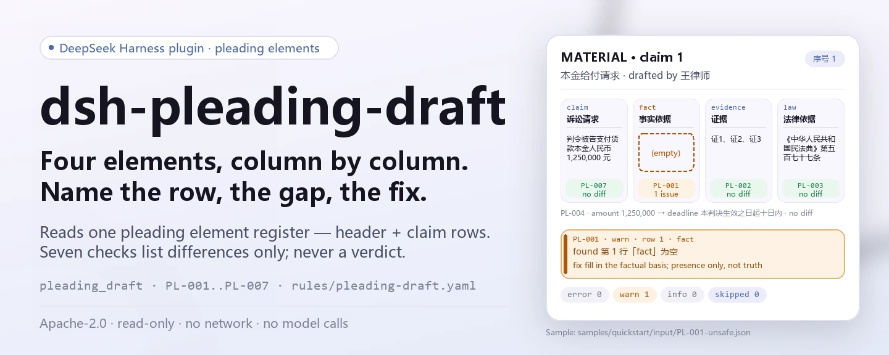

<div align="center">

<picture>
  <source media="(prefers-color-scheme: dark)" srcset="docs/assets/dsh-pleading-draft-hero-en-dark.webp">
  
</picture>

# dsh-pleading-draft

**Check a pleading-element checklist for completeness and internal consistency — you get a list of which row, which column, and what to fix; the verdict stays with the reviewer.**

A data-only checker plugin for DeepSeek Harness: it reads one pleading-element checklist (the case header plus one row per claim), applies the versioned rule pack it ships, and lists only the differences it can point to inside the material — never a compliance verdict, never a liability finding.

[Install](#three-step-setup) · [Configuration](#configuration) · [FAQ](#faq) · [简体中文](README.md) · [English](README.en.md) · [Español](README.es.md) · [Português](README.pt.md) · [हिन्दी](README.hi.md)

[](LICENSE)
[](#compatibility)
[](https://www.npmjs.com/package/dsh-pleading-draft)
[](https://github.com/PerryLink/dsh-pleading-draft/actions/workflows/ci.yml)
[](#compatibility)

[](https://github.com/PerryLink/dsh-pleading-draft/stargazers)
[](https://www.npmjs.com/package/dsh-pleading-draft)
[](https://dshfind.com/plugins/PerryLink/dsh-pleading-draft?ref=badge)
[](https://securityscorecards.dev/viewer/?uri=github.com/PerryLink/dsh-pleading-draft)
[](https://dsh.market/)
[](https://gitee.com/perrylink/dsh-pleading-draft)

```sh
dsh plugin --profile <name> add dsh-pleading-draft
```

</div>

<sub>Community plugin, not affiliated with DeepSeek. Canonical repository: <https://github.com/PerryLink/dsh-pleading-draft> (Gitee is a mirror).</sub>

## What it is

`dsh-pleading-draft` reads one pleading-element checklist — the case header plus one row per claim, with its number, claim, factual basis, evidence, legal basis, amount, and deadline columns — and checks that document's own completeness and internal consistency: that every claim records a factual basis, points at evidence and states a legal basis, that a claim carrying an amount also carries a performance deadline, that the header names the plaintiff and the defendant, that no element number is repeated, and that no unreplaced placeholder survives in the claim column.

It does not decide whether a claim will succeed, whether it is time-barred, whether jurisdiction is right, whether the evidence suffices, or whether the case should be accepted.

- **Who it is for**: lawyers and legal staff; no command line required — hand the material over in chat.
- **What you give it**: the source material the check works on (a table, register, or document); the original is never modified. Excel can be converted to JSON/YAML first, in chat if the platform supports it.
- **What you get back**: a list of "which row, which column, what is missing, how to fix it"; every check that could not run is listed in `skipped` with its reason.

<picture>
  <source media="(prefers-color-scheme: dark)" srcset="docs/assets/dsh-pleading-draft-flow-v5-dark.svg">
  
</picture>

## Three-step setup

1. **Install** (pick one channel):

   ```sh
   # git channel (latest main; equivalent to git+https://github.com/PerryLink/dsh-pleading-draft.git)
   dsh plugin --profile <name> add github:PerryLink/dsh-pleading-draft
   # npm channel (published releases)
   dsh plugin --profile <name> add dsh-pleading-draft
   # tarball channel: pnpm pack in this repo, then
   dsh plugin --profile <name> add ./dsh-pleading-draft-<version>.tgz
   ```

2. **Minimal config** (defaults are enough; a bundle row without `config` uses them all, and the rule-pack path points at the packaged `rules/pleading-draft.yaml`):

   ```yaml
   - insert:
       - id: dsh-pleading-draft
         name: dsh-pleading-draft
   ```

3. **Verify it mounts**:

   ```sh
   dsh --profile <name> --dump-config | grep 'dsh-pleading-draft'
   ```

   Then build once (`pnpm run build` produces `lib/`) and run the bundled sample (matches `samples/quickstart/expected/result.json`):

   ```sh
   node samples/quickstart/run.mjs --json
   # => {"tool":"pleading_draft","issueCount":1,"summary":{"error":0,"warn":1,"info":0},"skippedCount":0}
   ```

**Uninstall**: `dsh plugin --profile <name> remove dsh-pleading-draft` (or remove the row from the profile patch).

<details>
<summary>Use it from WorkBuddy / Coze</summary>

Search "Documents and Governance Suite" in WorkBuddy / Coze (the suite, of which this check is one part; availability as listed in the store) to use the same checking capability without a command line.

</details>

<details>
<summary>Install from the DSH Desktop market</summary>

Every PerryLink plugin is listed in the built-in DSH Desktop market: **Market → Sources → Add source → paste** `https://perrylink-dsh-catalog.perrylink.workers.dev/catalog-source.json` **→ select**. Installation still requires the market's npm identity check and your confirmation.

</details>

## Core capabilities

`dsh-pleading-draft` registers the `pleading_draft` tool: it reads one element checklist, applies a versioned rule pack, and returns a report.

- **Seven rules in one pack** — the rule pack is data, not code (`rules/pleading-draft.yaml`); replace the pack and you replace the whole rule set without touching TypeScript.
- **Read-only on the material** — accepts JSON or YAML; the original is never modified. Plain ESM, no network requests, no model calls.
- **No fabricated citations** — every rule carries `document` / `number` / `clause` / `excerpt` / `kind` / `source`; `excerpt` must be a verbatim quotation, and a rule whose text could not be obtained says so in `excerpt` and is marked `derived-from-principle`.
- **Severity follows the evidence** — `derived-from-principle` is capped at `warn`, institutional configuration (`institutional-configuration`) at `info`, and a test asserts it.
- **An empty issue list is not "nothing is wrong"** — every check that could not run goes into `skipped` with its reason; a rule whose required list is unset reports itself in `skipped` rather than passing silently.
- **No adjudicating wording** — the report lists differences only; it never pronounces on compliance, liability or correctness. A wording guard enforces this and the report always carries the disclaimer.

| Rule | Check | Severity | Basis kind |
|---|---|---|---|
| `PL-001` | every claim records its factual basis | warn | direct |
| `PL-002` | every claim points at evidence | warn | direct |
| `PL-003` | every claim states its legal basis | warn | direct |
| `PL-004` | a claim carrying an amount also carries a deadline | warn | principle |
| `PL-005` | the header names plaintiff and defendant | warn | direct |
| `PL-006` | element numbers are unique in the table | warn | principle |
| `PL-007` | the claim column holds no unreplaced placeholder | warn | principle |

### Examples

These are the plugin's real entry points; install once, then call one. The first row is the detailed walkthrough, the rest are short cases.

**Detailed example** — tool `pleading_draft`, input:

```json
{"caseNo":"（2026）某民初 1234 号","rows":[{"序号":"1","请求要素":"本金给付请求","诉讼请求":"判令被告支付货款本金人民币 1,250,000 元","事实依据":"","证据":"证1、证2、证3"}]}
```

Output:

```json
{
  "id": "dsh-pleading-draft.PL-001.de09b5a6",
  "ruleId": "PL-001",
  "severity": "warn",
  "locator": {
    "row": 1,
    "field": "fact"
  },
  "found": "第 1 行「fact」为空",
  "expected": "「fact」应填写",
  "fix": "补填事实依据；本条只核对是否写明，不判断事实是否属实"
}
```

*Observed from `dsh-pleading-draft/tests/fixtures/PL-001/PL-001-unsafe.json (cases.json expects 1×PL-001); executed parseMaterial+runCheck, checkedAt=2026-10-06T00:00:00.000Z`*

| You ask | What it answers |
|---|---|
| The claim is written out, but the evidence column points at nothing. | `PL-002` reports the row whose evidence column does not point at evidence — it checks that a reference is written, not that the evidence exists, is complete or bears on that particular claim. |
| The legal-basis column holds only a general phrase such as "relevant provisions". | `PL-003` requires the legal-basis column to be filled on every claim element. It reports an empty column; it does not verify that the provision cited exists, is in force or applies to the case. |
| The amount is stated, but no performance deadline is recorded. | `PL-004` fires only when the amount column is filled, and then requires the deadline column: an amount without a deadline is reported. A claim for a declaration is not asked for a deadline it does not have. Whether the amount is computed correctly or the deadline is reasonable is not checked. |
| Which fields must the case header carry? | `PL-005` requires the header to name the plaintiff and the defendant; both are configuration fields, so your own form can add the cause of action and the accepting court. It does not check that the parties are the right ones for that claim. |
| What happens when the claim column still holds a template placeholder? | `PL-007` reports it. The exact term list lives in `rules/pleading-draft.yaml` (`PL-007` `terms`); it covers square brackets, doubled braces, `XXX`, `TBD`, `todo`, and the Chinese words for "to be filled", "to be supplemented" and "example". A vague claim with none of those terms passes, because judging the required precision of a claim is a legal judgement. |
| A rule appears in `skipped` instead of reporting anything. Does that mean it passed? | No. `skipped` names a check that did not run: `PL-002`, for instance, is listed there when it was disabled in configuration, left out by the `only` selection, or when the material met its precondition and no difference was found. A check that does not run cannot clear a column, and its own limit stands: it never sees whether the evidence suffices or corresponds to the claim. |

## Configuration

All tunables are Schemastery `Config` fields in `src/config.ts` (changeable from cordis.yml); per-rule thresholds live in the rule pack under `rules/`. An id-targeted override replaces the whole row — restate every key you need.

| Key | Type | Default | Description |
|---|---|---|---|
| `rulesFile` | string | `rules/pleading-draft.yaml` | Rule-pack path, relative to the package root |
| `disabledRules` | string[] | `[]` | Rule ids to stop running; each appears in `skipped` |
| `onlyRules` | string[] | `[]` | Run only these rule ids; empty runs every rule |
| `skipNotes` | string | `""` | Note appended to every `skipped` reason |
| `timeoutMs` | number | `120000` | Cooperative tool timeout budget |

Rule-level parameters worth knowing:

- `PL-004` `conditionField` / `requiredFields` — which column triggers the deadline requirement; the amount column by default, requiring the performance deadline.
- `PL-005` `fields` — the header fields that must be present; plaintiff and defendant by default. Add `court` and `cause` if your checklist records them in the header.
- `PL-007` `terms` — the placeholders to look for.

Example override in your profile patch:

```yaml
- insert:
    - id: dsh-pleading-draft
      name: dsh-pleading-draft
      config:
        disabledRules: [PL-006]
        timeoutMs: 180000
```

## Material format

The tool accepts JSON or YAML:

```yaml
caseNo: （2026）某民初 1234 号
court: 某某人民法院
plaintiff: 原告某某公司
defendant: 被告某某公司
cause: 买卖合同纠纷
rows:
  - { 序号: '1', 请求要素: 本金给付请求,
      诉讼请求: 判令被告支付货款本金人民币 1,250,000 元,
      事实依据: 双方于 2025 年 3 月 10 日签订买卖合同，原告已按约交付货物，被告未按期付款,
      证据: 证1、证2、证3, 法律依据: 《中华人民共和国民法典》第五百七十七条,
      金额: '1250000', 期限: 本判决生效之日起十日内 }
```

Column names are matched case-insensitively and ignoring spaces, underscores and hyphens; the checklist's own column names are kept, so a finding names the column it read. Fields are optional at the reader layer and validated by the check engine, so a partial export produces "missing item" findings instead of crashing.

## Rule sources

Rule data lives in `rules/pleading-draft.yaml`, separate from the code: every rule carries the document, number, clause in the source's own numbering, a verbatim excerpt, and a source URL. A load-time guard enforces that `excerpt` is a real quotation of at least eight characters, but it cannot tell a quotation from a description — so this pack also leans on each rule's `note` and the verification record under `rules/evidence/`; `kind: derived-from-principle` is capped at `warn`, `institutional-configuration` at `info`; a pack that overstates its basis fails at load. `scripts/check-citations.mjs` additionally matches every `excerpt` against the verification record under `rules/evidence/`, and that baseline can only shrink. Four of the seven rules are `direct` (`PL-001`, `PL-002`, `PL-003`, `PL-005`) and three are `derived-from-principle` (`PL-004`, `PL-006`, `PL-007`): each quotes the provision it relies on, but the requirement it checks follows from the provision's principle rather than its wording, and the gap is stated in the rule's `note`.

## Standards it follows

| Document | Number | Cited by rules |
|---|---|---|
| Civil Procedure Law of the People's Republic of China | Adopted 1991; amended five times (2007, 2012, 2017, 2021, 2023); current article numbers checked against the 2021 and 2023 consolidated texts | PL-001, PL-002, PL-003, PL-004, PL-005, PL-006, PL-007 |

**Boundary:** this plugin checks a **pleading-element checklist** for completeness — that every claim records its factual basis, points at evidence, states its legal basis, that a monetary claim states an amount and a performance deadline, that the document names both parties, that element numbers are unique, and that no placeholder survives. It does **not** decide whether a claim will succeed, whether it is time-barred, whether jurisdiction is right, whether the evidence suffices, or whether the case should be accepted. **Those are the court's determinations and the advocate's substantive judgement.**

## FAQ

<details>
<summary>Where does the material go? Is it uploaded?</summary>

Nowhere. The tool reads only the local `file` path or inline `material` (JSON/YAML) you hand it; the plugin makes no network requests, writes nothing to disk, and calls no model (the manifest declares `network: false` and empty `writes`), and it returns report text only. The material itself is never modified.

</details>

<details>
<summary>Can an empty `issues` list be read as "nothing is wrong"?</summary>

No. Every check that could not run is listed in `skipped` with its reason; a rule whose required list is unset reports itself in `skipped` rather than passing silently. Read `issues` and `skipped` together.

</details>

<details>
<summary>Does the rule pack make up its citations?</summary>

No. Every rule carries `document` / `number` / `clause` / `excerpt` / `kind` / `source`; `excerpt` must be a verbatim quotation, and when the text could not be obtained the pack says so in `excerpt` and steps the rule down to a principle-based basis (capped at `warn`). `pnpm run check:citations` matches every excerpt against the verification record in `rules/evidence/`, and CI runs it.

</details>

<details>
<summary>Does it fight other plugins over tool names or service keys?</summary>

No. It registers one namespaced tool, `pleading_draft`, provides no service key, registers no client slot and no `webServer` prefix, and mutates no globals; `cordis.patch.yml` only `insert`s its own row and never overrides a built-in row. Tool registration is a Cordis effect, so unloading removes it.

</details>

<details>
<summary>Will it cope with a batch of documents at once?</summary>

The tool works in both `native` and `ptc` modes; for batch work (a whole directory) use `ptc`, where the schema cost is paid once. The checks themselves are local reading and rule evaluation — no network requests, no model calls; `timeoutMs` (default 120 s) is the cooperative timeout budget.

</details>

## Security boundaries

> ### ⚠️ Read this before trusting a citation in the report
>
> **It reads a checklist, not the pleadings, the evidence or the statutes.** So it can only check that a column *points at* evidence or *names* a provision — **never that the evidence suffices or that the provision exists, is in force, or applies**. `PL-002` and `PL-003` say so in their own `note`s. Test the plugin against a pleading whose cited article was repealed: it will pass, because looking up statutes is a different job and one this plugin deliberately does not do.
>
> **The citation status differs rule by rule; it is not uniform.** Four of the seven rules quote verbatim clause text (`kind: direct`): `PL-001`, `PL-002`, `PL-003`, `PL-005`. The other three (`PL-004`, `PL-006`, `PL-007`) quote the provision they rely on, but the requirement itself follows only from that provision's principle, so they are marked `derived-from-principle` and capped at `warn`, with the gap stated in each rule's `note`. The pack never presents a paraphrase as a quotation.
>
> `PL-004` fires only when an amount column is filled, so a claim for a declaration or for a change of legal relation is not asked for a performance deadline it does not have. And `PL-007` catches placeholders only: a claim that is vague **without** containing `【】` or a to-fill placeholder will pass, because judging whether a claim is stated with the required precision is a legal judgement.
>
> The conclusion stays with the reviewer: the plugin lists only differences it can point to inside the material, and never judges whether facts are true or whether conduct is compliant.

## Known limitations

- **It checks whether a column is written, not whether it is right.** It cannot see the evidence itself and cannot verify that a provision is in force; those judgements need legal expertise and are the advocate's core work.
- **`PL-004` is conditional.** A deadline is required only when the amount column is filled, so a declaration or constitutive claim is not asked for a deadline it does not have.
- **`PL-007` catches placeholders only.** A vague claim without `【】`, a to-fill placeholder, `TBD` or similar passes, because judging the required precision of a claim is a legal judgement.
- **Article numbers travel with the text.** The rule pack is version `2026.1`; citations and article numbers follow the 2021 fourth amendment and the 2023 fifth amendment, and a later amendment can move them again.
- **No timezone conversion.** All date checks are wall-clock arithmetic on the input strings.
- **The material is read column by column.** A partial export produces "missing item" findings instead of crashing — read `issues` and `skipped` together.

## Troubleshooting

- **`PL-003` passes on a provision I know was repealed.** It cannot check that: it verifies that a legal basis is *named*, not that it exists or applies. Statute lookup is out of scope by design.
- **`PL-002` passes although the evidence proves nothing.** Same reason: it checks that evidence is *pointed at*, not that it is sufficient.
- **`PL-004` does not fire on a declaration claim.** That is deliberate — the deadline is required only when an amount is stated.
- **`PL-007` does not fire on a vague claim.** It catches placeholders, not imprecision.
- **The plugin installs but the tool never appears.** Check that `main` resolves to `lib/index.mjs` and that `pnpm run build` produced it; a wrong `main` makes the loader skip the entry silently.
- **`dsh plugin add` refuses the package as incompatible.** The peer range covers `0.1.x` and `0.2.x`; if your runtime sits outside it, grant an explicit exemption: `dsh plugin --profile <name> allow-version dsh-pleading-draft@0.1.0 --dsh-version <runtime> --accept-risk`
- **`check` reports `manifest-peers` as failed.** The static checker compares against a hard-coded peer range that predates the 0.2 line. The runtime enforces peer compatibility at install time, so the declared range is the correct one; this is a known upstream issue in `dsh-plugin-dev`.
- **Times look shifted.** All arithmetic is wall-clock on the input strings, with no timezone conversion.

## Compatibility

| Surface | Status |
|---|---|
| Harness | Peer range `>=0.1.2-rc.1 <0.2.0 \|\| >=0.2.0-0 <0.3.0` — verified to accept both `0.2.0-rc.2` and `0.2.1-rc.2`. `engines.dsh` is declared as `>=0.2.1-0 <0.3.0` and is enforced by the host since 0.2.1 |
| Node | `^22.19.0 \|\| >=24.0.0` |
| Platforms | All (plain ESM; no native code, no network, no model call) |
| Tool mode | Works in `native` and `ptc`; for a whole directory of material use `ptc` |

## Ecosystem & quality

- [Gitee mirror](https://gitee.com/perrylink/dsh-pleading-draft) (sync mirror; GitHub is canonical)
- [dshfind plugin page](https://dshfind.com/plugins/PerryLink/dsh-pleading-draft) (installs and ranking)
- [OpenSSF Scorecard report](https://securityscorecards.dev/viewer/?uri=github.com/PerryLink/dsh-pleading-draft) (driven by [.github/workflows/scorecard.yml](.github/workflows/scorecard.yml))
- [DSH Market](https://dsh.market/) (listed)
- **1024 store channel**: `npm i -g dsh1024` once, then `dsh1024 plugin --profile <name> add dsh-pleading-draft` (counts toward the [deepseek1024.com](https://deepseek1024.com) install ranking)
- [Ecosystem knowledge base](https://perrylink.github.io/dsh-plugin-guide/) — plugin development guide · measured selection data · maintenance criteria

## Development

```sh
pnpm install                                        # node ^22.19 || >=24
pnpm run typecheck                                  # tsc --noEmit
pnpm test                                           # vitest: shared table-plugin suite + paired fixtures
pnpm run build                                      # tsdown -> lib/index.mjs + lib/index.d.mts
pnpm run verify:self-contained                      # dependency specs resolve from the registry
pnpm run check:lockfile                             # lockfile drift check
pnpm run check:readmes                              # five-language README consistency
pnpm run check:citations                            # rule-pack citation baseline
node ../scripts/sync-shared.mjs dsh-pleading-draft   # refresh src/shared from ../_shared
pnpm pack                                           # the published tarball
```

The plugin is **data-only**: `src/model.ts` declares the table shape, `src/check.ts` is the pure check core with no plugin context, `src/shared/` supplies the reader and report shape, and the rule pack declares every check. Local sample run (needs `pnpm run build` first to produce `lib/`):

```sh
node samples/quickstart/run.mjs --json
# => {"tool":"pleading_draft","issueCount":1,"summary":{"error":0,"warn":1,"info":0},"skippedCount":0}
```

The sample input lives in `samples/quickstart/input/`, the expected output in `samples/quickstart/expected/result.json`, and a screenshot in `docs/assets/quickstart.png`. The README images are generated programmatically by [`scripts/gen-readme-assets.py`](scripts/gen-readme-assets.py) (Pillow for the hero, hand-written SVG for the structure diagram) and are safe to re-run: it writes `docs/assets/dsh-pleading-draft-hero-{zh,en}-{light,dark}.webp` and `docs/assets/dsh-pleading-draft-flow-v5-{light,dark}.svg`. The older single-skin flow diagram and demo images stay in `docs/assets/` for external deep links, while the READMEs reference only the new hero and flow-v5.

Topics: `deepseek-harness`, `dsh`, `dsh-plugin`, `cordis`, `pleading`, `draft`

## Family & thanks

This project is part of the DeepSeek Harness plugin family from [PerryLink](https://github.com/PerryLink) (all Apache-2.0). Full family index: [choose a checker by material](https://perrylink.github.io/zh/checkers/choose/). If it is useful, **a star helps the next person find it** — nothing is gated behind it.

- [@PerryLink](https://github.com/PerryLink) — creator and maintainer: the data-only rule pack (PL-001..PL-007), the `pleading_draft` tool, the citation-verification record, and the five-language docs.

<details>
<summary>Expand all plugins</summary>

| Plugin | Status |
|---|---|
| **[dsh-aqua-input-check](https://github.com/PerryLink/dsh-aqua-input-check)** |  |
| **[dsh-archive-check](https://github.com/PerryLink/dsh-archive-check)** |  |
| **[dsh-auto-review](https://github.com/PerryLink/dsh-auto-review)** |  |
| **[dsh-autotier](https://github.com/PerryLink/dsh-autotier)** | 🧊 FROZEN — see the repo README |
| **[dsh-bid-ca-precheck](https://github.com/PerryLink/dsh-bid-ca-precheck)** |  |
| **[dsh-bid-qual-check](https://github.com/PerryLink/dsh-bid-qual-check)** |  |
| **[dsh-cert-mcp](https://github.com/PerryLink/dsh-cert-mcp)** | 🧊 FROZEN — see the repo README |
| **[dsh-checkpoint-rewind](https://github.com/PerryLink/dsh-checkpoint-rewind)** |  |
| **[dsh-click](https://github.com/PerryLink/dsh-click)** |  |
| **[dsh-composer-history](https://github.com/PerryLink/dsh-composer-history)** |  |
| **[dsh-contract-stance](https://github.com/PerryLink/dsh-contract-stance)** |  |
| **[dsh-customs-doc-check](https://github.com/PerryLink/dsh-customs-doc-check)** |  |
| **[dsh-data-quality](https://github.com/PerryLink/dsh-data-quality)** | 🧊 FROZEN — see the repo README |
| **[dsh-demurrage-ledger](https://github.com/PerryLink/dsh-demurrage-ledger)** |  |
| **[dsh-doublecheck](https://github.com/PerryLink/dsh-doublecheck)** |  |
| **[dsh-drill-script-check](https://github.com/PerryLink/dsh-drill-script-check)** |  |
| **[dsh-eia-guide-check](https://github.com/PerryLink/dsh-eia-guide-check)** |  |
| **[dsh-emergency-plan](https://github.com/PerryLink/dsh-emergency-plan)** |  |
| **[dsh-essay-rubric-check](https://github.com/PerryLink/dsh-essay-rubric-check)** |  |
| **[dsh-evidence-check](https://github.com/PerryLink/dsh-evidence-check)** |  |
| **[dsh-export-ctl-check](https://github.com/PerryLink/dsh-export-ctl-check)** |  |
| **[dsh-fast](https://github.com/PerryLink/dsh-fast)** |  |
| **[dsh-fmea-table-check](https://github.com/PerryLink/dsh-fmea-table-check)** |  |
| **[dsh-forecast-penalty](https://github.com/PerryLink/dsh-forecast-penalty)** |  |
| **[dsh-fund-research](https://github.com/PerryLink/dsh-fund-research)** |  |
| **[dsh-github](https://github.com/PerryLink/dsh-github)** |  |
| **[dsh-gongwen-flow-check](https://github.com/PerryLink/dsh-gongwen-flow-check)** |  |
| **[dsh-gongwen-word-check](https://github.com/PerryLink/dsh-gongwen-word-check)** |  |
| **[dsh-guard-plan-qc](https://github.com/PerryLink/dsh-guard-plan-qc)** |  |
| **[dsh-hazchem-check](https://github.com/PerryLink/dsh-hazchem-check)** |  |
| **[dsh-hazplan-check](https://github.com/PerryLink/dsh-hazplan-check)** |  |
| **[dsh-hidden-risk-map](https://github.com/PerryLink/dsh-hidden-risk-map)** |  |
| **[dsh-hs-classify](https://github.com/PerryLink/dsh-hs-classify)** |  |
| **[dsh-icd-rule-check](https://github.com/PerryLink/dsh-icd-rule-check)** |  |
| **[dsh-industry-research](https://github.com/PerryLink/dsh-industry-research)** |  |
| **[dsh-lawcite-adapter](https://github.com/PerryLink/dsh-lawcite-adapter)** |  |
| **[dsh-laya](https://github.com/PerryLink/dsh-laya)** |  |
| **[dsh-lc-doc-check](https://github.com/PerryLink/dsh-lc-doc-check)** |  |
| **[dsh-learning-gap-check](https://github.com/PerryLink/dsh-learning-gap-check)** |  |
| **[dsh-library](https://github.com/PerryLink/dsh-library)** |  |
| **[dsh-local-ai](https://github.com/PerryLink/dsh-local-ai)** |  |
| **[dsh-lsp-actions](https://github.com/PerryLink/dsh-lsp-actions)** |  |
| **[dsh-mask](https://github.com/PerryLink/dsh-mask)** |  |
| **[dsh-mcp-panel](https://github.com/PerryLink/dsh-mcp-panel)** |  |
| **[dsh-medrec-qc](https://github.com/PerryLink/dsh-medrec-qc)** |  |
| **[dsh-memento](https://github.com/PerryLink/dsh-memento)** | 🧊 FROZEN — see the repo README |
| **[dsh-nsfc-form-check](https://github.com/PerryLink/dsh-nsfc-form-check)** |  |
| **[dsh-nurse-record-check](https://github.com/PerryLink/dsh-nurse-record-check)** |  |
| **[dsh-observe](https://github.com/PerryLink/dsh-observe)** |  |
| **[dsh-origin-rvc-check](https://github.com/PerryLink/dsh-origin-rvc-check)** |  |
| **[dsh-ota-review-check](https://github.com/PerryLink/dsh-ota-review-check)** |  |
| **[dsh-output-styles](https://github.com/PerryLink/dsh-output-styles)** |  |
| **[dsh-paper-doc-adapter](https://github.com/PerryLink/dsh-paper-doc-adapter)** |  |
| **[dsh-permission-rules](https://github.com/PerryLink/dsh-permission-rules)** |  |
| **[dsh-permit-report-check](https://github.com/PerryLink/dsh-permit-report-check)** |  |
| **[dsh-pipeline-check](https://github.com/PerryLink/dsh-pipeline-check)** |  |
| **[dsh-pleading-draft](https://github.com/PerryLink/dsh-pleading-draft)** |  |
| **[dsh-plugin-doctor](https://github.com/PerryLink/dsh-plugin-doctor)** | 🚫 RETIRED (repo archived) |
| **[dsh-plugin-guide](https://github.com/PerryLink/dsh-plugin-guide)** |  |
| **[dsh-plugin-kit](https://github.com/PerryLink/dsh-plugin-kit)** | 🚫 RETIRED (repo archived) |
| **[dsh-plugin-upgrade](https://github.com/PerryLink/dsh-plugin-upgrade)** | 🚫 RETIRED (repo archived) |
| **[dsh-policy-brief-draft](https://github.com/PerryLink/dsh-policy-brief-draft)** |  |
| **[dsh-power-loss-split](https://github.com/PerryLink/dsh-power-loss-split)** |  |
| **[dsh-power-ticket-check](https://github.com/PerryLink/dsh-power-ticket-check)** |  |
| **[dsh-ppap-check](https://github.com/PerryLink/dsh-ppap-check)** |  |
| **[dsh-protest-deadline](https://github.com/PerryLink/dsh-protest-deadline)** |  |
| **[dsh-railway-window](https://github.com/PerryLink/dsh-railway-window)** |  |
| **[dsh-repair-order-qc](https://github.com/PerryLink/dsh-repair-order-qc)** |  |
| **[dsh-research-report](https://github.com/PerryLink/dsh-research-report)** |  |
| **[dsh-review-reply-check](https://github.com/PerryLink/dsh-review-reply-check)** |  |
| **[dsh-rulefile-check](https://github.com/PerryLink/dsh-rulefile-check)** |  |
| **[dsh-safety-brief-check](https://github.com/PerryLink/dsh-safety-brief-check)** |  |
| **[dsh-score](https://github.com/PerryLink/dsh-score)** | 🧊 FROZEN — see the repo README |
| **[dsh-session-sync](https://github.com/PerryLink/dsh-session-sync)** |  |
| **[dsh-site-log-check](https://github.com/PerryLink/dsh-site-log-check)** |  |
| **[dsh-skill-pack-security](https://github.com/PerryLink/dsh-skill-pack-security)** |  |
| **[dsh-soe-decision-check](https://github.com/PerryLink/dsh-soe-decision-check)** |  |
| **[dsh-soilwater-check](https://github.com/PerryLink/dsh-soilwater-check)** |  |
| **[dsh-sop-sync-check](https://github.com/PerryLink/dsh-sop-sync-check)** |  |
| **[dsh-spc-gbt-adapter](https://github.com/PerryLink/dsh-spc-gbt-adapter)** |  |
| **[dsh-talk](https://github.com/PerryLink/dsh-talk)** |  |
| **[dsh-tender-extract](https://github.com/PerryLink/dsh-tender-extract)** |  |
| **[dsh-tender-matrix](https://github.com/PerryLink/dsh-tender-matrix)** |  |
| **[dsh-test-drive](https://github.com/PerryLink/dsh-test-drive)** |  |
| **[dsh-ticktick](https://github.com/PerryLink/dsh-ticktick)** | 🚫 RETIRED (repo archived) |
| **[dsh-translate](https://github.com/PerryLink/dsh-translate)** |  |
| **[dsh-warranty-calc](https://github.com/PerryLink/dsh-warranty-calc)** |  |
| **[dsh-budget](https://github.com/PerryLink/dsh-budget)** | 🧊 FROZEN — see the repo README |
| **[dsh-claude-move](https://github.com/PerryLink/dsh-claude-move)** | 🧊 FROZEN — see the repo README |
| **[dsh-defend](https://github.com/PerryLink/dsh-defend)** | 🧊 FROZEN — see the repo README |
| **[dsh-draw](https://github.com/PerryLink/dsh-draw)** | 🧊 FROZEN — see the repo README |
| **[dsh-reach](https://github.com/PerryLink/dsh-reach)** | 🧊 FROZEN — see the repo README |
| **[dsh-background-agents](https://github.com/PerryLink/dsh-background-agents)** | 🚫 RETIRED (repo archived) |
| **[dsh-session-pin](https://github.com/PerryLink/dsh-session-pin)** | 🚫 RETIRED (repo archived) |
| **[dsh-team-rooms](https://github.com/PerryLink/dsh-team-rooms)** | 🚫 RETIRED (repo archived) |

</details>

## License

[LICENSE](LICENSE) (Apache License 2.0) © 2026 dsh-pleading-draft contributors

<p align="center"><sub>Apache-2.0 · Community plugin, not affiliated with DeepSeek.</sub></p>
