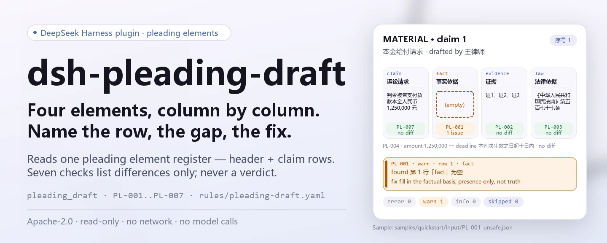

<div align="center">

<picture>
  <source media="(prefers-color-scheme: dark)" srcset="docs/assets/dsh-pleading-draft-hero-en-dark.webp">
  
</picture>

# dsh-pleading-draft

**Comprueba la completitud y la coherencia interna de una lista de elementos de la demanda: obtiene una lista de qué fila, qué columna y qué corregir; la decisión queda en el revisor.**

Un plugin de verificación solo de datos para DeepSeek Harness: lee una lista de elementos de la demanda (la cabecera del caso más una fila por pretensión), aplica el paquete de reglas versionado que incluye y enumera únicamente las divergencias que puede señalar dentro del material; nunca emite un juicio de cumplimiento ni una declaración de responsabilidad.

[Instalar](#instalación-en-tres-pasos) · [Configuración](#configuración) · [FAQ](#faq) · [简体中文](README.md) · [English](README.en.md) · [Español](README.es.md) · [Português](README.pt.md) · [हिन्दी](README.hi.md)

[](LICENSE)
[](#compatibilidad)
[](https://www.npmjs.com/package/dsh-pleading-draft)
[](https://github.com/PerryLink/dsh-pleading-draft/actions/workflows/ci.yml)
[](#compatibilidad)

[](https://github.com/PerryLink/dsh-pleading-draft/stargazers)
[](https://www.npmjs.com/package/dsh-pleading-draft)
[](https://dshfind.com/plugins/PerryLink/dsh-pleading-draft?ref=badge)
[](https://securityscorecards.dev/viewer/?uri=github.com/PerryLink/dsh-pleading-draft)
[](https://dsh.market/)
[](https://gitee.com/perrylink/dsh-pleading-draft)

```sh
dsh plugin --profile <name> add dsh-pleading-draft
```

</div>

<sub>Plugin de la comunidad, no afiliado a DeepSeek. Repositorio canónico: <https://github.com/PerryLink/dsh-pleading-draft> (Gitee es un espejo).</sub>

## Qué es

`dsh-pleading-draft` lee una lista de elementos de la demanda —la cabecera del caso más una fila por pretensión, con sus columnas de número, pretensión, base fáctica, pruebas, fundamento jurídico, importe y plazo— y comprueba la completitud y la coherencia interna de ese documento: que cada pretensión registre su base fáctica, señale pruebas y exponga su fundamento jurídico, que la pretensión que lleva importe lleve también plazo de cumplimiento, que la cabecera nombre al demandante y al demandado, que no se repita ningún número de elemento y que no quede ningún marcador de plantilla sin sustituir en la columna de pretensiones.

No decide si una pretensión prosperará, si ha prescrito, si la competencia es correcta, si la prueba es suficiente ni si el caso debe admitirse.

- **Para quién es**: abogados y personal jurídico; no hace falta saber usar la línea de comandos: entregue el material en el chat.
- **Qué le da**: el material de origen sobre el que trabaja la comprobación (una tabla, un registro o un documento); el original nunca se modifica. Excel puede convertirse antes a JSON/YAML, en el chat si la plataforma lo permite.
- **Qué recibe**: una lista de «qué fila, qué columna, qué falta y cómo corregirlo»; cada comprobación que no pudo ejecutarse se enumera en `skipped` con su motivo.

<picture>
  <source media="(prefers-color-scheme: dark)" srcset="docs/assets/dsh-pleading-draft-flow-v5-dark.svg">
  
</picture>

## Instalación en tres pasos

1. **Instala** (elige un canal):

   ```sh
   # canal git (último main; equivalente a git+https://github.com/PerryLink/dsh-pleading-draft.git)
   dsh plugin --profile <name> add github:PerryLink/dsh-pleading-draft
   # canal npm (versiones publicadas)
   dsh plugin --profile <name> add dsh-pleading-draft
   # canal tarball: pnpm pack en este repo y luego
   dsh plugin --profile <name> add ./dsh-pleading-draft-<version>.tgz
   ```

2. **Configuración mínima** (los valores por defecto ya sirven; una fila de bundle sin `config` los usa todos y la ruta del paquete de reglas apunta al `rules/pleading-draft.yaml` incluido):

   ```yaml
   - insert:
       - id: dsh-pleading-draft
         name: dsh-pleading-draft
   ```

3. **Comprueba que está activo**:

   ```sh
   dsh --profile <name> --dump-config | grep 'dsh-pleading-draft'
   ```

   Después compile una vez (`pnpm run build` produce `lib/`) y ejecute el ejemplo incluido (coincide con `samples/quickstart/expected/result.json`):

   ```sh
   node samples/quickstart/run.mjs --json
   # => {"tool":"pleading_draft","issueCount":1,"summary":{"error":0,"warn":1,"info":0},"skippedCount":0}
   ```

**Desinstalar**: `dsh plugin --profile <name> remove dsh-pleading-draft` (o elimine la fila del patch del perfil).

<details>
<summary>Usarlo desde WorkBuddy / Coze</summary>

Busque «Documents and Governance Suite» en WorkBuddy / Coze (el paquete del que esta comprobación forma parte; disponibilidad según la tienda) para usar la misma capacidad de verificación sin línea de comandos.

</details>

<details>
<summary>Instalar desde el mercado de DSH Desktop</summary>

Todos los plugins de PerryLink aparecen en el mercado integrado de DSH Desktop: **Mercado → Fuentes → Añadir fuente → pegar** `https://perrylink-dsh-catalog.perrylink.workers.dev/catalog-source.json` **→ seleccionar**. La instalación sigue requiriendo la verificación de identidad npm del mercado y su confirmación.

</details>

## Capacidades principales

`dsh-pleading-draft` registra la herramienta `pleading_draft`: lee una lista de elementos, aplica un paquete de reglas versionado y devuelve un informe.

- **Siete reglas en un paquete** — el paquete de reglas es datos, no código (`rules/pleading-draft.yaml`); sustituirlo cambia todo el conjunto de comprobaciones sin tocar TypeScript.
- **Solo lectura del material** — acepta JSON o YAML; el original nunca se modifica. ESM puro, sin peticiones de red, sin llamadas al modelo.
- **Sin citas inventadas** — cada regla lleva `document` / `number` / `clause` / `excerpt` / `kind` / `source`; `excerpt` debe ser una cita literal y la regla cuyo texto no se obtuvo lo dice en `excerpt` y se marca `derived-from-principle`.
- **La gravedad sigue a la evidencia** — `derived-from-principle` tiene tope `warn`, la configuración institucional (`institutional-configuration`) tope `info`, y hay un test que lo asegura.
- **Una lista vacía no significa «no hay nada mal»** — cada comprobación que no pudo ejecutarse va a `skipped` con su motivo; una regla cuya lista obligatoria no está configurada se declara en `skipped` en vez de pasar en silencio.
- **Redacción que no falla** — el informe solo enumera diferencias, nunca dictamina cumplimiento, responsabilidad ni corrección; un guardián de redacción lo impone y el informe siempre lleva el descargo de responsabilidad.

| Regla | Comprobación | Gravedad | Tipo de base |
|---|---|---|---|
| `PL-001` | cada pretensión registra su base fáctica | warn | direct |
| `PL-002` | cada pretensión señala pruebas | warn | direct |
| `PL-003` | cada pretensión expone su fundamento jurídico | warn | direct |
| `PL-004` | la pretensión con importe también lleva plazo | warn | principle |
| `PL-005` | la cabecera nombra al demandante y al demandado | warn | direct |
| `PL-006` | los números de elemento no se repiten | warn | principle |
| `PL-007` | la columna de pretensiones no conserva marcadores | warn | principle |

### Ejemplos

Estos son los puntos de entrada reales del plugin; instálelo una vez y llame a uno. La primera fila es el caso detallado; las demás, casos breves.

**Ejemplo detallado** — herramienta `pleading_draft`, entrada:

```json
{"caseNo":"（2026）某民初 1234 号","rows":[{"序号":"1","请求要素":"本金给付请求","诉讼请求":"判令被告支付货款本金人民币 1,250,000 元","事实依据":"","证据":"证1、证2、证3"}]}
```

Salida:

```json
{
  "id": "dsh-pleading-draft.PL-001.de09b5a6",
  "ruleId": "PL-001",
  "severity": "warn",
  "locator": {
    "row": 1,
    "field": "fact"
  },
  "found": "第 1 行「fact」为空",
  "expected": "「fact」应填写",
  "fix": "补填事实依据；本条只核对是否写明，不判断事实是否属实"
}
```

*Observed from `dsh-pleading-draft/tests/fixtures/PL-001/PL-001-unsafe.json (cases.json expects 1×PL-001); executed parseMaterial+runCheck, checkedAt=2026-10-06T00:00:00.000Z`*

| Usted pregunta | Qué responde |
|---|---|
| La pretensión está redactada, pero la columna de pruebas no señala nada. | `PL-002` señala la fila cuya columna `证据` no apunta a ninguna prueba: comprueba que la referencia esté escrita, no que la prueba exista, esté completa o se refiera a esa pretensión concreta. |
| La columna de fundamento jurídico solo contiene una frase general, como «las disposiciones aplicables». | `PL-003` exige que la columna `法律依据` esté completa en cada elemento de pretensión. Informa de la columna vacía; no verifica que el precepto citado exista, esté vigente o se aplique al caso. |
| El importe consta, pero no se registra plazo de cumplimiento. | `PL-004` solo se activa cuando la columna `金额` está rellena y entonces exige la columna `期限`: un importe sin plazo se informa. A una pretensión meramente declarativa no se le pide un plazo que no tiene. No se comprueba si el importe está bien calculado ni si el plazo es razonable. |
| ¿Qué campos debe llevar la cabecera del caso? | `PL-005` exige que la cabecera nombre al demandante y al demandado; ambos son campos de configuración, así que su propio formulario puede añadir la causa y el tribunal receptor. No comprueba que las partes sean las correctas para esa pretensión. |
| ¿Qué ocurre si la columna de pretensiones aún contiene un marcador de plantilla? | `PL-007` lo señala. La lista exacta de términos vive en `rules/pleading-draft.yaml` (`PL-007` `terms`): corchetes, llaves dobles, `XXX`, `TBD`, `todo` y las palabras chinas para «por rellenar», «por completar» y «ejemplo». Una pretensión vaga que no contenga ninguno de esos términos pasa, porque juzgar la precisión exigible a una pretensión es una valoración jurídica. |
| Una regla aparece en `skipped` en lugar de informar de algo. ¿Significa que pasó? | No. `skipped` nombra una comprobación que no se ejecutó: `PL-002`, por ejemplo, figura ahí cuando estaba desactivada en la configuración, cuando quedó fuera por la selección `only` o cuando el material cumplía su precondición y no se halló ninguna diferencia. Una comprobación que no se ejecuta no puede dar por buena una columna, y su límite sigue en pie: nunca ve si la prueba es suficiente o corresponde a la pretensión. |

## Configuración

Todos los parámetros ajustables son campos Schemastery `Config` de `src/config.ts` (modificables desde cordis.yml); los umbrales por regla están en el paquete de reglas bajo `rules/`. Una anulación dirigida por id sustituye la fila entera: vuelva a declarar todas las claves que necesite.

| Clave | Tipo | Predeterminado | Descripción |
|---|---|---|---|
| `rulesFile` | string | `rules/pleading-draft.yaml` | Ruta del paquete de reglas, relativa a la raíz del paquete |
| `disabledRules` | string[] | `[]` | Ids de reglas que se dejan de ejecutar; cada una aparece en `skipped` |
| `onlyRules` | string[] | `[]` | Ejecutar solo estas reglas; vacío ejecuta todas |
| `skipNotes` | string | `""` | Nota añadida a cada motivo de `skipped` |
| `timeoutMs` | number | `120000` | Presupuesto de tiempo de espera cooperativo de la herramienta |

Parámetros por regla que conviene conocer:

- `PL-004` `conditionField` / `requiredFields`: qué columna activa la exigencia de plazo; por defecto, la columna de importe exige la de plazo.
- `PL-005` `fields`: los campos que debe llevar la cabecera; por defecto, demandante y demandado. Añada `court` y `cause` si su lista los registra en la cabecera.
- `PL-007` `terms`: los marcadores que se buscan.

Ejemplo de anulación en el patch del perfil:

```yaml
- insert:
    - id: dsh-pleading-draft
      name: dsh-pleading-draft
      config:
        disabledRules: [PL-006]
        timeoutMs: 180000
```

## Formato del material

La herramienta acepta JSON o YAML:

```yaml
caseNo: （2026）某民初 1234 号
court: 某某人民法院
plaintiff: 原告某某公司
defendant: 被告某某公司
cause: 买卖合同纠纷
rows:
  - { 序号: '1', 请求要素: 本金给付请求,
      诉讼请求: 判令被告支付货款本金人民币 1,250,000 元,
      事实依据: 双方于 2025 年 3 月 10 日签订买卖合同，原告已按约交付货物，被告未按期付款,
      证据: 证1、证2、证3, 法律依据: 《中华人民共和国民法典》第五百七十七条,
      金额: '1250000', 期限: 本判决生效之日起十日内 }
```

Los nombres de columna se comparan sin distinguir mayúsculas y sin tener en cuenta espacios, guiones bajos ni guiones; se conservan los nombres propios de la lista, de modo que el hallazgo nombra la columna que leyó. Los campos son opcionales en la capa de lectura y los valida el motor, así que una exportación parcial produce hallazgos de «falta un elemento» en lugar de fallar.

## Origen de las reglas

Los datos de las reglas están en `rules/pleading-draft.yaml`, separados del código: cada regla lleva documento, número, cláusula en la numeración propia de la fuente, extracto literal y URL de origen. Una guarda de carga impone que `excerpt` sea una cita real de al menos ocho caracteres, pero no distingue una cita de una descripción; por eso este paquete se apoya además en el `note` de cada regla y en el registro de verificación de `rules/evidence/`; `kind: derived-from-principle` tiene tope `warn` y `institutional-configuration` tope `info`; un paquete que exagere su base falla al cargar. Además, `scripts/check-citations.mjs` contrasta cada `excerpt` con el registro de verificación de `rules/evidence/`, y esa línea base solo puede encogerse. Cuatro de las siete reglas son `direct` (`PL-001`, `PL-002`, `PL-003`, `PL-005`) y tres son `derived-from-principle` (`PL-004`, `PL-006`, `PL-007`): cada una cita el precepto en que se apoya, pero la exigencia que comprueba se deriva del principio del precepto y no de su literalidad, y la brecha se declara en el `note` de la regla.

## Normas que sigue

| Documento | Número | Reglas que lo citan |
|---|---|---|
| Ley de Enjuiciamiento Civil de la República Popular China | Aprobada en 1991; modificada cinco veces (2007, 2012, 2017, 2021, 2023); numeración vigente contrastada con los textos consolidados de 2021 y 2023 | PL-001, PL-002, PL-003, PL-004, PL-005, PL-006, PL-007 |

**Límite:** este plugin comprueba la completitud de una **lista de elementos de la demanda**: que cada pretensión registre su base fáctica, señale pruebas y exponga su fundamento jurídico, que la pretensión monetaria indique importe y plazo de cumplimiento, que el documento nombre a ambas partes, que los números de elemento sean únicos y que no quede ningún marcador. **No** decide si una pretensión prosperará, si ha prescrito, si la competencia es correcta, si la prueba es suficiente ni si el caso debe admitirse. **Eso son determinaciones del tribunal y el juicio sustantivo del abogado.**

## FAQ

<details>
<summary>¿A dónde va el material? ¿Se sube?</summary>

A ningún sitio. La herramienta solo lee la ruta `file` local o el `material` en línea (JSON/YAML) que usted entrega; el plugin no hace peticiones de red, no escribe en disco y no llama a ningún modelo (el manifiesto declara `network: false` y `writes` vacío), y devuelve únicamente texto de informe. El material nunca se modifica.

</details>

<details>
<summary>¿Una lista `issues` vacía puede leerse como «no hay nada mal»?</summary>

No. Cada comprobación que no pudo ejecutarse se enumera en `skipped` con su motivo; una regla cuya lista obligatoria no está configurada se declara en `skipped` en vez de pasar en silencio. Lea `issues` y `skipped` juntos.

</details>

<details>
<summary>¿El paquete de reglas se inventa las citas?</summary>

No. Cada regla lleva `document` / `number` / `clause` / `excerpt` / `kind` / `source`; `excerpt` debe ser una cita literal y, cuando el texto no pudo obtenerse, el paquete lo dice en `excerpt` y rebaja la regla a una base de principio (tope `warn`). `pnpm run check:citations` contrasta cada extracto con el registro de verificación de `rules/evidence/`, y la CI lo ejecuta.

</details>

<details>
<summary>¿Compite con otros plugins por nombres de herramienta o claves de servicio?</summary>

No. Registra una única herramienta con espacio de nombres, `pleading_draft`, no ofrece ninguna clave de servicio, no registra slots de cliente ni prefijos `webServer` y no modifica objetos globales; `cordis.patch.yml` solo `insert`a su propia fila y nunca sobrescribe una fila integrada. El registro es un efecto de Cordis: al descargar el plugin se retira.

</details>

<details>
<summary>¿Aguantará un lote de documentos a la vez?</summary>

La herramienta funciona en modos `native` y `ptc`; para lotes (un directorio completo) use `ptc`, donde el coste del esquema se paga una vez. Las comprobaciones son lectura local y evaluación de reglas: sin red, sin llamadas al modelo; `timeoutMs` (120 s por defecto) es el presupuesto de tiempo de espera cooperativo.

</details>

## Límites de seguridad

> ### ⚠️ Lea esto antes de fiarse de una cita del informe
>
> **Lee una lista de comprobación, no la demanda, las pruebas ni las leyes.** Por eso solo puede comprobar que una columna *señala* pruebas o *nombra* un precepto: **nunca que la prueba sea suficiente ni que el precepto exista, esté vigente o se aplique**. `PL-002` y `PL-003` lo dicen en sus propios `note`. Pruebe el plugin con una demanda cuyo artículo citado esté derogado: pasará, porque consultar la ley es otro trabajo y este plugin deliberadamente no lo hace.
>
> **El estado de la cita difiere regla a regla; no es uniforme.** Cuatro de las siete reglas citan literalmente el texto del precepto (`kind: direct`): `PL-001`, `PL-002`, `PL-003`, `PL-005`. Las otras tres (`PL-004`, `PL-006`, `PL-007`) citan el precepto en que se apoyan, pero la exigencia solo se deriva del principio de ese precepto, así que se marcan `derived-from-principle` y tienen tope `warn`, con la brecha declarada en el `note` de cada regla. El paquete nunca presenta una paráfrasis como cita.
>
> `PL-004` solo se activa cuando la columna de importe está rellena, así que a una pretensión declarativa o de cambio de relación jurídica no se le pide un plazo de cumplimiento que no tiene. Y `PL-007` solo detecta marcadores: una pretensión vaga que **no** contenga `【】` ni un marcador de «por rellenar» pasará, porque juzgar si una pretensión está redactada con la precisión exigida es una valoración jurídica.
>
> La conclusión queda en el revisor: el plugin solo enumera diferencias que puede señalar dentro del material y nunca juzga si los hechos son ciertos ni si la conducta cumple la norma.

## Limitaciones conocidas

- **Comprueba si una columna está escrita, no si está bien.** No ve la prueba en sí ni puede verificar que un precepto esté vigente; esos juicios requieren criterio jurídico y son el trabajo central del abogado.
- **`PL-004` es condicional.** Solo se exige plazo cuando la columna de importe está rellena, así que a una pretensión declarativa o constitutiva no se le pide un plazo que no tiene.
- **`PL-007` solo detecta marcadores.** Una pretensión vaga sin `【】`, sin marcador de «por rellenar», sin `TBD` ni similar pasa, porque juzgar la precisión exigible es una valoración jurídica.
- **Los números de artículo viajan con el texto.** El paquete de reglas es la versión `2026.1`; las citas y los números de artículo siguen la cuarta enmienda de 2021 y la quinta de 2023, y una enmienda posterior puede volver a moverlos.
- **Sin conversión de zona horaria.** Todas las comprobaciones de fecha son aritmética de reloj de pared sobre las cadenas de entrada.
- **El material se lee columna a columna.** Una exportación parcial produce hallazgos de «falta un elemento» en lugar de fallar; lea `issues` y `skipped` juntos.

## Resolución de problemas

- **`PL-003` pasa con un precepto que sé que está derogado.** No puede comprobarlo: verifica que se *nombra* una base jurídica, no que exista o se aplique. Consultar la ley queda fuera de alcance por diseño.
- **`PL-002` pasa aunque la prueba no demuestre nada.** Por la misma razón: comprueba que se *señala* la prueba, no que sea suficiente.
- **`PL-004` no se activa en una pretensión declarativa.** Es deliberado: el plazo solo se exige cuando hay importe.
- **`PL-007` no se activa en una pretensión vaga.** Detecta marcadores, no imprecisión.
- **El plugin se instala pero la herramienta no aparece.** Compruebe que `main` resuelve a `lib/index.mjs` y que `pnpm run build` lo generó; un `main` incorrecto hace que el cargador omita la entrada en silencio.
- **`dsh plugin add` rechaza el paquete por incompatibilidad.** El rango de peers cubre `0.1.x` y `0.2.x`; si su runtime queda fuera, conceda una exención explícita: `dsh plugin --profile <name> allow-version dsh-pleading-draft@0.1.0 --dsh-version <runtime> --accept-risk`
- **`check` informa `manifest-peers` como fallo.** El comprobador estático compara con un rango de peers codificado que es anterior a la línea 0.2. El runtime aplica la compatibilidad de peers al instalar, así que el rango declarado es el correcto; es un problema conocido de `dsh-plugin-dev`.
- **Los horarios parecen desplazados.** Toda la aritmética es de reloj de pared sobre las cadenas de entrada, sin conversión de zona horaria.

## Compatibilidad

| Superficie | Estado |
|---|---|
| Harness | Rango de peers `>=0.1.2-rc.1 <0.2.0 \|\| >=0.2.0-0 <0.3.0` — verificado para aceptar tanto `0.2.0-rc.2` como `0.2.1-rc.2`. **`engines.dsh` se declara como `>=0.2.1-0 <0.3.0`** y el host lo aplica desde 0.2.1 |
| Node | `^22.19.0 \|\| >=24.0.0` |
| Plataformas | Todas (ESM puro; sin código nativo, sin red, sin llamada al modelo) |
| Modo de herramienta | Funciona en `native` y `ptc`; para un directorio completo use `ptc` |

## Ecosistema y calidad

- [Espejo en Gitee](https://gitee.com/perrylink/dsh-pleading-draft) (espejo sincronizado; GitHub es la fuente canónica)
- [Página del plugin en dshfind](https://dshfind.com/plugins/PerryLink/dsh-pleading-draft) (instalaciones y ranking)
- [Informe OpenSSF Scorecard](https://securityscorecards.dev/viewer/?uri=github.com/PerryLink/dsh-pleading-draft) (impulsado por [.github/workflows/scorecard.yml](.github/workflows/scorecard.yml))
- [DSH Market](https://dsh.market/) (publicado)
- **Canal de la tienda 1024**: `npm i -g dsh1024` una vez y luego `dsh1024 plugin --profile <name> add dsh-pleading-draft` (cuenta para el ranking de instalaciones de [deepseek1024.com](https://deepseek1024.com))
- [Base de conocimiento del ecosistema](https://perrylink.github.io/dsh-plugin-guide/): guía de desarrollo de plugins · datos de selección medidos · criterios de mantenimiento

## Desarrollo

```sh
pnpm install                                        # node ^22.19 || >=24
pnpm run typecheck                                  # tsc --noEmit
pnpm test                                           # vitest: suite compartida de plugins de tabla + fixtures emparejados
pnpm run build                                      # tsdown -> lib/index.mjs + lib/index.d.mts
pnpm run verify:self-contained                      # las specs de dependencias resuelven desde el registry
pnpm run check:lockfile                             # comprobación de deriva del lockfile
pnpm run check:readmes                              # consistencia de los README en cinco idiomas
pnpm run check:citations                            # línea base de citas del paquete de reglas
node ../scripts/sync-shared.mjs dsh-pleading-draft   # refresca src/shared desde ../_shared
pnpm pack                                           # el tarball publicado
```

El plugin es **solo de datos**: `src/model.ts` declara la forma de la tabla, `src/check.ts` es el núcleo de comprobación puro sin contexto de plugin, `src/shared/` aporta el lector y la forma del informe, y el paquete de reglas declara cada comprobación. Ejecución local del ejemplo (requiere `pnpm run build` antes para producir `lib/`):

```sh
node samples/quickstart/run.mjs --json
# => {"tool":"pleading_draft","issueCount":1,"summary":{"error":0,"warn":1,"info":0},"skippedCount":0}
```

La entrada del ejemplo está en `samples/quickstart/input/`, la salida esperada en `samples/quickstart/expected/result.json` y una captura en `docs/assets/quickstart.png`. Las imágenes del README las genera programáticamente [`scripts/gen-readme-assets.py`](scripts/gen-readme-assets.py) (Pillow para el hero, SVG escrito a mano para el diagrama de estructura) y es seguro volver a ejecutarlo: escribe `docs/assets/dsh-pleading-draft-hero-{zh,en}-{light,dark}.webp` y `docs/assets/dsh-pleading-draft-flow-v5-{light,dark}.svg`. El diagrama de flujo antiguo de una sola piel y las imágenes de demo permanecen en `docs/assets/` para enlaces externos, mientras que los README solo referencian el nuevo hero y flow-v5.

Topics: `deepseek-harness`, `dsh`, `dsh-plugin`, `cordis`, `pleading`, `draft`

## Familia y agradecimientos

Este proyecto forma parte de la familia de plugins de DeepSeek Harness de [PerryLink](https://github.com/PerryLink) (todos Apache-2.0). Índice completo: [elija un verificador por material](https://perrylink.github.io/zh/checkers/choose/). Si le resulta útil, **una estrella ayuda a que la siguiente persona lo encuentre**: nada está bloqueado tras ella.

- [@PerryLink](https://github.com/PerryLink) — creador y mantenedor: el paquete de reglas solo de datos (PL-001..PL-007), la herramienta `pleading_draft`, el registro de verificación de citas y la documentación en cinco idiomas.

<details>
<summary>Ver todos los plugins</summary>

| Plugin | Estado |
|---|---|
| **[dsh-aqua-input-check](https://github.com/PerryLink/dsh-aqua-input-check)** |  |
| **[dsh-archive-check](https://github.com/PerryLink/dsh-archive-check)** |  |
| **[dsh-auto-review](https://github.com/PerryLink/dsh-auto-review)** |  |
| **[dsh-autotier](https://github.com/PerryLink/dsh-autotier)** | 🧊 CONGELADO — ver el README del repo |
| **[dsh-bid-ca-precheck](https://github.com/PerryLink/dsh-bid-ca-precheck)** |  |
| **[dsh-bid-qual-check](https://github.com/PerryLink/dsh-bid-qual-check)** |  |
| **[dsh-cert-mcp](https://github.com/PerryLink/dsh-cert-mcp)** | 🧊 CONGELADO — ver el README del repo |
| **[dsh-checkpoint-rewind](https://github.com/PerryLink/dsh-checkpoint-rewind)** |  |
| **[dsh-click](https://github.com/PerryLink/dsh-click)** |  |
| **[dsh-composer-history](https://github.com/PerryLink/dsh-composer-history)** |  |
| **[dsh-contract-stance](https://github.com/PerryLink/dsh-contract-stance)** |  |
| **[dsh-customs-doc-check](https://github.com/PerryLink/dsh-customs-doc-check)** |  |
| **[dsh-data-quality](https://github.com/PerryLink/dsh-data-quality)** | 🧊 CONGELADO — ver el README del repo |
| **[dsh-demurrage-ledger](https://github.com/PerryLink/dsh-demurrage-ledger)** |  |
| **[dsh-doublecheck](https://github.com/PerryLink/dsh-doublecheck)** |  |
| **[dsh-drill-script-check](https://github.com/PerryLink/dsh-drill-script-check)** |  |
| **[dsh-eia-guide-check](https://github.com/PerryLink/dsh-eia-guide-check)** |  |
| **[dsh-emergency-plan](https://github.com/PerryLink/dsh-emergency-plan)** |  |
| **[dsh-essay-rubric-check](https://github.com/PerryLink/dsh-essay-rubric-check)** |  |
| **[dsh-evidence-check](https://github.com/PerryLink/dsh-evidence-check)** |  |
| **[dsh-export-ctl-check](https://github.com/PerryLink/dsh-export-ctl-check)** |  |
| **[dsh-fast](https://github.com/PerryLink/dsh-fast)** |  |
| **[dsh-fmea-table-check](https://github.com/PerryLink/dsh-fmea-table-check)** |  |
| **[dsh-forecast-penalty](https://github.com/PerryLink/dsh-forecast-penalty)** |  |
| **[dsh-fund-research](https://github.com/PerryLink/dsh-fund-research)** |  |
| **[dsh-github](https://github.com/PerryLink/dsh-github)** |  |
| **[dsh-gongwen-flow-check](https://github.com/PerryLink/dsh-gongwen-flow-check)** |  |
| **[dsh-gongwen-word-check](https://github.com/PerryLink/dsh-gongwen-word-check)** |  |
| **[dsh-guard-plan-qc](https://github.com/PerryLink/dsh-guard-plan-qc)** |  |
| **[dsh-hazchem-check](https://github.com/PerryLink/dsh-hazchem-check)** |  |
| **[dsh-hazplan-check](https://github.com/PerryLink/dsh-hazplan-check)** |  |
| **[dsh-hidden-risk-map](https://github.com/PerryLink/dsh-hidden-risk-map)** |  |
| **[dsh-hs-classify](https://github.com/PerryLink/dsh-hs-classify)** |  |
| **[dsh-icd-rule-check](https://github.com/PerryLink/dsh-icd-rule-check)** |  |
| **[dsh-industry-research](https://github.com/PerryLink/dsh-industry-research)** |  |
| **[dsh-lawcite-adapter](https://github.com/PerryLink/dsh-lawcite-adapter)** |  |
| **[dsh-laya](https://github.com/PerryLink/dsh-laya)** |  |
| **[dsh-lc-doc-check](https://github.com/PerryLink/dsh-lc-doc-check)** |  |
| **[dsh-learning-gap-check](https://github.com/PerryLink/dsh-learning-gap-check)** |  |
| **[dsh-library](https://github.com/PerryLink/dsh-library)** |  |
| **[dsh-local-ai](https://github.com/PerryLink/dsh-local-ai)** |  |
| **[dsh-lsp-actions](https://github.com/PerryLink/dsh-lsp-actions)** |  |
| **[dsh-mask](https://github.com/PerryLink/dsh-mask)** |  |
| **[dsh-mcp-panel](https://github.com/PerryLink/dsh-mcp-panel)** |  |
| **[dsh-medrec-qc](https://github.com/PerryLink/dsh-medrec-qc)** |  |
| **[dsh-memento](https://github.com/PerryLink/dsh-memento)** | 🧊 CONGELADO — ver el README del repo |
| **[dsh-nsfc-form-check](https://github.com/PerryLink/dsh-nsfc-form-check)** |  |
| **[dsh-nurse-record-check](https://github.com/PerryLink/dsh-nurse-record-check)** |  |
| **[dsh-observe](https://github.com/PerryLink/dsh-observe)** |  |
| **[dsh-origin-rvc-check](https://github.com/PerryLink/dsh-origin-rvc-check)** |  |
| **[dsh-ota-review-check](https://github.com/PerryLink/dsh-ota-review-check)** |  |
| **[dsh-output-styles](https://github.com/PerryLink/dsh-output-styles)** |  |
| **[dsh-paper-doc-adapter](https://github.com/PerryLink/dsh-paper-doc-adapter)** |  |
| **[dsh-permission-rules](https://github.com/PerryLink/dsh-permission-rules)** |  |
| **[dsh-permit-report-check](https://github.com/PerryLink/dsh-permit-report-check)** |  |
| **[dsh-pipeline-check](https://github.com/PerryLink/dsh-pipeline-check)** |  |
| **[dsh-pleading-draft](https://github.com/PerryLink/dsh-pleading-draft)** |  |
| **[dsh-plugin-doctor](https://github.com/PerryLink/dsh-plugin-doctor)** | 🚫 RETIRADO (repo archivado) |
| **[dsh-plugin-guide](https://github.com/PerryLink/dsh-plugin-guide)** |  |
| **[dsh-plugin-kit](https://github.com/PerryLink/dsh-plugin-kit)** | 🚫 RETIRADO (repo archivado) |
| **[dsh-plugin-upgrade](https://github.com/PerryLink/dsh-plugin-upgrade)** | 🚫 RETIRADO (repo archivado) |
| **[dsh-policy-brief-draft](https://github.com/PerryLink/dsh-policy-brief-draft)** |  |
| **[dsh-power-loss-split](https://github.com/PerryLink/dsh-power-loss-split)** |  |
| **[dsh-power-ticket-check](https://github.com/PerryLink/dsh-power-ticket-check)** |  |
| **[dsh-ppap-check](https://github.com/PerryLink/dsh-ppap-check)** |  |
| **[dsh-protest-deadline](https://github.com/PerryLink/dsh-protest-deadline)** |  |
| **[dsh-railway-window](https://github.com/PerryLink/dsh-railway-window)** |  |
| **[dsh-repair-order-qc](https://github.com/PerryLink/dsh-repair-order-qc)** |  |
| **[dsh-research-report](https://github.com/PerryLink/dsh-research-report)** |  |
| **[dsh-review-reply-check](https://github.com/PerryLink/dsh-review-reply-check)** |  |
| **[dsh-rulefile-check](https://github.com/PerryLink/dsh-rulefile-check)** |  |
| **[dsh-safety-brief-check](https://github.com/PerryLink/dsh-safety-brief-check)** |  |
| **[dsh-score](https://github.com/PerryLink/dsh-score)** | 🧊 CONGELADO — ver el README del repo |
| **[dsh-session-sync](https://github.com/PerryLink/dsh-session-sync)** |  |
| **[dsh-site-log-check](https://github.com/PerryLink/dsh-site-log-check)** |  |
| **[dsh-skill-pack-security](https://github.com/PerryLink/dsh-skill-pack-security)** |  |
| **[dsh-soe-decision-check](https://github.com/PerryLink/dsh-soe-decision-check)** |  |
| **[dsh-soilwater-check](https://github.com/PerryLink/dsh-soilwater-check)** |  |
| **[dsh-sop-sync-check](https://github.com/PerryLink/dsh-sop-sync-check)** |  |
| **[dsh-spc-gbt-adapter](https://github.com/PerryLink/dsh-spc-gbt-adapter)** |  |
| **[dsh-talk](https://github.com/PerryLink/dsh-talk)** |  |
| **[dsh-tender-extract](https://github.com/PerryLink/dsh-tender-extract)** |  |
| **[dsh-tender-matrix](https://github.com/PerryLink/dsh-tender-matrix)** |  |
| **[dsh-test-drive](https://github.com/PerryLink/dsh-test-drive)** |  |
| **[dsh-ticktick](https://github.com/PerryLink/dsh-ticktick)** | 🚫 RETIRADO (repo archivado) |
| **[dsh-translate](https://github.com/PerryLink/dsh-translate)** |  |
| **[dsh-warranty-calc](https://github.com/PerryLink/dsh-warranty-calc)** |  |
| **[dsh-budget](https://github.com/PerryLink/dsh-budget)** | 🧊 CONGELADO — ver el README del repo |
| **[dsh-claude-move](https://github.com/PerryLink/dsh-claude-move)** | 🧊 CONGELADO — ver el README del repo |
| **[dsh-defend](https://github.com/PerryLink/dsh-defend)** | 🧊 CONGELADO — ver el README del repo |
| **[dsh-draw](https://github.com/PerryLink/dsh-draw)** | 🧊 CONGELADO — ver el README del repo |
| **[dsh-reach](https://github.com/PerryLink/dsh-reach)** | 🧊 CONGELADO — ver el README del repo |
| **[dsh-background-agents](https://github.com/PerryLink/dsh-background-agents)** | 🚫 RETIRADO (repo archivado) |
| **[dsh-session-pin](https://github.com/PerryLink/dsh-session-pin)** | 🚫 RETIRADO (repo archivado) |
| **[dsh-team-rooms](https://github.com/PerryLink/dsh-team-rooms)** | 🚫 RETIRADO (repo archivado) |

</details>

## Licencia

[LICENSE](LICENSE) (Apache License 2.0) © 2026 dsh-pleading-draft contributors

<p align="center"><sub>Apache-2.0 · Plugin de la comunidad, no afiliado a DeepSeek.</sub></p>
