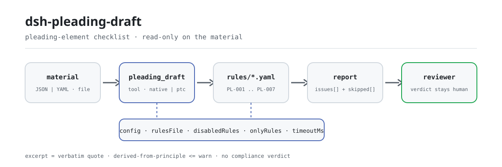

<div align="center">

<picture>
  <source media="(prefers-color-scheme: dark)" srcset="docs/assets/dsh-pleading-draft-flow-dark.svg">
  
</picture>

# dsh-pleading-draft

**वाद-पत्र के तत्वों की सूची की पूर्णता और आंतरिक सुसंगति की जाँच करें — आपको यह सूची मिलती है कि कौन-सी पंक्ति, कौन-सा कॉलम और क्या सुधारना है; निर्णय समीक्षक के पास रहता है।**

DeepSeek Harness के लिए केवल-डेटा जाँच प्लगइन: यह वाद-पत्र (अथवा आवेदन) के तत्वों की सूची पढ़ता है, अपने साथ आए संस्करणबद्ध नियम-पैक को लागू करता है, और केवल वे अंतर गिनाता है जिन्हें सामग्री के भीतर अलग से इंगित किया जा सकता है; कभी अनुपालन का निर्णय नहीं देता, कभी दायित्व का निर्धारण नहीं करता।

[इंस्टॉल](#तीन-चरणों-में-शुरुआत) · [कॉन्फ़िगरेशन](#कॉन्फ़िगरेशन) · [FAQ](#faq) · [简体中文](README.md) · [English](README.en.md) · [Español](README.es.md) · [Português](README.pt.md) · [हिन्दी](README.hi.md)

[](LICENSE)
[](#संगतता)
[](https://www.npmjs.com/package/dsh-pleading-draft)
[](https://github.com/PerryLink/dsh-pleading-draft/actions/workflows/ci.yml)
[](#संगतता)

[](https://github.com/PerryLink/dsh-pleading-draft/stargazers)
[](https://www.npmjs.com/package/dsh-pleading-draft)
[](https://dshfind.com/plugins/PerryLink/dsh-pleading-draft?ref=badge)
[](https://securityscorecards.dev/viewer/?uri=github.com/PerryLink/dsh-pleading-draft)
[](https://dsh.market/)
[](https://gitee.com/perrylink/dsh-pleading-draft)

```sh
dsh plugin --profile <name> add dsh-pleading-draft
```

</div>

<sub>सामुदायिक प्लगइन, DeepSeek से असंबद्ध। कैनोनिकल रिपॉज़िटरी: <https://github.com/PerryLink/dsh-pleading-draft> (Gitee एक मिरर है)।</sub>

## यह क्या है

`dsh-pleading-draft` वाद-पत्र (अथवा आवेदन) के तत्वों की सूची पढ़ता है — मुकदमे का शीर्षक और प्रत्येक दावे की एक पंक्ति, जिसमें क्रमांक, दावा, तथ्य-आधार, साक्ष्य, विधिक आधार, राशि और अवधि के कॉलम होते हैं — और उसी दस्तावेज़ की पूर्णता तथा आंतरिक सुसंगति की जाँच करता है: क्या प्रत्येक दावे का तथ्य-आधार दर्ज है, साक्ष्य की ओर संकेत है और विधिक आधार लिखा है, क्या राशि वाले दावे में पालन-अवधि भी दर्ज है, क्या शीर्षक में वादी और प्रतिवादी के नाम हैं, क्या कोई क्रमांक दोहराया नहीं गया है, और क्या दावा-कॉलम में कोई भरा न गया टेम्पलेट प्लेसहोल्डर शेष है।

यह यह निर्णय नहीं देता कि दावा सफल होगा या नहीं, परिसीमा बीत चुकी है या नहीं, अधिकार-क्षेत्र सही है या नहीं, साक्ष्य पर्याप्त है या नहीं, अथवा मुकदमा स्वीकार किया जाना चाहिए या नहीं।

- **किसके लिए**: वकील और विधिक कर्मचारी; कमांड लाइन की जानकारी आवश्यक नहीं — सामग्री चैट में सौंप दें।
- **आप क्या देते हैं**: जाँच के लिए आवश्यक मूल सामग्री (तालिका, रजिस्टर या दस्तावेज़); मूल कभी नहीं बदला जाता। Excel को पहले JSON/YAML में बदला जा सकता है, प्लेटफ़ॉर्म समर्थन दे तो चैट में ही।
- **आपको क्या मिलता है**: «कौन-सी पंक्ति, कौन-सा कॉलम, क्या अनुपस्थित है और कैसे सुधारें» की सूची; जो जाँच नहीं चल सकी वह `skipped` में कारण के साथ दर्ज होती है।

## तीन चरणों में शुरुआत

1. **इंस्टॉल करें** (एक चैनल चुनें):

   ```sh
   # git चैनल (नवीनतम main; git+https://github.com/PerryLink/dsh-pleading-draft.git के बराबर)
   dsh plugin --profile <name> add github:PerryLink/dsh-pleading-draft
   # npm चैनल (प्रकाशित संस्करण)
   dsh plugin --profile <name> add dsh-pleading-draft
   # tarball चैनल: इस रेपो में pnpm pack के बाद
   dsh plugin --profile <name> add ./dsh-pleading-draft-<version>.tgz
   ```

2. **न्यूनतम कॉन्फ़िगरेशन** (डिफ़ॉल्ट ही पर्याप्त हैं; `config` के बिना bundle पंक्ति सभी डिफ़ॉल्ट लेती है, और नियम-पैक पथ साथ आए `rules/pleading-draft.yaml` की ओर जाता है):

   ```yaml
   - insert:
       - id: dsh-pleading-draft
         name: dsh-pleading-draft
   ```

3. **जाँचें कि यह सक्रिय है**:

   ```sh
   dsh --profile <name> --dump-config | grep 'dsh-pleading-draft'
   ```

   फिर एक बार बिल्ड करें (`pnpm run build` से `lib/` बनता है) और साथ आया नमूना चलाएँ (`samples/quickstart/expected/result.json` से मेल खाता है):

   ```sh
   node samples/quickstart/run.mjs --json
   # => {"tool":"pleading_draft","issueCount":1,"summary":{"error":0,"warn":1,"info":0},"skippedCount":0}
   ```

**अनइंस्टॉल**: `dsh plugin --profile <name> remove dsh-pleading-draft` (या प्रोफ़ाइल patch से वह पंक्ति हटा दें)।

<details>
<summary>WorkBuddy / Coze में उपयोग करें</summary>

WorkBuddy / Coze में «Documents and Governance Suite» खोजें (यह जाँच उसी पैकेज का एक भाग है; उपलब्धता स्टोर के अनुसार) और बिना कमांड लाइन के वही जाँच क्षमता पाएँ।

</details>

<details>
<summary>DSH Desktop मार्केट से इंस्टॉल करें</summary>

सभी PerryLink प्लगइन DSH Desktop के अंतर्निहित मार्केट में सूचीबद्ध हैं: **मार्केट → स्रोत → स्रोत जोड़ें → चिपकाएँ** `https://perrylink-dsh-catalog.perrylink.workers.dev/catalog-source.json` **→ चुनें**। इंस्टॉल के लिए मार्केट की npm पहचान जाँच और आपकी पुष्टि अब भी आवश्यक है।

</details>

## मुख्य क्षमताएँ

`dsh-pleading-draft` `pleading_draft` टूल पंजीकृत करता है: एक तत्व-सूची पढ़ता है, संस्करणबद्ध नियम-पैक लागू करता है और रिपोर्ट लौटाता है।

- **सात नियम एक पैक में** — नियम-पैक डेटा है, कोड नहीं (`rules/pleading-draft.yaml`); पैक बदलने से पूरा नियम-समुच्चय बदल जाता है, TypeScript की एक पंक्ति छुए बिना।
- **सामग्री पर केवल पठन** — JSON या YAML स्वीकार्य; मूल कभी नहीं बदला जाता। शुद्ध ESM, कोई नेटवर्क अनुरोध नहीं, कोई मॉडल कॉल नहीं।
- **कोई गढ़ा हुआ उद्धरण नहीं** — प्रत्येक नियम में `document` / `number` / `clause` / `excerpt` / `kind` / `source` होता है; `excerpt` शब्दशः उद्धरण होना चाहिए, और जिस नियम का पाठ नहीं मिला वह `excerpt` में यह बताता है और `derived-from-principle` चिह्नित होता है।
- **गंभीरता साक्ष्य के अनुसार** — `derived-from-principle` की अधिकतम सीमा `warn`, संस्थागत कॉन्फ़िगरेशन (`institutional-configuration`) की `info`, और एक परीक्षण इसे सुनिश्चित करता है।
- **खाली सूची का अर्थ «कुछ गलत नहीं» नहीं** — जो जाँच नहीं चल सकी वह कारण के साथ `skipped` में जाती है; जिस नियम की अनिवार्य सूची सेट नहीं है वह चुपचाप पास होने के बजाय स्वयं को `skipped` में बताता है।
- **निर्णय देने वाली भाषा नहीं** — रिपोर्ट केवल अंतर गिनाती है, अनुपालन, दायित्व या सत्यता पर निर्णय नहीं देती; शब्द-संरक्षक (wording guard) इसे लागू करता है और रिपोर्ट के साथ अस्वीकरण सदैव रहता है।

| नियम | जाँच | गंभीरता | आधार प्रकार |
|---|---|---|---|
| `PL-001` | प्रत्येक दावे का तथ्य-आधार दर्ज है | warn | direct |
| `PL-002` | प्रत्येक दावा साक्ष्य की ओर संकेत करता है | warn | direct |
| `PL-003` | प्रत्येक दावा विधिक आधार बताता है | warn | direct |
| `PL-004` | राशि वाले दावे में अवधि भी दर्ज है | warn | principle |
| `PL-005` | शीर्षक में वादी और प्रतिवादी के नाम हैं | warn | direct |
| `PL-006` | तत्वों के क्रमांक दोहराए नहीं गए | warn | principle |
| `PL-007` | दावा-कॉलम में कोई प्लेसहोल्डर शेष नहीं | warn | principle |

### उदाहरण

ये प्लगइन के वास्तविक प्रवेश-बिंदु हैं; एक बार इंस्टॉल करें और एक को कॉल करें। पहली पंक्ति विस्तृत केस है, बाकी संक्षिप्त केस हैं।

**विस्तृत उदाहरण** — टूल `pleading_draft`, इनपुट:

```json
{"caseNo":"（2026）某民初 1234 号","rows":[{"序号":"1","请求要素":"本金给付请求","诉讼请求":"判令被告支付货款本金人民币 1,250,000 元","事实依据":"","证据":"证1、证2、证3"}]}
```

आउटपुट:

```json
{
  "id": "dsh-pleading-draft.PL-001.de09b5a6",
  "ruleId": "PL-001",
  "severity": "warn",
  "locator": {
    "row": 1,
    "field": "fact"
  },
  "found": "第 1 行「fact」为空",
  "expected": "「fact」应填写",
  "fix": "补填事实依据；本条只核对是否写明，不判断事实是否属实"
}
```

*Observed from `dsh-pleading-draft/tests/fixtures/PL-001/PL-001-unsafe.json (cases.json expects 1×PL-001); executed parseMaterial+runCheck, checkedAt=2026-10-06T00:00:00.000Z`*

| आपका सवाल | इसका जवाब |
|---|---|
| दावा लिखा गया है, पर साक्ष्य कॉलम किसी ओर संकेत नहीं करता। | `PL-002` उस पंक्ति को दर्ज करता है जिसका `证据` कॉलम साक्ष्य की ओर संकेत नहीं करता: यह देखता है कि संदर्भ लिखा है, यह नहीं कि साक्ष्य मौजूद है, पूरा है या उसी दावे से संबंधित है। |
| विधिक आधार कॉलम में केवल «संबंधित उपबंध» जैसा सामान्य वाक्य लिखा है। | `PL-003` हर दावे के तत्व में `法律依据` कॉलम भरा होने की अपेक्षा करता है। खाली कॉलम दर्ज होता है; यह नहीं जाँचता कि उद्धृत उपबंध मौजूद है, प्रभावी है या इस मामले पर लागू होता है। |
| राशि लिखी है, पर पालन-अवधि दर्ज नहीं है। | `PL-004` केवल तब चलता है जब `金额` कॉलम भरा हो, और तब `期限` कॉलम की अपेक्षा करता है: अवधि के बिना राशि दर्ज होती है। केवल घोषणात्मक दावे से ऐसी अवधि नहीं माँगी जाती जो उसमें नहीं है। राशि का हिसाब सही है या अवधि उचित है, यह नहीं जाँचा जाता। |
| मुकदमे के शीर्षक में कौन-कौन से क्षेत्र होने चाहिए? | `PL-005` शीर्षक में वादी और प्रतिवादी के नाम की अपेक्षा करता है; दोनों कॉन्फ़िगरेशन क्षेत्र हैं, इसलिए आपका अपना प्रपत्र वाद-कारण और विचारणीय न्यायालय भी जोड़ सकता है। यह नहीं जाँचता कि पक्षकार इस दावे के लिए सही हैं या नहीं। |
| यदि दावा-कॉलम में अब भी टेम्पलेट प्लेसहोल्डर रह गया हो तो क्या होता है? | `PL-007` उसे दर्ज करता है। शब्दों की सटीक सूची `rules/pleading-draft.yaml` (`PL-007` `terms`) में है: वर्ग कोष्ठक, दोहरे ब्रेस, `XXX`, `TBD`, `todo`, और «भरना है», «पूरा करना है» तथा «उदाहरण» के लिए चीनी शब्द। इनमें से कोई शब्द न रखने वाला अस्पष्ट दावा पास हो जाता है, क्योंकि दावे की अपेक्षित स्पष्टता का निर्णय विधिक निर्णय है। |
| कोई नियम कुछ दर्ज करने के बजाय `skipped` में दिखता है। क्या इसका अर्थ है कि वह पास हो गया? | नहीं। `skipped` उस जाँच का नाम है जो चली ही नहीं: उदाहरण के लिए `PL-002` वहाँ तब आता है जब वह कॉन्फ़िगरेशन में बंद थी, `only` चयन से बाहर रह गई, अथवा सामग्री उसकी पूर्व-शर्त पूरी करती थी और कोई अंतर नहीं मिला। जो जाँच चलती ही नहीं, वह किसी कॉलम को पास नहीं करा सकती, और उसकी सीमा वही रहती है: वह कभी नहीं देखती कि साक्ष्य पर्याप्त है या दावे से मेल खाता है। |

## कॉन्फ़िगरेशन

सभी समायोज्य पैरामीटर `src/config.ts` के Schemastery `Config` क्षेत्र हैं (cordis.yml से बदले जा सकते हैं); प्रति-नियम सीमाएँ `rules/` के नियम-पैक में हैं। id के आधार पर ओवरराइड पूरी पंक्ति बदल देता है — आवश्यक सभी कुंजियाँ दोबारा लिखें।

| कुंजी | प्रकार | डिफ़ॉल्ट | विवरण |
|---|---|---|---|
| `rulesFile` | string | `rules/pleading-draft.yaml` | नियम-पैक का पथ, पैकेज रूट के सापेक्ष |
| `disabledRules` | string[] | `[]` | बंद करने वाले नियम id; प्रत्येक `skipped` में दिखता है |
| `onlyRules` | string[] | `[]` | केवल ये नियम चलाएँ; खाली होने पर सभी नियम चलते हैं |
| `skipNotes` | string | `""` | हर `skipped` कारण के आगे जोड़ी जाने वाली टिप्पणी |
| `timeoutMs` | number | `120000` | उपकरण का सहकारी समय-सीमा बजट |

जानने योग्य नियम-स्तरीय पैरामीटर:

- `PL-004` `conditionField` / `requiredFields` — कौन-सा कॉलम भरा होने पर अवधि की अपेक्षा होती है; डिफ़ॉल्ट में राशि कॉलम भरा होने पर पालन-अवधि कॉलम आवश्यक है।
- `PL-005` `fields` — शीर्षक में अनिवार्य क्षेत्र; डिफ़ॉल्ट में वादी और प्रतिवादी। यदि आपका प्रपत्र शीर्षक में वाद-कारण और न्यायालय भी दर्ज करता है तो उन्हें जोड़ें।
- `PL-007` `terms` — खोजे जाने वाले प्लेसहोल्डर।

प्रोफ़ाइल patch में ओवरराइड का उदाहरण:

```yaml
- insert:
    - id: dsh-pleading-draft
      name: dsh-pleading-draft
      config:
        disabledRules: [PL-006]
        timeoutMs: 180000
```

## सामग्री प्रारूप

टूल JSON या YAML स्वीकार करता है:

```yaml
caseNo: （2026）某民初 1234 号
court: 某某人民法院
plaintiff: 原告某某公司
defendant: 被告某某公司
cause: 买卖合同纠纷
rows:
  - { 序号: '1', 请求要素: 本金给付请求,
      诉讼请求: 判令被告支付货款本金人民币 1,250,000 元,
      事实依据: 双方于 2025 年 3 月 10 日签订买卖合同，原告已按约交付货物，被告未按期付款,
      证据: 证1、证2、证3, 法律依据: 《中华人民共和国民法典》第五百七十七条,
      金额: '1250000', 期限: 本判决生效之日起十日内 }
```

कॉलम नाम बड़े/छोटे अक्षरों का भेद किए बिना, और रिक्त स्थान, अंडरस्कोर तथा हाइफ़न छोड़कर मिलाए जाते हैं; सूची के अपने कॉलम नाम सुरक्षित रहते हैं, इसलिए निष्कर्ष वही कॉलम बताता है जिसे वास्तव में पढ़ा गया। पठन-परत में क्षेत्र वैकल्पिक हैं और जाँच इंजन उन्हें सत्यापित करता है, इसलिए आंशिक निर्यात पर क्रैश के बजाय «अनुपस्थित» श्रेणी के निष्कर्ष मिलते हैं।

## नियमों का स्रोत

नियम-डेटा `rules/pleading-draft.yaml` में कोड से अलग है: प्रत्येक नियम में दस्तावेज़, संख्या, स्रोत की अपनी क्रमांकन-प्रणाली के अनुसार धारा, शब्दशः उद्धरण और स्रोत URL होता है। लोड-समय की गार्ड लागू करती है कि `excerpt` कम से कम आठ अक्षरों का वास्तविक उद्धरण हो, पर वह उद्धरण और विवरण में भेद नहीं कर पाती — इसलिए यह पैक हर नियम के `note` तथा `rules/evidence/` के सत्यापन-रिकॉर्ड पर भी टिकता है; `kind: derived-from-principle` की अधिकतम सीमा `warn` और `institutional-configuration` की `info` है; अपने आधार को बढ़ा-चढ़ाकर बताने वाला पैक लोड होते ही विफल होता है। इसके अतिरिक्त `scripts/check-citations.mjs` हर `excerpt` की तुलना `rules/evidence/` के सत्यापन-रिकॉर्ड से करता है, और वह आधार-रेखा केवल छोटी हो सकती है। सात में से चार नियम `direct` हैं (`PL-001`, `PL-002`, `PL-003`, `PL-005`) और तीन `derived-from-principle` (`PL-004`, `PL-006`, `PL-007`): प्रत्येक उस उपबंध को उद्धृत करता है जिस पर टिका है, पर जो अपेक्षा जाँची जाती है वह उपबंध के सिद्धांत से निकलती है, उसके शब्दों से नहीं, और यह अंतराल हर नियम के `note` में लिखा है।

## यह किन मानकों पर आधारित है

| दस्तावेज़ | संख्यांक | इन्हें उद्धृत करने वाले नियम |
|---|---|---|
| चीनी जनवादी गणराज्य की सिविल प्रक्रिया विधि | 1991 में अधिनियमित; पाँच बार संशोधित (2007, 2012, 2017, 2021, 2023); वर्तमान अनुच्छेद संख्याएँ 2021 और 2023 के समेकित पाठों से मिलाई गईं | PL-001, PL-002, PL-003, PL-004, PL-005, PL-006, PL-007 |

**सीमा:** यह प्लगइन **वाद-पत्र (अथवा आवेदन) के तत्वों की सूची** की पूर्णता जाँचता है: कि प्रत्येक दावे का तथ्य-आधार दर्ज है, साक्ष्य की ओर संकेत है, विधिक आधार लिखा है, राशि वाला दावा राशि और पालन-अवधि दोनों बताता है, दस्तावेज़ दोनों पक्षों के नाम देता है, तत्वों के क्रमांक अद्वितीय हैं, और कोई प्लेसहोल्डर शेष नहीं है। यह **निर्णय नहीं देता** कि दावा सफल होगा, परिसीमा बीत चुकी है, अधिकार-क्षेत्र सही है, साक्ष्य पर्याप्त है, या मुकदमा स्वीकार किया जाना चाहिए। **ये न्यायालय के निर्धारण और अधिवक्ता के सारभूत निर्णय हैं।**

## FAQ

<details>
<summary>सामग्री कहाँ जाती है? क्या अपलोड होती है?</summary>

कहीं नहीं। टूल केवल आपके दिए स्थानीय `file` पथ या इनलाइन `material` (JSON/YAML) को पढ़ता है; प्लगइन कोई नेटवर्क अनुरोध नहीं करता, डिस्क पर कुछ नहीं लिखता और किसी मॉडल को नहीं बुलाता (manifest में `network: false` और `writes` खाली है), और केवल रिपोर्ट पाठ लौटाता है। सामग्री स्वयं कभी नहीं बदलती।

</details>

<details>
<summary>क्या खाली `issues` सूची को «कुछ गलत नहीं» माना जा सकता है?</summary>

नहीं। जो जाँच नहीं चल सकी वह कारण के साथ `skipped` में सूचीबद्ध होती है; जिस नियम की अनिवार्य सूची सेट नहीं है वह चुपचाप पास होने के बजाय स्वयं को `skipped` में बताता है। `issues` और `skipped` दोनों को साथ पढ़ें।

</details>

<details>
<summary>क्या नियम-पैक अपने उद्धरण गढ़ता है?</summary>

नहीं। प्रत्येक नियम में `document` / `number` / `clause` / `excerpt` / `kind` / `source` होता है; `excerpt` शब्दशः उद्धरण होना चाहिए और जब पाठ नहीं मिला तो पैक यह `excerpt` में बताता है और नियम को सिद्धांत-आधारित (अधिकतम `warn`) कर देता है। `pnpm run check:citations` हर उद्धरण की तुलना `rules/evidence/` के सत्यापन-रिकॉर्ड से करता है, और CI यही चरण चलाती है।

</details>

<details>
<summary>क्या यह अन्य प्लगइन के टूल नाम या सर्विस कुंजियों से टकराता है?</summary>

नहीं। यह नाम-स्थान वाला एक ही टूल `pleading_draft` पंजीकृत करता है, कोई सर्विस कुंजी नहीं देता, कोई क्लाइंट slot या `webServer` उपसर्ग पंजीकृत नहीं करता और कोई ग्लोबल नहीं बदलता; `cordis.patch.yml` केवल अपनी पंक्ति `insert` करता है और अंतर्निहित पंक्ति को कभी नहीं बदलता। टूल पंजीकरण Cordis effect है: अनलोड पर हट जाता है।

</details>

<details>
<summary>एक साथ बहुत सी सामग्री जाँची जा सकती है?</summary>

टूल `native` और `ptc` दोनों मोड में चलता है; बैच (पूरा फ़ोल्डर) के लिए `ptc` चुनें, जहाँ स्कीमा लागत एक बार चुकाई जाती है। जाँच स्वयं स्थानीय पठन और नियम-मूल्यांकन है: कोई नेटवर्क नहीं, कोई मॉडल कॉल नहीं; `timeoutMs` (डिफ़ॉल्ट 120 सेकंड) सहकारी समय-सीमा बजट है।

</details>

## सुरक्षा सीमाएँ

> ### ⚠️ रिपोर्ट के किसी उद्धरण पर भरोसा करने से पहले यह पढ़ें
>
> **यह एक जाँच-सूची पढ़ता है, वाद-पत्र, साक्ष्य या विधि-पाठ नहीं।** इसलिए यह केवल यह देख सकता है कि कोई कॉलम साक्ष्य की ओर *संकेत* करता है या किसी उपबंध का *नाम* लेता है — **कभी नहीं कि साक्ष्य पर्याप्त है या उपबंध मौजूद है, प्रभावी है या लागू होता है**। `PL-002` और `PL-003` अपने `note` में यही कहते हैं। ऐसे वाद-पत्र पर प्लगइन आज़माएँ जिसमें उद्धृत अनुच्छेद निरसित हो चुका है: वह पास हो जाएगा, क्योंकि विधि खोजना दूसरा काम है और यह प्लगइन जान-बूझकर वह नहीं करता।
>
> **उद्धरण की स्थिति हर नियम में अलग है; एक-सी नहीं।** सात में से चार नियम उपबंध का शब्दशः पाठ उद्धृत करते हैं (`kind: direct`): `PL-001`, `PL-002`, `PL-003`, `PL-005`। शेष तीन (`PL-004`, `PL-006`, `PL-007`) उस उपबंध को उद्धृत करते हैं जिस पर टिके हैं, पर अपेक्षा केवल उस उपबंध के सिद्धांत से निकलती है, इसलिए वे `derived-from-principle` चिह्नित और `warn` तक सीमित हैं, और अंतराल प्रत्येक नियम के `note` में लिखा है। पैक कभी परोक्षकथन को उद्धरण के रूप में प्रस्तुत नहीं करता।
>
> `PL-004` केवल तब चलता है जब राशि कॉलम भरा हो, इसलिए घोषणात्मक या विधिक संबंध बदलने वाले दावे से ऐसी पालन-अवधि नहीं माँगी जाती जो उसमें नहीं है। और `PL-007` केवल प्लेसहोल्डर पकड़ता है: जिस अस्पष्ट दावे में `【】` या «भरना है» जैसा प्लेसहोल्डर **नहीं** है वह पास हो जाएगा, क्योंकि दावा अपेक्षित स्पष्टता में लिखा है या नहीं, यह विधिक निर्णय है।
>
> निष्कर्ष समीक्षक के पास रहता है: प्लगइन केवल वे अंतर गिनाता है जिन्हें सामग्री के भीतर अलग से इंगित किया जा सकता है, और कभी यह निर्णय नहीं देता कि तथ्य सत्य हैं या आचरण अनुपालन में है।

## ज्ञात सीमाएँ

- **यह देखता है कि कॉलम लिखा है या नहीं, यह नहीं कि सही है या नहीं।** यह साक्ष्य को स्वयं नहीं देखता और न ही सत्यापित कर सकता कि कोई उपबंध प्रभावी है; ये निर्णय विधिक विशेषज्ञता माँगते हैं और अधिवक्ता का मुख्य काम हैं।
- **`PL-004` सशर्त है।** अवधि केवल तब आवश्यक है जब राशि कॉलम भरा हो, इसलिए घोषणात्मक या रचनात्मक दावे से ऐसी अवधि नहीं माँगी जाती जो उसमें नहीं है।
- **`PL-007` केवल प्लेसहोल्डर पकड़ता है।** `【】`, «भरना है» जैसा प्लेसहोल्डर, `TBD` या समान कुछ न रखने वाला अस्पष्ट दावा पास हो जाता है, क्योंकि अपेक्षित स्पष्टता का निर्णय विधिक निर्णय है।
- **अनुच्छेद संख्याएँ पाठ के साथ बदलती हैं।** नियम-पैक संस्करण `2026.1` है; उद्धरण और अनुच्छेद संख्याएँ 2021 के चौथे संशोधन और 2023 के पाँचवें संशोधन का पालन करती हैं, और आगे का संशोधन उन्हें फिर से खिसका सकता है।
- **कोई समय-क्षेत्र रूपांतरण नहीं।** सभी तिथि-जाँचें इनपुट स्ट्रिंग पर वॉल-क्लॉक अंकगणित हैं।
- **सामग्री कॉलम-दर-कॉलम पढ़ी जाती है।** आंशिक निर्यात पर क्रैश के बजाय «अनुपस्थित» श्रेणी के निष्कर्ष मिलते हैं — `issues` और `skipped` साथ पढ़ें।

## समस्या-समाधान

- **`PL-003` उस उपबंध पर पास हो जाता है जिसे मैं जानता हूँ कि निरसित है।** यह उसे जाँच नहीं सकता: यह देखता है कि विधिक आधार का *नाम* लिया गया है, यह नहीं कि वह मौजूद है या लागू होता है। विधि खोजना जान-बूझकर इसके दायरे से बाहर है।
- **`PL-002` पास हो जाता है जबकि साक्ष्य कुछ सिद्ध नहीं करता।** इसी कारण: यह देखता है कि साक्ष्य की *ओर संकेत* है, यह नहीं कि वह पर्याप्त है।
- **`PL-004` घोषणात्मक दावे पर नहीं चलता।** यह जान-बूझकर है — अवधि केवल तब आवश्यक है जब राशि लिखी हो।
- **`PL-007` अस्पष्ट दावे पर नहीं चलता।** यह प्लेसहोल्डर पकड़ता है, अस्पष्टता नहीं।
- **प्लगइन इंस्टॉल हो गया पर टूल दिखता नहीं।** जाँचें कि `main` `lib/index.mjs` पर जाता है और `pnpm run build` ने उसे बनाया है; गलत `main` लोडर को प्रविष्टि चुपचाप छोड़ने देता है।
- **`dsh plugin add` असंगत बताकर मना करता है।** peer रेंज `0.1.x` और `0.2.x` दोनों को कवर करती है; बाहर होने पर स्पष्ट छूट दें: `dsh plugin --profile <name> allow-version dsh-pleading-draft@0.1.0 --dsh-version <runtime> --accept-risk`
- **`check` में `manifest-peers` विफल दिखता है।** स्थिर जाँचकर्ता 0.2 पंक्ति से पुरानी हार्डकोडेड peer रेंज से तुलना करता है। रनटाइम इंस्टॉल के समय peer अनुकूलता लागू करता है, इसलिए घोषित रेंज सही है; यह `dsh-plugin-dev` की ज्ञात अपस्ट्रीम समस्या है।
- **समय खिसका हुआ लगता है।** सारी गणना इनपुट स्ट्रिंग पर वॉल-क्लॉक है, समय-क्षेत्र रूपांतरण के बिना।

## संगतता

| सतह | स्थिति |
|---|---|
| Harness | peer रेंज `>=0.1.2-rc.1 <0.2.0 \|\| >=0.2.0-0 <0.3.0` — `0.2.0-rc.2` और `0.2.1-rc.2` दोनों को स्वीकार करने के लिए सत्यापित। **`engines.dsh` `>=0.2.1-0 <0.3.0` के रूप में घोषित है** और 0.2.1 से होस्ट इसे लागू करता है |
| Node | `^22.19.0 \|\| >=24.0.0` |
| प्लेटफ़ॉर्म | सभी (शुद्ध ESM; कोई नेटिव कोड नहीं, कोई नेटवर्क नहीं, कोई मॉडल कॉल नहीं) |
| टूल मोड | `native` और `ptc` में काम करता है; पूरे फ़ोल्डर के लिए `ptc` चुनें |

## पारिस्थितिकी और गुणवत्ता

- [Gitee मिरर](https://gitee.com/perrylink/dsh-pleading-draft) (समकालिक मिरर; GitHub कैनोनिकल है)
- [dshfind प्लगइन पृष्ठ](https://dshfind.com/plugins/PerryLink/dsh-pleading-draft) (इंस्टॉल और रैंकिंग)
- [OpenSSF Scorecard रिपोर्ट](https://securityscorecards.dev/viewer/?uri=github.com/PerryLink/dsh-pleading-draft) ([.github/workflows/scorecard.yml](.github/workflows/scorecard.yml) से संचालित)
- [DSH Market](https://dsh.market/) (सूचीबद्ध)
- **1024 स्टोर चैनल**: एक बार `npm i -g dsh1024`, फिर `dsh1024 plugin --profile <name> add dsh-pleading-draft` ([deepseek1024.com](https://deepseek1024.com) की इंस्टॉल रैंकिंग में गिना जाता है)
- [पारिस्थितिकी ज्ञान-आधार](https://perrylink.github.io/dsh-plugin-guide/): प्लगइन विकास गाइड · मापे गए चयन-आँकड़े · रखरखाव के मानदंड

## विकास

```sh
pnpm install                                        # node ^22.19 || >=24
pnpm run typecheck                                  # tsc --noEmit
pnpm test                                           # vitest: साझा टेबल-प्लगइन सूट + युग्मित fixtures
pnpm run build                                      # tsdown -> lib/index.mjs + lib/index.d.mts
pnpm run verify:self-contained                      # निर्भरता specs registry से हल होती हैं
pnpm run check:lockfile                             # lockfile ड्रिफ्ट जाँच
pnpm run check:readmes                              # पाँच-भाषा README सुसंगति
pnpm run check:citations                            # नियम-पैक उद्धरण आधार-रेखा
node ../scripts/sync-shared.mjs dsh-pleading-draft   # ../_shared से src/shared ताज़ा करें
pnpm pack                                           # प्रकाशित tarball
```

प्लगइन **केवल-डेटा** है: `src/model.ts` तालिका का आकार घोषित करता है, `src/check.ts` प्लगइन-संदर्भ से मुक्त शुद्ध जाँच-कोर है, `src/shared/` पाठक और रिपोर्ट-आकार देता है, और नियम-पैक हर जाँच घोषित करता है। स्थानीय नमूना चलाना (`lib/` बनाने के लिए पहले `pnpm run build` आवश्यक):

```sh
node samples/quickstart/run.mjs --json
# => {"tool":"pleading_draft","issueCount":1,"summary":{"error":0,"warn":1,"info":0},"skippedCount":0}
```

नमूना इनपुट `samples/quickstart/input/` में, अपेक्षित आउटपुट `samples/quickstart/expected/result.json` में और स्क्रीनशॉट `docs/assets/quickstart.png` में है। README की छवियाँ [`scripts/gen-readme-assets.py`](scripts/gen-readme-assets.py) (Python + Pillow) से क्रमादेशित रूप से बनती हैं और दोबारा चलाना सुरक्षित है; पुराना एक-रूपीय प्रवाह आरेख और डेमो छवियाँ बाहरी लिंक के लिए `docs/assets/` में रहती हैं, जबकि README केवल नए लाइट/डार्क युग्म का संदर्भ देते हैं।

Topics: `deepseek-harness`, `dsh`, `dsh-plugin`, `cordis`, `pleading`, `draft`

## परिवार और आभार

यह परियोजना [PerryLink](https://github.com/PerryLink) के DeepSeek Harness प्लगइन परिवार का हिस्सा है (सभी Apache-2.0)। पूरा सूचकांक: [सामग्री के अनुसार जाँचकर्ता चुनें](https://perrylink.github.io/zh/checkers/choose/)। यदि यह उपयोगी हो, तो **एक स्टार अगले व्यक्ति को इसे खोजने में मदद करता है** — इसके पीछे कुछ भी बंद नहीं है।

- [@PerryLink](https://github.com/PerryLink) — निर्माता और अनुरक्षक: केवल-डेटा नियम-पैक (PL-001..PL-007), `pleading_draft` टूल, उद्धरण-सत्यापन रिकॉर्ड और पाँच-भाषा दस्तावेज़।

<details>
<summary>सभी प्लगइन देखें</summary>

| प्लगइन | स्थिति |
|---|---|
| **[dsh-aqua-input-check](https://github.com/PerryLink/dsh-aqua-input-check)** |  |
| **[dsh-archive-check](https://github.com/PerryLink/dsh-archive-check)** |  |
| **[dsh-auto-review](https://github.com/PerryLink/dsh-auto-review)** |  |
| **[dsh-autotier](https://github.com/PerryLink/dsh-autotier)** | 🧊 फ़्रोज़न — रेपो README देखें |
| **[dsh-bid-ca-precheck](https://github.com/PerryLink/dsh-bid-ca-precheck)** |  |
| **[dsh-bid-qual-check](https://github.com/PerryLink/dsh-bid-qual-check)** |  |
| **[dsh-cert-mcp](https://github.com/PerryLink/dsh-cert-mcp)** | 🧊 फ़्रोज़न — रेपो README देखें |
| **[dsh-checkpoint-rewind](https://github.com/PerryLink/dsh-checkpoint-rewind)** |  |
| **[dsh-click](https://github.com/PerryLink/dsh-click)** |  |
| **[dsh-composer-history](https://github.com/PerryLink/dsh-composer-history)** |  |
| **[dsh-contract-stance](https://github.com/PerryLink/dsh-contract-stance)** |  |
| **[dsh-customs-doc-check](https://github.com/PerryLink/dsh-customs-doc-check)** |  |
| **[dsh-data-quality](https://github.com/PerryLink/dsh-data-quality)** | 🧊 फ़्रोज़न — रेपो README देखें |
| **[dsh-demurrage-ledger](https://github.com/PerryLink/dsh-demurrage-ledger)** |  |
| **[dsh-doublecheck](https://github.com/PerryLink/dsh-doublecheck)** |  |
| **[dsh-drill-script-check](https://github.com/PerryLink/dsh-drill-script-check)** |  |
| **[dsh-eia-guide-check](https://github.com/PerryLink/dsh-eia-guide-check)** |  |
| **[dsh-emergency-plan](https://github.com/PerryLink/dsh-emergency-plan)** |  |
| **[dsh-essay-rubric-check](https://github.com/PerryLink/dsh-essay-rubric-check)** |  |
| **[dsh-evidence-check](https://github.com/PerryLink/dsh-evidence-check)** |  |
| **[dsh-export-ctl-check](https://github.com/PerryLink/dsh-export-ctl-check)** |  |
| **[dsh-fast](https://github.com/PerryLink/dsh-fast)** |  |
| **[dsh-fmea-table-check](https://github.com/PerryLink/dsh-fmea-table-check)** |  |
| **[dsh-forecast-penalty](https://github.com/PerryLink/dsh-forecast-penalty)** |  |
| **[dsh-fund-research](https://github.com/PerryLink/dsh-fund-research)** |  |
| **[dsh-github](https://github.com/PerryLink/dsh-github)** |  |
| **[dsh-gongwen-flow-check](https://github.com/PerryLink/dsh-gongwen-flow-check)** |  |
| **[dsh-gongwen-word-check](https://github.com/PerryLink/dsh-gongwen-word-check)** |  |
| **[dsh-guard-plan-qc](https://github.com/PerryLink/dsh-guard-plan-qc)** |  |
| **[dsh-hazchem-check](https://github.com/PerryLink/dsh-hazchem-check)** |  |
| **[dsh-hazplan-check](https://github.com/PerryLink/dsh-hazplan-check)** |  |
| **[dsh-hidden-risk-map](https://github.com/PerryLink/dsh-hidden-risk-map)** |  |
| **[dsh-hs-classify](https://github.com/PerryLink/dsh-hs-classify)** |  |
| **[dsh-icd-rule-check](https://github.com/PerryLink/dsh-icd-rule-check)** |  |
| **[dsh-industry-research](https://github.com/PerryLink/dsh-industry-research)** |  |
| **[dsh-lawcite-adapter](https://github.com/PerryLink/dsh-lawcite-adapter)** |  |
| **[dsh-laya](https://github.com/PerryLink/dsh-laya)** |  |
| **[dsh-lc-doc-check](https://github.com/PerryLink/dsh-lc-doc-check)** |  |
| **[dsh-learning-gap-check](https://github.com/PerryLink/dsh-learning-gap-check)** |  |
| **[dsh-library](https://github.com/PerryLink/dsh-library)** |  |
| **[dsh-local-ai](https://github.com/PerryLink/dsh-local-ai)** |  |
| **[dsh-lsp-actions](https://github.com/PerryLink/dsh-lsp-actions)** |  |
| **[dsh-mask](https://github.com/PerryLink/dsh-mask)** |  |
| **[dsh-mcp-panel](https://github.com/PerryLink/dsh-mcp-panel)** |  |
| **[dsh-medrec-qc](https://github.com/PerryLink/dsh-medrec-qc)** |  |
| **[dsh-memento](https://github.com/PerryLink/dsh-memento)** | 🧊 फ़्रोज़न — रेपो README देखें |
| **[dsh-nsfc-form-check](https://github.com/PerryLink/dsh-nsfc-form-check)** |  |
| **[dsh-nurse-record-check](https://github.com/PerryLink/dsh-nurse-record-check)** |  |
| **[dsh-observe](https://github.com/PerryLink/dsh-observe)** |  |
| **[dsh-origin-rvc-check](https://github.com/PerryLink/dsh-origin-rvc-check)** |  |
| **[dsh-ota-review-check](https://github.com/PerryLink/dsh-ota-review-check)** |  |
| **[dsh-output-styles](https://github.com/PerryLink/dsh-output-styles)** |  |
| **[dsh-paper-doc-adapter](https://github.com/PerryLink/dsh-paper-doc-adapter)** |  |
| **[dsh-permission-rules](https://github.com/PerryLink/dsh-permission-rules)** |  |
| **[dsh-permit-report-check](https://github.com/PerryLink/dsh-permit-report-check)** |  |
| **[dsh-pipeline-check](https://github.com/PerryLink/dsh-pipeline-check)** |  |
| **[dsh-pleading-draft](https://github.com/PerryLink/dsh-pleading-draft)** |  |
| **[dsh-plugin-doctor](https://github.com/PerryLink/dsh-plugin-doctor)** | 🚫 रिटायर्ड (रेपो संग्रहीत) |
| **[dsh-plugin-guide](https://github.com/PerryLink/dsh-plugin-guide)** |  |
| **[dsh-plugin-kit](https://github.com/PerryLink/dsh-plugin-kit)** | 🚫 रिटायर्ड (रेपो संग्रहीत) |
| **[dsh-plugin-upgrade](https://github.com/PerryLink/dsh-plugin-upgrade)** | 🚫 रिटायर्ड (रेपो संग्रहीत) |
| **[dsh-policy-brief-draft](https://github.com/PerryLink/dsh-policy-brief-draft)** |  |
| **[dsh-power-loss-split](https://github.com/PerryLink/dsh-power-loss-split)** |  |
| **[dsh-power-ticket-check](https://github.com/PerryLink/dsh-power-ticket-check)** |  |
| **[dsh-ppap-check](https://github.com/PerryLink/dsh-ppap-check)** |  |
| **[dsh-protest-deadline](https://github.com/PerryLink/dsh-protest-deadline)** |  |
| **[dsh-railway-window](https://github.com/PerryLink/dsh-railway-window)** |  |
| **[dsh-repair-order-qc](https://github.com/PerryLink/dsh-repair-order-qc)** |  |
| **[dsh-research-report](https://github.com/PerryLink/dsh-research-report)** |  |
| **[dsh-review-reply-check](https://github.com/PerryLink/dsh-review-reply-check)** |  |
| **[dsh-rulefile-check](https://github.com/PerryLink/dsh-rulefile-check)** |  |
| **[dsh-safety-brief-check](https://github.com/PerryLink/dsh-safety-brief-check)** |  |
| **[dsh-score](https://github.com/PerryLink/dsh-score)** | 🧊 फ़्रोज़न — रेपो README देखें |
| **[dsh-session-sync](https://github.com/PerryLink/dsh-session-sync)** |  |
| **[dsh-site-log-check](https://github.com/PerryLink/dsh-site-log-check)** |  |
| **[dsh-skill-pack-security](https://github.com/PerryLink/dsh-skill-pack-security)** |  |
| **[dsh-soe-decision-check](https://github.com/PerryLink/dsh-soe-decision-check)** |  |
| **[dsh-soilwater-check](https://github.com/PerryLink/dsh-soilwater-check)** |  |
| **[dsh-sop-sync-check](https://github.com/PerryLink/dsh-sop-sync-check)** |  |
| **[dsh-spc-gbt-adapter](https://github.com/PerryLink/dsh-spc-gbt-adapter)** |  |
| **[dsh-talk](https://github.com/PerryLink/dsh-talk)** |  |
| **[dsh-tender-extract](https://github.com/PerryLink/dsh-tender-extract)** |  |
| **[dsh-tender-matrix](https://github.com/PerryLink/dsh-tender-matrix)** |  |
| **[dsh-test-drive](https://github.com/PerryLink/dsh-test-drive)** |  |
| **[dsh-ticktick](https://github.com/PerryLink/dsh-ticktick)** | 🚫 रिटायर्ड (रेपो संग्रहीत) |
| **[dsh-translate](https://github.com/PerryLink/dsh-translate)** |  |
| **[dsh-warranty-calc](https://github.com/PerryLink/dsh-warranty-calc)** |  |
| **[dsh-budget](https://github.com/PerryLink/dsh-budget)** | 🧊 फ़्रोज़न — रेपो README देखें |
| **[dsh-claude-move](https://github.com/PerryLink/dsh-claude-move)** | 🧊 फ़्रोज़न — रेपो README देखें |
| **[dsh-defend](https://github.com/PerryLink/dsh-defend)** | 🧊 फ़्रोज़न — रेपो README देखें |
| **[dsh-draw](https://github.com/PerryLink/dsh-draw)** | 🧊 फ़्रोज़न — रेपो README देखें |
| **[dsh-reach](https://github.com/PerryLink/dsh-reach)** | 🧊 फ़्रोज़न — रेपो README देखें |
| **[dsh-background-agents](https://github.com/PerryLink/dsh-background-agents)** | 🚫 रिटायर्ड (रेपो संग्रहीत) |
| **[dsh-session-pin](https://github.com/PerryLink/dsh-session-pin)** | 🚫 रिटायर्ड (रेपो संग्रहीत) |
| **[dsh-team-rooms](https://github.com/PerryLink/dsh-team-rooms)** | 🚫 रिटायर्ड (रेपो संग्रहीत) |

</details>

## लाइसेंस

[LICENSE](LICENSE) (Apache License 2.0) © 2026 dsh-pleading-draft contributors

<p align="center"><sub>Apache-2.0 · सामुदायिक प्लगइन, DeepSeek से असंबद्ध।</sub></p>
