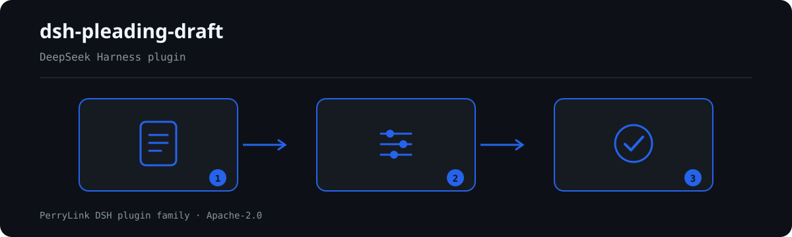

# dsh-pleading-draft — Pleading element checklist completeness check, one row per claim

[English](README.md) · [简体中文](README-zh.md) · [Español](README-es.md) · [Português](README-pt.md) · [हिन्दी](README-hi.md)

[](https://dsh.market/)

`dsh-pleading-draft` reads one pleading-element checklist — the case header plus one row per claim, with its `序号`、`诉讼请求`、`事实依据`、`证据`、`法律依据`、`金额`、`期限` columns — and checks that document's own completeness and internal consistency: that every claim records a factual basis, points at evidence and states a legal basis, that a claim carrying an amount also carries a performance deadline, that the header names the plaintiff and the defendant, that no element number is repeated, and that no unreplaced placeholder survives in the claim column.

## Install

```sh
dsh plugin --profile <name> add dsh-pleading-draft
dsh --profile <name> --dump-config | grep 'dsh-pleading-draft'
```

## What it looks like



*Workflow overview: call → plugin → result. The examples below use the real command surface.*


## What it answers

### Examples

The table below is the example set: the first row is the detailed walkthrough, the remaining rows are short cases.

| You ask | What it answers |
|---|---|
| The claim is written out, but the evidence column points at nothing. | `PL-002` reports the row whose `证据` column does not point at evidence — it checks that a reference is written, not that the evidence exists, is complete or bears on that particular claim. |
| The legal-basis column holds only a general phrase such as “relevant provisions”. | `PL-003` requires the `法律依据` column to be filled on every claim element. It reports an empty column; it does not verify that the provision cited exists, is in force or applies to the case. |
| The amount is stated, but no performance deadline is recorded. | `PL-004` fires only when the `金额` column is filled, and then requires the `期限` column: an amount without a deadline is reported. A claim for a declaration is not asked for a deadline it does not have. Whether the amount is computed correctly or the deadline is reasonable is not checked. |
| Which fields must the case header carry? | `PL-005` requires the header to name the plaintiff and the defendant; both are configuration fields, so your own form can add the cause of action and the accepting court. It does not check that the parties are the right ones for that claim. |
| What happens when the claim column still holds a template placeholder? | `PL-007` reports it: the terms it looks for are `【`, `】`, `{{`, `}}`, `XXX`, `xxx`, `待填`, `待补充`, `TBD`, `todo` and `示例`. A vague claim with none of those terms passes, because judging the required precision of a claim is a legal judgement. |
| A rule appears in `skipped` instead of reporting anything. Does that mean it passed? | No. `skipped` names a check that did not run: `PL-002`, for instance, is listed there when it was disabled in configuration, left out by the `only` selection, or when the material met its precondition and no difference was found. A check that does not run cannot clear a column, and its own limit stands: it never sees whether the evidence suffices or corresponds to the claim. |

## Standards it follows

| Document | Number | Cited by rules |
|---|---|---|
| 《中华人民共和国民事诉讼法》 | 1991年通过，经 2007、2012、2017、2021、2023 年五次修正（现行条号据 2021 年第四次修正及 2023 年第五次修正文本核对） | PL-001, PL-002, PL-003, PL-004, PL-005, PL-006, PL-007 |

**Boundary:** this plugin checks a **起诉状（或申请书）要素核对表** for completeness — that every claim records
its factual basis, points at evidence, states its legal basis, that a monetary claim states an amount and a
performance deadline, that the document names both parties, that element numbers are unique, and that no
placeholder survives. It does **not** decide whether a claim will succeed, whether it is time-barred, whether
jurisdiction is right, whether the evidence suffices, or whether the case should be accepted. **Those are the
court's determinations and the advocate's substantive judgement.**

> ### ⚠️ What this plugin can and cannot do
>
> **It reads a checklist, not the pleadings, the evidence or the statutes.** So it can only check that a
> column *points at* evidence or *names* a provision — **never that the evidence suffices or that the
> provision exists, is in force, or applies**. `PL-002` and `PL-003` say so in their own notes. Test the
> plugin against a pleading whose cited article was repealed: it will pass, because looking up statutes is a
> different job and one this plugin deliberately does not do.
>
> **The rule pack states its citation status rule by rule.** **4 of its 7 rules quote verbatim clause text** and are marked `direct`; the remaining 3 state in the `excerpt` field itself that the text was not obtained, and stay at `warn` or `info`. Where a rule still carries that note, treat it as a lead rather than as a citation. The
> regime lives in 《中华人民共和国民事诉讼法》(notably its article on what a statement of claim must record)
> and the Supreme People's Court's interpretation of it. For the rules whose text the verification pass could not retrieve, the pack states the gap in the
> `excerpt` field itself rather than paraphrasing it, and those rules stay at `warn` or `info`. **When the texts are in hand, replace each `excerpt` with the real clause and raise `kind` to
> `direct`.**
>
> `PL-004` fires only when an amount column is filled, so a claim for a declaration or for a change of legal
> relation is not asked for a performance deadline it does not have. And `PL-007` catches placeholders only:
> a claim that is vague **without** containing `【】` or `待填` will pass, because judging whether a claim is
> stated with the required precision is a legal judgement.

## Compatibility

| Surface | Status |
|---|---|
| Harness | Peer range `>=0.1.2-rc.1 <0.2.0 \|\| >=0.2.0-0 <0.3.0` — verified to accept both `0.2.0-rc.2` and `0.2.1-rc.2`. `engines.dsh` is declared as `>=0.2.1-0 <0.3.0` and is enforced by the host since 0.2.1 |
| Node | `^22.19.0 || >=24.0.0` |
| Platforms | All (plain ESM; no native code, no network, no model call) |
| Tool mode | Works in `native` and `ptc`; for several claims use `ptc` |

## What it does

Registers the `pleading_draft` tool. It reads one pleading-element checklist — the case header plus one row per
claim — applies a versioned rule pack, and returns a report.

| Rule | Check | Severity | Basis kind |
|---|---|---|---|
| `PL-001` | every claim records its factual basis | warn | direct |
| `PL-002` | every claim points at evidence | warn | direct |
| `PL-003` | every claim states its legal basis | warn | direct |
| `PL-004` | a monetary claim states amount and deadline | warn | principle |
| `PL-005` | the document names plaintiff and defendant | warn | direct |
| `PL-006` | element numbers are unique | warn | principle |
| `PL-007` | the claim column holds no unreplaced placeholder | warn | principle |
## Configuration

| Key | Type | Default | Description |
|---|---|---|---|
| `rulesFile` | string | `rules/pleading-draft.yaml` | Rule-pack path, relative to the package root |
| `disabledRules` | string[] | `[]` | Rule ids to stop running; each appears in `skipped` |
| `onlyRules` | string[] | `[]` | Run only these rule ids; empty runs every rule |
| `skipNotes` | string | `""` | Note appended to every `skipped` reason |
| `timeoutMs` | number | `120000` | Cooperative tool timeout budget |

Rule-level parameters worth knowing:

- `PL-004` `conditionField` / `requiredFields` — which column triggers the deadline requirement; the amount
  column by default, requiring the performance deadline.
- `PL-005` `fields` — the header fields that must be present; plaintiff and defendant by default. Add `court`
  and `cause` if your checklist records them in the header.
- `PL-007` `terms` — the placeholders to look for.

## Material format

The tool accepts JSON or YAML:

```yaml
caseNo: （2026）某民初 1234 号
court: 某某人民法院
plaintiff: 原告某某公司
defendant: 被告某某公司
cause: 买卖合同纠纷
rows:
  - { 序号: '1', 请求要素: 本金给付请求,
      诉讼请求: 判令被告支付货款本金人民币 1,250,000 元,
      事实依据: 双方于 2025 年 3 月 10 日签订买卖合同，原告已按约交付货物，被告未按期付款,
      证据: 证1、证2、证3, 法律依据: 《中华人民共和国民法典》第五百七十七条,
      金额: '1250000', 期限: 本判决生效之日起十日内 }
```

Column names are matched case-insensitively and ignoring spaces, underscores and hyphens; the checklist's own
column names are kept, so a finding names the column it read.

## Rule sources

Rule data lives in `rules/pleading-draft.yaml`. The pack's header states the citation gap in full, and each
rule's `note` repeats the part that matters for that rule. The load-time guard that normally enforces "an
excerpt must be a real quotation of at least eight characters" cannot tell a quotation from a description —
so this pack leans on the header, the per-rule notes and a test that asserts every `excerpt` admits the gap.

## Troubleshooting

- **`PL-003` passes on a provision I know was repealed.** It cannot check that: it verifies that a legal basis
  is *named*, not that it exists or applies. Statute lookup is out of scope by design.
- **`PL-002` passes although the evidence proves nothing.** Same reason: it checks that evidence is *pointed
  at*, not that it is sufficient.
- **`PL-004` does not fire on a declaration claim.** That is deliberate — the deadline is required only when
  an amount is stated.
- **`PL-007` does not fire on a vague claim.** It catches placeholders (`【】`, `待填`, `TBD`), not imprecision.
- **The plugin installs but the tool never appears.** Check that `main` resolves to `lib/index.mjs` and
  that `pnpm run build` produced it; a wrong `main` makes the loader skip the entry silently.
- **`dsh plugin add` refuses the package as incompatible.** The peer range covers `0.1.x` and `0.2.x`; if
  your runtime sits outside it, grant an explicit exemption:
  `dsh plugin --profile <name> allow-version dsh-pleading-draft@0.1.0 --dsh-version <runtime> --accept-risk`
- **`check` reports `manifest-peers` as failed.** The static checker compares against a hard-coded peer
  range that predates the 0.2 line. The runtime enforces peer compatibility at install time, so the
  declared range is the correct one; this is a known upstream issue in `dsh-plugin-dev`.

## Development

```sh
pnpm install
pnpm run typecheck   # tsc --noEmit
pnpm test            # vitest, the shared table-plugin suite plus paired fixtures
pnpm run build       # tsdown -> lib/index.mjs + lib/index.d.mts
node ../scripts/sync-shared.mjs dsh-pleading-draft   # refresh src/shared from ../_shared
```

The plugin is **data-only**: `src/model.ts` declares the table shape, the shared kit supplies the reader and
the check engine, and the rule pack declares every check.

## PerryLink DSH Plugin Family

This project is part of the DeepSeek Harness plugin family from [PerryLink](https://github.com/PerryLink). The roster stays collapsed below so every README keeps a short first screen; expand it to see every row and its status.

<details>
<summary>Expand all plugins</summary>

| Plugin | Status |
|---|---|
| **[dsh-aqua-input-check](https://github.com/PerryLink/dsh-aqua-input-check)** |  |
| **[dsh-archive-check](https://github.com/PerryLink/dsh-archive-check)** |  |
| **[dsh-auto-review](https://github.com/PerryLink/dsh-auto-review)** |  |
| **[dsh-autotier](https://github.com/PerryLink/dsh-autotier)** |  |
| **[dsh-bid-ca-precheck](https://github.com/PerryLink/dsh-bid-ca-precheck)** |  |
| **[dsh-bid-qual-check](https://github.com/PerryLink/dsh-bid-qual-check)** |  |
| **[dsh-cert-mcp](https://github.com/PerryLink/dsh-cert-mcp)** |  |
| **[dsh-checkpoint-rewind](https://github.com/PerryLink/dsh-checkpoint-rewind)** |  |
| **[dsh-click](https://github.com/PerryLink/dsh-click)** |  |
| **[dsh-composer-history](https://github.com/PerryLink/dsh-composer-history)** |  |
| **[dsh-contract-stance](https://github.com/PerryLink/dsh-contract-stance)** |  |
| **[dsh-customs-doc-check](https://github.com/PerryLink/dsh-customs-doc-check)** |  |
| **[dsh-data-quality](https://github.com/PerryLink/dsh-data-quality)** |  |
| **[dsh-demurrage-ledger](https://github.com/PerryLink/dsh-demurrage-ledger)** |  |
| **[dsh-doublecheck](https://github.com/PerryLink/dsh-doublecheck)** |  |
| **[dsh-drill-script-check](https://github.com/PerryLink/dsh-drill-script-check)** |  |
| **[dsh-eia-guide-check](https://github.com/PerryLink/dsh-eia-guide-check)** |  |
| **[dsh-emergency-plan](https://github.com/PerryLink/dsh-emergency-plan)** |  |
| **[dsh-essay-rubric-check](https://github.com/PerryLink/dsh-essay-rubric-check)** |  |
| **[dsh-evidence-check](https://github.com/PerryLink/dsh-evidence-check)** |  |
| **[dsh-export-ctl-check](https://github.com/PerryLink/dsh-export-ctl-check)** |  |
| **[dsh-fast](https://github.com/PerryLink/dsh-fast)** |  |
| **[dsh-fmea-table-check](https://github.com/PerryLink/dsh-fmea-table-check)** |  |
| **[dsh-forecast-penalty](https://github.com/PerryLink/dsh-forecast-penalty)** |  |
| **[dsh-fund-research](https://github.com/PerryLink/dsh-fund-research)** |  |
| **[dsh-github](https://github.com/PerryLink/dsh-github)** |  |
| **[dsh-gongwen-flow-check](https://github.com/PerryLink/dsh-gongwen-flow-check)** |  |
| **[dsh-gongwen-word-check](https://github.com/PerryLink/dsh-gongwen-word-check)** |  |
| **[dsh-guard-plan-qc](https://github.com/PerryLink/dsh-guard-plan-qc)** |  |
| **[dsh-hazchem-check](https://github.com/PerryLink/dsh-hazchem-check)** |  |
| **[dsh-hazplan-check](https://github.com/PerryLink/dsh-hazplan-check)** |  |
| **[dsh-hidden-risk-map](https://github.com/PerryLink/dsh-hidden-risk-map)** |  |
| **[dsh-hs-classify](https://github.com/PerryLink/dsh-hs-classify)** |  |
| **[dsh-icd-rule-check](https://github.com/PerryLink/dsh-icd-rule-check)** |  |
| **[dsh-industry-research](https://github.com/PerryLink/dsh-industry-research)** |  |
| **[dsh-lawcite-adapter](https://github.com/PerryLink/dsh-lawcite-adapter)** |  |
| **[dsh-laya](https://github.com/PerryLink/dsh-laya)** |  |
| **[dsh-lc-doc-check](https://github.com/PerryLink/dsh-lc-doc-check)** |  |
| **[dsh-learning-gap-check](https://github.com/PerryLink/dsh-learning-gap-check)** |  |
| **[dsh-library](https://github.com/PerryLink/dsh-library)** |  |
| **[dsh-local-ai](https://github.com/PerryLink/dsh-local-ai)** |  |
| **[dsh-lsp-actions](https://github.com/PerryLink/dsh-lsp-actions)** |  |
| **[dsh-mask](https://github.com/PerryLink/dsh-mask)** |  |
| **[dsh-mcp-panel](https://github.com/PerryLink/dsh-mcp-panel)** |  |
| **[dsh-medrec-qc](https://github.com/PerryLink/dsh-medrec-qc)** |  |
| **[dsh-memento](https://github.com/PerryLink/dsh-memento)** |  |
| **[dsh-nsfc-form-check](https://github.com/PerryLink/dsh-nsfc-form-check)** |  |
| **[dsh-nurse-record-check](https://github.com/PerryLink/dsh-nurse-record-check)** |  |
| **[dsh-observe](https://github.com/PerryLink/dsh-observe)** |  |
| **[dsh-origin-rvc-check](https://github.com/PerryLink/dsh-origin-rvc-check)** |  |
| **[dsh-ota-review-check](https://github.com/PerryLink/dsh-ota-review-check)** |  |
| **[dsh-output-styles](https://github.com/PerryLink/dsh-output-styles)** |  |
| **[dsh-paper-doc-adapter](https://github.com/PerryLink/dsh-paper-doc-adapter)** |  |
| **[dsh-permission-rules](https://github.com/PerryLink/dsh-permission-rules)** |  |
| **[dsh-permit-report-check](https://github.com/PerryLink/dsh-permit-report-check)** |  |
| **[dsh-pipeline-check](https://github.com/PerryLink/dsh-pipeline-check)** |  |
| **[dsh-pleading-draft](https://github.com/PerryLink/dsh-pleading-draft)** |  |
| **[dsh-plugin-doctor](https://github.com/PerryLink/dsh-plugin-doctor)** |  |
| **[dsh-plugin-guide](https://github.com/PerryLink/dsh-plugin-guide)** |  |
| **[dsh-plugin-kit](https://github.com/PerryLink/dsh-plugin-kit)** |  |
| **[dsh-plugin-upgrade](https://github.com/PerryLink/dsh-plugin-upgrade)** |  |
| **[dsh-policy-brief-draft](https://github.com/PerryLink/dsh-policy-brief-draft)** |  |
| **[dsh-power-loss-split](https://github.com/PerryLink/dsh-power-loss-split)** |  |
| **[dsh-power-ticket-check](https://github.com/PerryLink/dsh-power-ticket-check)** |  |
| **[dsh-ppap-check](https://github.com/PerryLink/dsh-ppap-check)** |  |
| **[dsh-protest-deadline](https://github.com/PerryLink/dsh-protest-deadline)** |  |
| **[dsh-railway-window](https://github.com/PerryLink/dsh-railway-window)** |  |
| **[dsh-repair-order-qc](https://github.com/PerryLink/dsh-repair-order-qc)** |  |
| **[dsh-research-report](https://github.com/PerryLink/dsh-research-report)** |  |
| **[dsh-review-reply-check](https://github.com/PerryLink/dsh-review-reply-check)** |  |
| **[dsh-rulefile-check](https://github.com/PerryLink/dsh-rulefile-check)** |  |
| **[dsh-safety-brief-check](https://github.com/PerryLink/dsh-safety-brief-check)** |  |
| **[dsh-score](https://github.com/PerryLink/dsh-score)** |  |
| **[dsh-session-sync](https://github.com/PerryLink/dsh-session-sync)** |  |
| **[dsh-site-log-check](https://github.com/PerryLink/dsh-site-log-check)** |  |
| **[dsh-skill-pack-security](https://github.com/PerryLink/dsh-skill-pack-security)** |  |
| **[dsh-soe-decision-check](https://github.com/PerryLink/dsh-soe-decision-check)** |  |
| **[dsh-soilwater-check](https://github.com/PerryLink/dsh-soilwater-check)** |  |
| **[dsh-sop-sync-check](https://github.com/PerryLink/dsh-sop-sync-check)** |  |
| **[dsh-spc-gbt-adapter](https://github.com/PerryLink/dsh-spc-gbt-adapter)** |  |
| **[dsh-talk](https://github.com/PerryLink/dsh-talk)** |  |
| **[dsh-tender-extract](https://github.com/PerryLink/dsh-tender-extract)** |  |
| **[dsh-tender-matrix](https://github.com/PerryLink/dsh-tender-matrix)** |  |
| **[dsh-test-drive](https://github.com/PerryLink/dsh-test-drive)** |  |
| **[dsh-ticktick](https://github.com/PerryLink/dsh-ticktick)** |  |
| **[dsh-translate](https://github.com/PerryLink/dsh-translate)** |  |
| **[dsh-warranty-calc](https://github.com/PerryLink/dsh-warranty-calc)** |  |
| **[dsh-budget](https://github.com/PerryLink/dsh-budget)** | 🧊 FROZEN — see the repo README |
| **[dsh-claude-move](https://github.com/PerryLink/dsh-claude-move)** | 🧊 FROZEN — see the repo README |
| **[dsh-defend](https://github.com/PerryLink/dsh-defend)** | 🧊 FROZEN — see the repo README |
| **[dsh-draw](https://github.com/PerryLink/dsh-draw)** | 🧊 FROZEN — see the repo README |
| **[dsh-reach](https://github.com/PerryLink/dsh-reach)** | 🧊 FROZEN — see the repo README |
| **[dsh-background-agents](https://github.com/PerryLink/dsh-background-agents)** | 🚫 RETIRED — see the repo README |
| **[dsh-session-pin](https://github.com/PerryLink/dsh-session-pin)** | 🚫 RETIRED — see the repo README |
| **[dsh-team-rooms](https://github.com/PerryLink/dsh-team-rooms)** | 🚫 RETIRED — see the repo README |

</details>

## License

[Apache License 2.0](LICENSE) © 2026 dsh-pleading-draft contributors.
