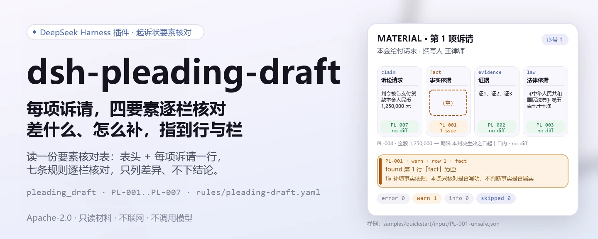
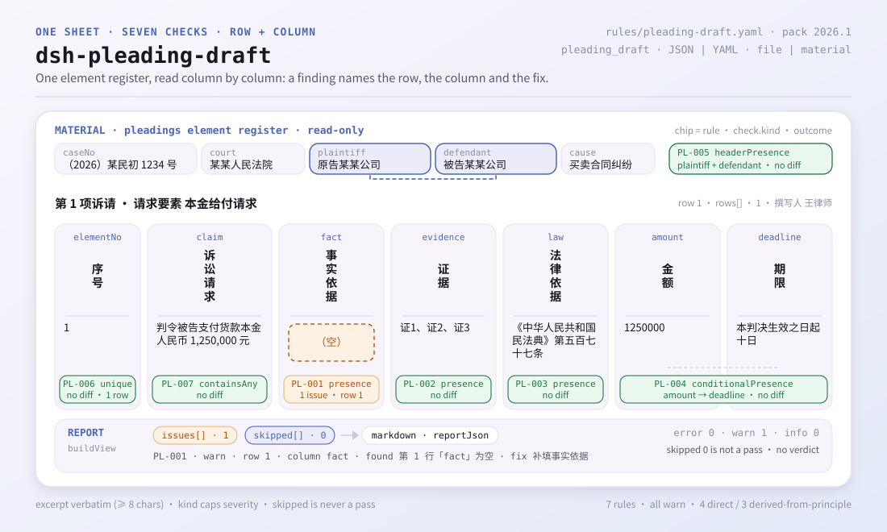

<div align="center">

<picture>
  <source media="(prefers-color-scheme: dark)" srcset="docs/assets/dsh-pleading-draft-hero-zh-dark.webp">
  
</picture>

# dsh-pleading-draft

**核对起诉状要素核对表的齐备与自洽——输出「哪一行、哪一栏、差什么、怎么补」的清单，结论留给复核人。**

面向 DeepSeek Harness 的数据型核查插件：读取一份起诉状（或申请书）要素核对表，按随包的版本化规则包逐条核对，只列材料内部能指认的差异，不判合规、不认定责任、不替代审核人。

[安装](#三步上手) · [配置](#配置) · [FAQ](#faq) · [简体中文](README.md) · [English](README.en.md) · [Español](README.es.md) · [Português](README.pt.md) · [हिन्दी](README.hi.md)

[](LICENSE)
[](#兼容性)
[](https://www.npmjs.com/package/dsh-pleading-draft)
[](https://github.com/PerryLink/dsh-pleading-draft/actions/workflows/ci.yml)
[](#兼容性)

[](https://github.com/PerryLink/dsh-pleading-draft/stargazers)
[](https://www.npmjs.com/package/dsh-pleading-draft)
[](https://dshfind.com/plugins/PerryLink/dsh-pleading-draft?ref=badge)
[](https://securityscorecards.dev/viewer/?uri=github.com/PerryLink/dsh-pleading-draft)
[](https://dsh.market/)
[](https://gitee.com/perrylink/dsh-pleading-draft)

```sh
dsh plugin --profile <name> add dsh-pleading-draft
```

</div>

<sub>社区插件，与 DeepSeek 官方无关。唯一仓库：<https://github.com/PerryLink/dsh-pleading-draft>（Gitee 为镜像）。</sub>

## 它是什么

`dsh-pleading-draft` 读取一份起诉状（或申请书）要素核对表——案件表头加每项请求要素一行，含 `序号`、`诉讼请求`、`事实依据`、`证据`、`法律依据`、`金额`、`期限` 各栏——核对这份文书自身的齐备与自洽：每项诉请是否写明事实依据、是否指明证据、是否写明法律依据，写了金额的是否也写了履行期限，表头是否写明原告与被告，请求要素序号是否重复，诉请栏是否残留未替换的占位符。

它不判定诉请能否获得支持、是否已过诉讼时效、管辖是否正确、证据是否充分，或案件是否应当受理。

- **给谁用**：律师、法务；不用懂命令行，在对话里把材料交给它即可。
- **你交什么**：这项核对用到的原始材料（表格、清单或文书）；不改原件。Excel 可先转成 JSON/YAML，对话里也能代转。
- **它交什么**：一份「哪一行、哪一栏、差什么、怎么补」的清单；没能执行的检查逐条列入 `skipped` 并写明原因。

<picture>
  <source media="(prefers-color-scheme: dark)" srcset="docs/assets/dsh-pleading-draft-flow-v5-dark.svg">
  
</picture>

## 三步上手

1. **安装**（三选一）：

   ```sh
   # git 通道（最新 main；等价于 git+https://github.com/PerryLink/dsh-pleading-draft.git）
   dsh plugin --profile <name> add github:PerryLink/dsh-pleading-draft
   # npm 通道（已发布版本）
   dsh plugin --profile <name> add dsh-pleading-draft
   # tarball 通道：本仓库 pnpm pack 后
   dsh plugin --profile <name> add ./dsh-pleading-draft-<version>.tgz
   ```

2. **最小配置**（默认即可用；bundle 行不带 `config` 时全部走默认值，规则包路径指向随包的 `rules/pleading-draft.yaml`）：

   ```yaml
   - insert:
       - id: dsh-pleading-draft
         name: dsh-pleading-draft
   ```

3. **验证已生效**：

   ```sh
   dsh --profile <name> --dump-config | grep 'dsh-pleading-draft'
   ```

   先 `pnpm run build` 产出 `lib/`，再跑仓内自带样例（对应 `samples/quickstart/expected/result.json`）：

   ```sh
   node samples/quickstart/run.mjs --json
   # => {"tool":"pleading_draft","issueCount":1,"summary":{"error":0,"warn":1,"info":0},"skippedCount":0}
   ```

**卸载**：`dsh plugin --profile <name> remove dsh-pleading-draft`（或从 profile patch 删掉该行）。

<details>
<summary>在 WorkBuddy / 扣子中使用</summary>

在 WorkBuddy / 扣子搜「文书与治理核对包」（总包，本检查是其中一项；上架以商城为准）即可调用同一套核对能力，无需命令行。

</details>

<details>
<summary>从 DSH Desktop 市场安装</summary>

所有 PerryLink 插件均可在 DSH Desktop 内置市场中浏览：**市场 → 来源 → 添加来源 → 粘贴** `https://perrylink-dsh-catalog.perrylink.workers.dev/catalog-source.json` **→ 选中**。安装仍需通过市场的 npm 身份校验与你的确认。

</details>

## 核心能力

`dsh-pleading-draft` 注册 `pleading_draft` 工具：读入一份要素核对表，套用版本化规则包，返回一份报告。

- **七条规则一包带走** —— 规则包是数据不是代码（`rules/pleading-draft.yaml`），换掉规则包即换掉整套检查，不动一行 TypeScript。
- **只读材料** —— 接受 JSON 或 YAML，原件永不修改；纯 ESM，无网络请求、不调用模型。
- **引文不造假** —— 每条规则带 `document` / `number` / `clause` / `excerpt` / `kind` / `source`；`excerpt` 必须是逐字引文，取不到原文的规则在 `excerpt` 里如实写明并标为 `derived-from-principle`。
- **严重级跟着证据走** —— `derived-from-principle` 最高 `warn`，本机构配置（`institutional-configuration`）最高 `info`，并有测试断言。
- **空清单 ≠ 没问题** —— 每条没能执行的检查都进 `skipped` 并写明原因；必填清单未配置的规则自我报告 `skipped`，绝不静默通过。
- **措辞不作裁决** —— 报告只列差异，不判定合规、责任或正确性；措辞守卫（wording guard）强制执行，报告永远附带免责声明。

| 规则 | 核对内容 | 严重级 | 依据类别 |
|---|---|---|---|
| `PL-001` | 每项诉请写明事实依据 | warn | direct |
| `PL-002` | 每项诉请指明证据 | warn | direct |
| `PL-003` | 每项诉请写明法律依据 | warn | direct |
| `PL-004` | 写了金额的诉请同时写明履行期限 | warn | principle |
| `PL-005` | 表头写明原告与被告 | warn | direct |
| `PL-006` | 请求要素序号在表内不重复 | warn | principle |
| `PL-007` | 诉请栏不残留未替换的占位符 | warn | principle |

### 示例

以下为插件真实入口；安装后调用一次即可。第一行是详细走查，其余是简短案例。

**详细示例** — 工具 `pleading_draft`，输入：

```json
{"caseNo":"（2026）某民初 1234 号","rows":[{"序号":"1","请求要素":"本金给付请求","诉讼请求":"判令被告支付货款本金人民币 1,250,000 元","事实依据":"","证据":"证1、证2、证3"}]}
```

输出：

```json
{
  "id": "dsh-pleading-draft.PL-001.de09b5a6",
  "ruleId": "PL-001",
  "severity": "warn",
  "locator": {
    "row": 1,
    "field": "fact"
  },
  "found": "第 1 行「fact」为空",
  "expected": "「fact」应填写",
  "fix": "补填事实依据；本条只核对是否写明，不判断事实是否属实"
}
```

*Observed from `dsh-pleading-draft/tests/fixtures/PL-001/PL-001-unsafe.json (cases.json expects 1×PL-001); executed parseMaterial+runCheck, checkedAt=2026-10-06T00:00:00.000Z`*

| 你会问 | 它怎么答 |
|---|---|
| 诉讼请求写了，但「证据」栏什么都没指。 | `PL-002` 会报出 `证据` 栏没有指明证据的行。它只核对是否写明了指向，不判断证据是否存在、是否完整、是否与该项诉请对应。 |
| 「法律依据」栏只写了「相关法律规定」这样一句笼统的话。 | `PL-003` 要求每项请求要素都填写 `法律依据` 栏。栏内空白会被报出；它不校验所引法条是否存在、是否现行有效、是否适用于本案。 |
| 金额写了，履行期限没有写。 | `PL-004` 只在 `金额` 栏已填写时才启动，随后要求填写 `期限` 栏：有金额而无期限的会被报出。确认之诉不会被要求写它本来就没有的期限。金额算得对不对、期限是否合理，它不核对。 |
| 表头必须写哪些字段？ | `PL-005` 要求表头写明原告与被告；这两项是配置字段，本机构表式可以把案由与受诉法院一并加进去。它不判断当事人是不是该案适格的当事人。 |
| 诉请栏里还留着模板占位符，会怎样？ | `PL-007` 会报出。它找的词是 `【`、`】`、`{{`、`}}`、`XXX`、`xxx`、`待填`、`待补充`、`TBD`、`todo`、`示例`。措辞含糊但不含这些词的诉请会通过，因为判断诉请该写到多具体是法律判断。 |
| 某条规则出现在 `skipped` 里，而不是报出差错——算它通过了吗？ | 不算。`skipped` 列的是**没有执行**的检查：例如 `PL-002` 在配置里被停用、被 `only` 限定在本次执行范围之外，或者材料已满足它的前置条件且未发现差异条目时，都会出现在这里。没有执行的检查不可能把某一栏核清，它的能力边界依旧：它看不到证据是否充分、是否与诉请对应。 |

## 配置

全部可调参数都是 `src/config.ts` 里的 Schemastery `Config` 字段（可从 cordis.yml 覆盖），逐条阈值在 `rules/` 下的规则库文件里。按 id 覆盖会替换整行——请重述所有需要的键。

| 键 | 类型 | 默认值 | 说明 |
|---|---|---|---|
| `rulesFile` | string | `rules/pleading-draft.yaml` | 规则库文件路径，相对插件包根目录 |
| `disabledRules` | string[] | `[]` | 要停用的规则 id 列表；每条都会出现在 `skipped` 中 |
| `onlyRules` | string[] | `[]` | 只执行这些规则 id；留空表示执行全部规则 |
| `skipNotes` | string | `""` | 附加到每条 `skipped` 说明后的备注 |
| `timeoutMs` | number | `120000` | 工具协作式超时预算（毫秒） |

值得了解的规则级参数：

- `PL-004` `conditionField` / `requiredFields` —— 哪一栏有值才触发期限要求；默认金额栏有值即要求履行期限栏。
- `PL-005` `fields` —— 表头必须写明的字段；默认原告与被告。表头还记录案由与受诉法院时，把它们加进去即可。
- `PL-007` `terms` —— 要查找的占位符词组。

profile patch 覆盖示例：

```yaml
- insert:
    - id: dsh-pleading-draft
      name: dsh-pleading-draft
      config:
        disabledRules: [PL-006]
        timeoutMs: 180000
```

## 材料格式

工具接受 JSON 或 YAML：

```yaml
caseNo: （2026）某民初 1234 号
court: 某某人民法院
plaintiff: 原告某某公司
defendant: 被告某某公司
cause: 买卖合同纠纷
rows:
  - { 序号: '1', 请求要素: 本金给付请求,
      诉讼请求: 判令被告支付货款本金人民币 1,250,000 元,
      事实依据: 双方于 2025 年 3 月 10 日签订买卖合同，原告已按约交付货物，被告未按期付款,
      证据: 证1、证2、证3, 法律依据: 《中华人民共和国民法典》第五百七十七条,
      金额: '1250000', 期限: 本判决生效之日起十日内 }
```

列名匹配忽略大小写，并忽略空格、下划线与连字符；核对表自己的列名会被保留，因此发现里写明的列就是它实际读到的列。字段在读取层是可选的，由检查引擎校验，因此部分导出的材料会产生「缺项」类差异，而不是让程序崩溃。

## 规则来源

规则数据在 `rules/pleading-draft.yaml`，与代码分离：每条规则都带文件名、文号、按原文自身编号体系的条款号、逐字摘录与来源地址。加载期守卫强制 `excerpt` 是不少于八个字符的真实引文，但它分不清引文与描述——因此本规则包另靠逐条 `note` 与 `rules/evidence/` 的核验记录兜底；`kind: derived-from-principle` 的严重级封顶 `warn`，`institutional-configuration` 封顶 `info`；夸大依据的规则库会在加载期失败。`scripts/check-citations.mjs` 另把每条 `excerpt` 与 `rules/evidence/` 下的核验记录逐字比对，基线只能缩小。7 条规则中 4 条为 `direct`（`PL-001`、`PL-002`、`PL-003`、`PL-005`），3 条为 `derived-from-principle`（`PL-004`、`PL-006`、`PL-007`）——它们各自引用所依据的条文，但所检查的要求并非条文直接规定，缺口写在每条规则的 `note` 里。

## 依据的标准

| 文件 | 文号 | 引用它的规则 |
|---|---|---|
| 《中华人民共和国民事诉讼法》 | 1991年通过，经 2007、2012、2017、2021、2023 年五次修正（现行条号据 2021 年第四次修正及 2023 年第五次修正文本核对） | PL-001, PL-002, PL-003, PL-004, PL-005, PL-006, PL-007 |

**边界：** 本插件核对一份**起诉状（或申请书）要素核对表**的齐备性——每项诉请是否写明事实依据、是否指明证据、是否写明法律依据，写了金额的诉请是否写明金额与履行期限，文书是否写明原告与被告，请求要素序号是否唯一，以及是否残留占位符。它**不**判定诉请能否获得支持、是否已过诉讼时效、管辖是否正确、证据是否充分，或案件是否应当受理。**这些是法院的认定，也是代理人的实体判断。**

## FAQ

<details>
<summary>材料会被上传到哪里？</summary>

不会上传。工具只在本地读取你给的 `file` 路径或内联 `material`（JSON/YAML）；插件不联网、不写盘、不调用模型（manifest 的 `network` 为 `false`、`writes` 为空），返回的只是报告文本。材料原件不会被修改。

</details>

<details>
<summary>`issues` 为空能当作「没问题」吗？</summary>

不能。每条没能执行的检查都列在 `skipped` 里并写明原因；必填清单未配置的规则自我报告 `skipped`，绝不静默通过。判读报告时请把 `issues` 与 `skipped` 一起看完。

</details>

<details>
<summary>规则库会不会自己编法条？</summary>

不会。每条规则都带 `document` / `number` / `clause` / `excerpt` / `kind` / `source`；`excerpt` 必须是逐字引文，取不到原文时在 `excerpt` 里如实写明并降为原则性依据（封顶 `warn`）。`pnpm run check:citations` 会把每条引文与 `rules/evidence/` 的核验记录逐字比对，CI 里就跑这一步。

</details>

<details>
<summary>会和其他插件抢工具名或服务键吗？</summary>

不会。它只注册一个带命名空间的工具 `pleading_draft`，不提供任何服务键、不注册客户端 slot、不注册 `webServer` 前缀、不改全局对象；`cordis.patch.yml` 只 `insert` 自己那一行，从不覆写内置行。工具注册是 Cordis effect，卸载即撤销。

</details>

<details>
<summary>一次核对很多份材料，性能吃得消吗？</summary>

工具在 `native` 与 `ptc` 两种模式都能跑；批量核对（例如整个目录）建议 `ptc`，schema 成本只付一次。检查本身是纯本地的读取与规则求值，无网络请求、不调用模型；`timeoutMs`（默认 120 秒）是协作式超时预算。

</details>

## 安全边界

> ### ⚠️ 在采信报告中的引文之前，请先读这一段
>
> **它读的是一份核对表，而不是起诉状、证据或法律条文。** 因此它只能核对其中的某一栏是否*指向*证据、是否*写明*某项条款——**永远不能核对证据是否充分，也不能核对该条款是否存在、是否现行有效、是否适用**。`PL-002` 与 `PL-003` 在各自的 `note` 中写明了这一点。拿一份所引条文已被废止的起诉状来测试本插件：它会通过，因为查法是另一件工作，也是本插件特意不做的工作。
>
> **引文状态逐条不同，不是统一的。** 7 条规则中 4 条逐字引用条款原文（`kind: direct`）：`PL-001`、`PL-002`、`PL-003`、`PL-005`；其余 3 条（`PL-004`、`PL-006`、`PL-007`）引用所依据的条文，但所检查的要求只能由条文原则推出，故标为 `derived-from-principle` 并封顶 `warn`，各自的 `note` 写明缺口。规则包从不把概括当引文。
>
> `PL-004` 只在金额栏已填写时才触发，因此确认之诉或变更法律关系之诉不会被要求填写它本来就没有的履行期限。而 `PL-007` 只抓占位符：一条措辞含糊、但**不含** `【】` 或 `待填` 的诉请会通过，因为判断诉请是否写到要求的精确程度，属于法律判断。
>
> 结论性判断留给审核人：本插件只列出材料内部可以逐条指认的差异，不判断事实真伪，也不评价合规性。

## 已知限制

- **只看「有没有写」，不看「写得对不对」。** 它核对每一栏是否填写、是否指向，看不到证据本身，也不校验法条是否现行有效；这些判断需要法律专业能力，也是诉讼代理人的核心工作。
- **`PL-004` 的触发条件。** 只有金额栏已填写时才要求期限栏，避免对确认之诉、形成之诉报出它本来就没有的期限。
- **`PL-007` 只抓占位符。** 不含 `【】`、`待填`、`TBD` 之类词的含糊诉请会通过，因为判断诉请该写到多具体是法律判断。
- **条号随文本变化。** 规则库版本为 `2026.1`，引文与条号以 2021 年第四次修正及 2023 年第五次修正文本为准；后续修法可能使条号再次位移。
- **不做时区换算。** 全部日期判断都是对输入字符串做墙上时钟运算。
- **材料是逐栏读取的。** 部分导出的材料会产生「缺项」类差异，而不是让程序崩溃——请把 `issues` 与 `skipped` 一起判读。

## 排障

- **`PL-003` 对一条我知道已废止的条文通过。** 它不校验条文是否存在、是否现行有效或是否适用；它只核对法律依据栏是否写明。查法是另一件工作，本插件刻意不做。
- **`PL-002` 通过了，但证据其实证明不了什么。** 同理：它核对证据是否*被指向*，不核对证据是否充分。
- **`PL-004` 对确认之诉不触发。** 这是有意的——只有写了金额才要求履行期限。
- **`PL-007` 对含糊诉请不触发。** 它抓的是占位符，不是不精确的措辞。
- **插件装上了但工具不出现。** 确认 `main` 解析到 `lib/index.mjs`，且 `pnpm run build` 已产出该文件；`main` 写错会让加载器静默跳过该条目。
- **`dsh plugin add` 以不兼容为由拒绝安装。** peer 范围覆盖 `0.1.x` 与 `0.2.x`；若运行时在其之外，可显式豁免：`dsh plugin --profile <name> allow-version dsh-pleading-draft@0.1.0 --dsh-version <runtime> --accept-risk`
- **`check` 把 `manifest-peers` 报为失败。** 静态检查器比对的是一份早于 0.2 世代的硬编码 peer 范围；安装期的 peer 校验以运行时为准，声明的范围才是正确的。这是 `dsh-plugin-dev` 的已知上游问题。
- **时间看起来偏移。** 全部计算都是对输入字符串做墙上时钟运算，不做时区换算。

## 兼容性

| 项目 | 状态 |
|---|---|
| Harness | 对等版本范围 `>=0.1.2-rc.1 <0.2.0 \|\| >=0.2.0-0 <0.3.0` —— 已实测同时接受 `0.2.0-rc.2` 与 `0.2.1-rc.2`。已声明 `engines.dsh`：0.2.1 起由宿主单独裁决，范围为 `>=0.2.1-0 <0.3.0` |
| Node | `^22.19.0 \|\| >=24.0.0` |
| 平台 | 全平台（纯 ESM；无原生代码、无联网、不调用模型） |
| 工具模式 | `native` / `ptc` 均可；批量核对整个目录时建议 `ptc`，schema 成本只付一次 |

## 生态与质量

- [Gitee 镜像](https://gitee.com/perrylink/dsh-pleading-draft)（同步镜像，以 GitHub 为准）
- [dshfind 插件页](https://dshfind.com/plugins/PerryLink/dsh-pleading-draft)（安装量与排名）
- [OpenSSF Scorecard 报告](https://securityscorecards.dev/viewer/?uri=github.com/PerryLink/dsh-pleading-draft)（由 [.github/workflows/scorecard.yml](.github/workflows/scorecard.yml) 驱动）
- [DSH Market](https://dsh.market/)（已上架）
- **1024 商店渠道**：先 `npm i -g dsh1024`，再 `dsh1024 plugin --profile <name> add dsh-pleading-draft`（计入 [deepseek1024.com](https://deepseek1024.com) 安装排行）
- [生态实测知识库](https://perrylink.github.io/dsh-plugin-guide/)：插件开发指南 · 选型实测数据 · 维护取舍判据

## 开发

```sh
pnpm install                                        # node ^22.19 || >=24
pnpm run typecheck                                  # tsc --noEmit
pnpm test                                           # vitest：共享表格插件套件 + 成对夹具
pnpm run build                                      # tsdown -> lib/index.mjs + lib/index.d.mts
pnpm run verify:self-contained                      # 依赖 spec 均来自 registry
pnpm run check:lockfile                             # lockfile 漂移检查
pnpm run check:readmes                              # 五语 README 一致性
pnpm run check:citations                            # 规则包引文基线
node ../scripts/sync-shared.mjs dsh-pleading-draft   # 从 ../_shared 刷新 src/shared
pnpm pack                                           # 发布 tarball
```

本插件是**数据型**的：`src/model.ts` 声明表格结构，`src/check.ts` 是与插件上下文无关的纯检查核心，`src/shared/` 提供读取器与报告形状，规则包声明每一条检查。本地样例试跑（需先 `pnpm run build` 产出 `lib/`）：

```sh
node samples/quickstart/run.mjs --json
# => {"tool":"pleading_draft","issueCount":1,"summary":{"error":0,"warn":1,"info":0},"skippedCount":0}
```

样例输入在 `samples/quickstart/input/`，期望输出在 `samples/quickstart/expected/result.json`，截图见 `docs/assets/quickstart.png`。README 配图由 [`scripts/gen-readme-assets.py`](scripts/gen-readme-assets.py) 程序化生成（Pillow 画 hero，手写 SVG 画结构图），可重复执行：输出 `docs/assets/dsh-pleading-draft-hero-{zh,en}-{light,dark}.webp` 与 `docs/assets/dsh-pleading-draft-flow-v5-{light,dark}.svg`。旧的单版流程图与演示图保留在 `docs/assets/` 供外链使用，README 只引用新生成的 hero 与 flow-v5。

Topics：`deepseek-harness`, `dsh`, `dsh-plugin`, `cordis`, `pleading`, `draft`

## 家族与致谢

本项目是 [PerryLink](https://github.com/PerryLink) 维护的 DeepSeek Harness 插件家族成员（全部 Apache-2.0）。完整家族索引见[按材料选核查器](https://perrylink.github.io/zh/checkers/choose/)。如果这个插件帮到了你，**给个 star**——它不解锁任何功能，但会让下一个人更容易找到它。

- [@PerryLink](https://github.com/PerryLink) —— 创建者与维护者：数据型规则包（PL-001..PL-007）、`pleading_draft` 工具、引文核验记录与五语文档。

<details>
<summary>展开全部插件</summary>

| 插件 | 状态 |
|---|---|
| **[dsh-aqua-input-check](https://github.com/PerryLink/dsh-aqua-input-check)** |  |
| **[dsh-archive-check](https://github.com/PerryLink/dsh-archive-check)** |  |
| **[dsh-auto-review](https://github.com/PerryLink/dsh-auto-review)** |  |
| **[dsh-autotier](https://github.com/PerryLink/dsh-autotier)** | 🧊 已冻结 — 见仓库 README |
| **[dsh-bid-ca-precheck](https://github.com/PerryLink/dsh-bid-ca-precheck)** |  |
| **[dsh-bid-qual-check](https://github.com/PerryLink/dsh-bid-qual-check)** |  |
| **[dsh-cert-mcp](https://github.com/PerryLink/dsh-cert-mcp)** | 🧊 已冻结 — 见仓库 README |
| **[dsh-checkpoint-rewind](https://github.com/PerryLink/dsh-checkpoint-rewind)** |  |
| **[dsh-click](https://github.com/PerryLink/dsh-click)** |  |
| **[dsh-composer-history](https://github.com/PerryLink/dsh-composer-history)** |  |
| **[dsh-contract-stance](https://github.com/PerryLink/dsh-contract-stance)** |  |
| **[dsh-customs-doc-check](https://github.com/PerryLink/dsh-customs-doc-check)** |  |
| **[dsh-data-quality](https://github.com/PerryLink/dsh-data-quality)** | 🧊 已冻结 — 见仓库 README |
| **[dsh-demurrage-ledger](https://github.com/PerryLink/dsh-demurrage-ledger)** |  |
| **[dsh-doublecheck](https://github.com/PerryLink/dsh-doublecheck)** |  |
| **[dsh-drill-script-check](https://github.com/PerryLink/dsh-drill-script-check)** |  |
| **[dsh-eia-guide-check](https://github.com/PerryLink/dsh-eia-guide-check)** |  |
| **[dsh-emergency-plan](https://github.com/PerryLink/dsh-emergency-plan)** |  |
| **[dsh-essay-rubric-check](https://github.com/PerryLink/dsh-essay-rubric-check)** |  |
| **[dsh-evidence-check](https://github.com/PerryLink/dsh-evidence-check)** |  |
| **[dsh-export-ctl-check](https://github.com/PerryLink/dsh-export-ctl-check)** |  |
| **[dsh-fast](https://github.com/PerryLink/dsh-fast)** |  |
| **[dsh-fmea-table-check](https://github.com/PerryLink/dsh-fmea-table-check)** |  |
| **[dsh-forecast-penalty](https://github.com/PerryLink/dsh-forecast-penalty)** |  |
| **[dsh-fund-research](https://github.com/PerryLink/dsh-fund-research)** |  |
| **[dsh-github](https://github.com/PerryLink/dsh-github)** |  |
| **[dsh-gongwen-flow-check](https://github.com/PerryLink/dsh-gongwen-flow-check)** |  |
| **[dsh-gongwen-word-check](https://github.com/PerryLink/dsh-gongwen-word-check)** |  |
| **[dsh-guard-plan-qc](https://github.com/PerryLink/dsh-guard-plan-qc)** |  |
| **[dsh-hazchem-check](https://github.com/PerryLink/dsh-hazchem-check)** |  |
| **[dsh-hazplan-check](https://github.com/PerryLink/dsh-hazplan-check)** |  |
| **[dsh-hidden-risk-map](https://github.com/PerryLink/dsh-hidden-risk-map)** |  |
| **[dsh-hs-classify](https://github.com/PerryLink/dsh-hs-classify)** |  |
| **[dsh-icd-rule-check](https://github.com/PerryLink/dsh-icd-rule-check)** |  |
| **[dsh-industry-research](https://github.com/PerryLink/dsh-industry-research)** |  |
| **[dsh-lawcite-adapter](https://github.com/PerryLink/dsh-lawcite-adapter)** |  |
| **[dsh-laya](https://github.com/PerryLink/dsh-laya)** |  |
| **[dsh-lc-doc-check](https://github.com/PerryLink/dsh-lc-doc-check)** |  |
| **[dsh-learning-gap-check](https://github.com/PerryLink/dsh-learning-gap-check)** |  |
| **[dsh-library](https://github.com/PerryLink/dsh-library)** |  |
| **[dsh-local-ai](https://github.com/PerryLink/dsh-local-ai)** |  |
| **[dsh-lsp-actions](https://github.com/PerryLink/dsh-lsp-actions)** |  |
| **[dsh-mask](https://github.com/PerryLink/dsh-mask)** |  |
| **[dsh-mcp-panel](https://github.com/PerryLink/dsh-mcp-panel)** |  |
| **[dsh-medrec-qc](https://github.com/PerryLink/dsh-medrec-qc)** |  |
| **[dsh-memento](https://github.com/PerryLink/dsh-memento)** | 🧊 已冻结 — 见仓库 README |
| **[dsh-nsfc-form-check](https://github.com/PerryLink/dsh-nsfc-form-check)** |  |
| **[dsh-nurse-record-check](https://github.com/PerryLink/dsh-nurse-record-check)** |  |
| **[dsh-observe](https://github.com/PerryLink/dsh-observe)** |  |
| **[dsh-origin-rvc-check](https://github.com/PerryLink/dsh-origin-rvc-check)** |  |
| **[dsh-ota-review-check](https://github.com/PerryLink/dsh-ota-review-check)** |  |
| **[dsh-output-styles](https://github.com/PerryLink/dsh-output-styles)** |  |
| **[dsh-paper-doc-adapter](https://github.com/PerryLink/dsh-paper-doc-adapter)** |  |
| **[dsh-permission-rules](https://github.com/PerryLink/dsh-permission-rules)** |  |
| **[dsh-permit-report-check](https://github.com/PerryLink/dsh-permit-report-check)** |  |
| **[dsh-pipeline-check](https://github.com/PerryLink/dsh-pipeline-check)** |  |
| **[dsh-pleading-draft](https://github.com/PerryLink/dsh-pleading-draft)** |  |
| **[dsh-plugin-doctor](https://github.com/PerryLink/dsh-plugin-doctor)** | 🚫 已退役（仓库已归档） |
| **[dsh-plugin-guide](https://github.com/PerryLink/dsh-plugin-guide)** |  |
| **[dsh-plugin-kit](https://github.com/PerryLink/dsh-plugin-kit)** | 🚫 已退役（仓库已归档） |
| **[dsh-plugin-upgrade](https://github.com/PerryLink/dsh-plugin-upgrade)** | 🚫 已退役（仓库已归档） |
| **[dsh-policy-brief-draft](https://github.com/PerryLink/dsh-policy-brief-draft)** |  |
| **[dsh-power-loss-split](https://github.com/PerryLink/dsh-power-loss-split)** |  |
| **[dsh-power-ticket-check](https://github.com/PerryLink/dsh-power-ticket-check)** |  |
| **[dsh-ppap-check](https://github.com/PerryLink/dsh-ppap-check)** |  |
| **[dsh-protest-deadline](https://github.com/PerryLink/dsh-protest-deadline)** |  |
| **[dsh-railway-window](https://github.com/PerryLink/dsh-railway-window)** |  |
| **[dsh-repair-order-qc](https://github.com/PerryLink/dsh-repair-order-qc)** |  |
| **[dsh-research-report](https://github.com/PerryLink/dsh-research-report)** |  |
| **[dsh-review-reply-check](https://github.com/PerryLink/dsh-review-reply-check)** |  |
| **[dsh-rulefile-check](https://github.com/PerryLink/dsh-rulefile-check)** |  |
| **[dsh-safety-brief-check](https://github.com/PerryLink/dsh-safety-brief-check)** |  |
| **[dsh-score](https://github.com/PerryLink/dsh-score)** | 🧊 已冻结 — 见仓库 README |
| **[dsh-session-sync](https://github.com/PerryLink/dsh-session-sync)** |  |
| **[dsh-site-log-check](https://github.com/PerryLink/dsh-site-log-check)** |  |
| **[dsh-skill-pack-security](https://github.com/PerryLink/dsh-skill-pack-security)** |  |
| **[dsh-soe-decision-check](https://github.com/PerryLink/dsh-soe-decision-check)** |  |
| **[dsh-soilwater-check](https://github.com/PerryLink/dsh-soilwater-check)** |  |
| **[dsh-sop-sync-check](https://github.com/PerryLink/dsh-sop-sync-check)** |  |
| **[dsh-spc-gbt-adapter](https://github.com/PerryLink/dsh-spc-gbt-adapter)** |  |
| **[dsh-talk](https://github.com/PerryLink/dsh-talk)** |  |
| **[dsh-tender-extract](https://github.com/PerryLink/dsh-tender-extract)** |  |
| **[dsh-tender-matrix](https://github.com/PerryLink/dsh-tender-matrix)** |  |
| **[dsh-test-drive](https://github.com/PerryLink/dsh-test-drive)** |  |
| **[dsh-ticktick](https://github.com/PerryLink/dsh-ticktick)** | 🚫 已退役（仓库已归档） |
| **[dsh-translate](https://github.com/PerryLink/dsh-translate)** |  |
| **[dsh-warranty-calc](https://github.com/PerryLink/dsh-warranty-calc)** |  |
| **[dsh-budget](https://github.com/PerryLink/dsh-budget)** | 🧊 已冻结 — 见仓库 README |
| **[dsh-claude-move](https://github.com/PerryLink/dsh-claude-move)** | 🧊 已冻结 — 见仓库 README |
| **[dsh-defend](https://github.com/PerryLink/dsh-defend)** | 🧊 已冻结 — 见仓库 README |
| **[dsh-draw](https://github.com/PerryLink/dsh-draw)** | 🧊 已冻结 — 见仓库 README |
| **[dsh-reach](https://github.com/PerryLink/dsh-reach)** | 🧊 已冻结 — 见仓库 README |
| **[dsh-background-agents](https://github.com/PerryLink/dsh-background-agents)** | 🚫 已退役（仓库已归档） |
| **[dsh-session-pin](https://github.com/PerryLink/dsh-session-pin)** | 🚫 已退役（仓库已归档） |
| **[dsh-team-rooms](https://github.com/PerryLink/dsh-team-rooms)** | 🚫 已退役（仓库已归档） |

</details>

## License

[LICENSE](LICENSE)（Apache License 2.0）© 2026 dsh-pleading-draft contributors

<p align="center"><sub>Apache-2.0 · 社区插件，与 DeepSeek 无关。</sub></p>
