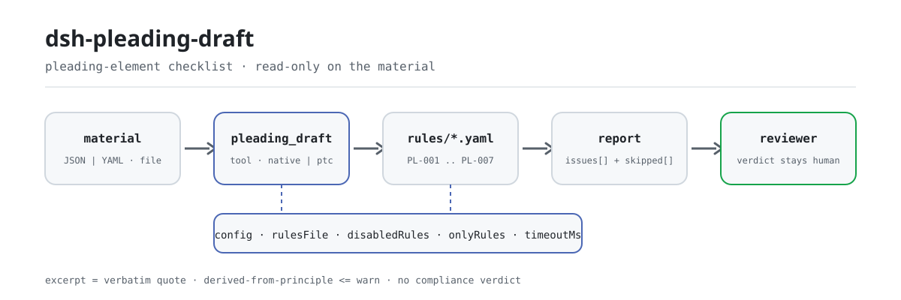

<div align="center">

<picture>
  <source media="(prefers-color-scheme: dark)" srcset="docs/assets/dsh-pleading-draft-flow-dark.svg">
  
</picture>

# dsh-pleading-draft

**Verifica a completude e a coerência interna de uma lista de elementos da petição inicial: você recebe uma lista de qual linha, qual coluna e o que corrigir; a decisão fica com o revisor.**

Um plugin de verificação apenas de dados para o DeepSeek Harness: lê uma lista de elementos da petição inicial (o cabeçalho do processo mais uma linha por pedido), aplica o pacote de regras versionado que traz e lista apenas as divergências que consegue apontar dentro do material; nunca emite juízo de conformidade nem declaração de responsabilidade.

[Instalar](#instalação-em-três-passos) · [Configuração](#configuração) · [FAQ](#faq) · [简体中文](README.md) · [English](README.en.md) · [Español](README.es.md) · [Português](README.pt.md) · [हिन्दी](README.hi.md)

[](LICENSE)
[](#compatibilidade)
[](https://www.npmjs.com/package/dsh-pleading-draft)
[](https://github.com/PerryLink/dsh-pleading-draft/actions/workflows/ci.yml)
[](#compatibilidade)

[](https://github.com/PerryLink/dsh-pleading-draft/stargazers)
[](https://www.npmjs.com/package/dsh-pleading-draft)
[](https://dshfind.com/plugins/PerryLink/dsh-pleading-draft?ref=badge)
[](https://securityscorecards.dev/viewer/?uri=github.com/PerryLink/dsh-pleading-draft)
[](https://dsh.market/)
[](https://gitee.com/perrylink/dsh-pleading-draft)

```sh
dsh plugin --profile <name> add dsh-pleading-draft
```

</div>

<sub>Plugin da comunidade, sem afiliação com a DeepSeek. Repositório canônico: <https://github.com/PerryLink/dsh-pleading-draft> (o Gitee é um espelho).</sub>

## O que é

O `dsh-pleading-draft` lê uma lista de elementos da petição inicial — o cabeçalho do processo mais uma linha por pedido, com as colunas de número, pedido, fundamento de facto, provas, fundamento jurídico, montante e prazo — e verifica a completude e a coerência interna desse documento: se cada pedido registra o seu fundamento de facto, indica provas e apresenta o seu fundamento jurídico, se o pedido com montante indica também prazo de cumprimento, se o cabeçalho nomeia o autor e o réu, se não há números de elemento repetidos e se não resta nenhum marcador de modelo por substituir na coluna dos pedidos.

Não decide se um pedido vai prosperar, se já prescreveu, se a competência está correta, se a prova é suficiente ou se o caso deve ser admitido.

- **Para quem é**: advogados e pessoal jurídico; não é preciso saber usar a linha de comandos — entregue o material no chat.
- **O que você entrega**: o material de origem sobre o qual a verificação trabalha (uma tabela, um registo ou um documento); o original nunca é modificado. O Excel pode ser convertido antes para JSON/YAML, no chat se a plataforma o permitir.
- **O que você recebe**: uma lista de «qual linha, qual coluna, o que falta e como corrigir»; cada verificação que não pôde correr é listada em `skipped` com o motivo.

## Instalação em três passos

1. **Instale** (escolha um canal):

   ```sh
   # canal git (último main; equivalente a git+https://github.com/PerryLink/dsh-pleading-draft.git)
   dsh plugin --profile <name> add github:PerryLink/dsh-pleading-draft
   # canal npm (versões publicadas)
   dsh plugin --profile <name> add dsh-pleading-draft
   # canal tarball: pnpm pack neste repo e depois
   dsh plugin --profile <name> add ./dsh-pleading-draft-<version>.tgz
   ```

2. **Configuração mínima** (os valores padrão bastam; uma linha de bundle sem `config` usa todos eles e o caminho do pacote de regras aponta para o `rules/pleading-draft.yaml` incluído):

   ```yaml
   - insert:
       - id: dsh-pleading-draft
         name: dsh-pleading-draft
   ```

3. **Confirme que está ativo**:

   ```sh
   dsh --profile <name> --dump-config | grep 'dsh-pleading-draft'
   ```

   Depois compile uma vez (`pnpm run build` produz `lib/`) e execute o exemplo incluído (coincide com `samples/quickstart/expected/result.json`):

   ```sh
   node samples/quickstart/run.mjs --json
   # => {"tool":"pleading_draft","issueCount":1,"summary":{"error":0,"warn":1,"info":0},"skippedCount":0}
   ```

**Desinstalar**: `dsh plugin --profile <name> remove dsh-pleading-draft` (ou remova a linha do patch do perfil).

<details>
<summary>Usar no WorkBuddy / Coze</summary>

Pesquise «Documents and Governance Suite» no WorkBuddy / Coze (o pacote do qual esta verificação faz parte; disponibilidade conforme a loja) para usar a mesma capacidade de verificação sem linha de comandos.

</details>

<details>
<summary>Instalar a partir do mercado do DSH Desktop</summary>

Todos os plugins da PerryLink aparecem no mercado integrado do DSH Desktop: **Mercado → Fontes → Adicionar fonte → colar** `https://perrylink-dsh-catalog.perrylink.workers.dev/catalog-source.json` **→ selecionar**. A instalação continua a exigir a verificação de identidade npm do mercado e a sua confirmação.

</details>

## Capacidades principais

O `dsh-pleading-draft` registra a ferramenta `pleading_draft`: lê uma lista de elementos, aplica um pacote de regras versionado e devolve um relatório.

- **Sete regras num pacote** — o pacote de regras é dados, não código (`rules/pleading-draft.yaml`); substituí-lo troca todo o conjunto de verificações sem tocar em TypeScript.
- **Apenas leitura do material** — aceita JSON ou YAML; o original nunca é modificado. ESM puro, sem pedidos de rede, sem chamadas ao modelo.
- **Sem citações inventadas** — cada regra traz `document` / `number` / `clause` / `excerpt` / `kind` / `source`; `excerpt` tem de ser uma citação literal e a regra cujo texto não foi obtido diz isso em `excerpt` e é marcada `derived-from-principle`.
- **A gravidade segue a evidência** — `derived-from-principle` tem teto `warn`, a configuração institucional (`institutional-configuration`) teto `info`, e há um teste que o garante.
- **Lista vazia não é «nada errado»** — cada verificação que não pôde correr vai para `skipped` com o motivo; uma regra cuja lista obrigatória não está configurada declara-se em `skipped` em vez de passar em silêncio.
- **Redação que não julga** — o relatório apenas lista diferenças, nunca declara conformidade, responsabilidade ou correção; um guardião de redação impõe isso e o relatório traz sempre o aviso legal.

| Regra | Verificação | Gravidade | Tipo de base |
|---|---|---|---|
| `PL-001` | cada pedido registra o seu fundamento de facto | warn | direct |
| `PL-002` | cada pedido indica provas | warn | direct |
| `PL-003` | cada pedido apresenta o seu fundamento jurídico | warn | direct |
| `PL-004` | o pedido com montante também indica prazo | warn | principle |
| `PL-005` | o cabeçalho nomeia autor e réu | warn | direct |
| `PL-006` | os números de elemento são únicos | warn | principle |
| `PL-007` | a coluna dos pedidos não conserva marcadores | warn | principle |

### Exemplos

Estes são os pontos de entrada reais do plugin; instale uma vez e chame um. A primeira linha é o caso detalhado; as restantes, casos curtos.

**Exemplo detalhado** — ferramenta `pleading_draft`, entrada:

```json
{"caseNo":"（2026）某民初 1234 号","rows":[{"序号":"1","请求要素":"本金给付请求","诉讼请求":"判令被告支付货款本金人民币 1,250,000 元","事实依据":"","证据":"证1、证2、证3"}]}
```

Saída:

```json
{
  "id": "dsh-pleading-draft.PL-001.de09b5a6",
  "ruleId": "PL-001",
  "severity": "warn",
  "locator": {
    "row": 1,
    "field": "fact"
  },
  "found": "第 1 行「fact」为空",
  "expected": "「fact」应填写",
  "fix": "补填事实依据；本条只核对是否写明，不判断事实是否属实"
}
```

*Observed from `dsh-pleading-draft/tests/fixtures/PL-001/PL-001-unsafe.json (cases.json expects 1×PL-001); executed parseMaterial+runCheck, checkedAt=2026-10-06T00:00:00.000Z`*

| Você pergunta | O que ele responde |
|---|---|
| O pedido está redigido, mas a coluna das provas não aponta para nada. | `PL-002` assinala a linha cuja coluna `证据` não aponta para provas: verifica que a referência está escrita, não que a prova exista, esteja completa ou diga respeito a esse pedido em concreto. |
| A coluna do fundamento jurídico contém apenas uma frase genérica, como «as disposições aplicáveis». | `PL-003` exige que a coluna `法律依据` esteja preenchida em cada elemento do pedido. Reporta a coluna vazia; não verifica se a norma citada existe, está em vigor ou se aplica ao caso. |
| O montante está indicado, mas não há prazo de cumprimento registado. | `PL-004` só dispara quando a coluna `金额` está preenchida e exige então a coluna `期限`: um montante sem prazo é reportado. A um pedido meramente declarativo não se pede um prazo que ele não tem. Não se verifica se o montante está bem calculado nem se o prazo é razoável. |
| Que campos deve conter o cabeçalho do processo? | `PL-005` exige que o cabeçalho nomeie o autor e o réu; ambos são campos de configuração, pelo que o seu próprio formulário pode acrescentar a causa e o tribunal recetor. Não verifica se as partes são as corretas para esse pedido. |
| O que acontece se a coluna dos pedidos ainda contiver um marcador de modelo? | `PL-007` assinala-o. A lista exata de termos está em `rules/pleading-draft.yaml` (`PL-007` `terms`): parênteses retos, chavetas duplas, `XXX`, `TBD`, `todo` e as palavras chinesas para «a preencher», «a completar» e «exemplo». Um pedido vago que não contenha nenhum desses termos passa, porque avaliar a precisão exigível a um pedido é um juízo jurídico. |
| Uma regra aparece em `skipped` em vez de reportar algo. Isso significa que passou? | Não. `skipped` nomeia uma verificação que não correu: `PL-002`, por exemplo, surge aí quando estava desativada na configuração, quando ficou de fora pela seleção `only` ou quando o material cumpria a sua precondição e não foi encontrada qualquer diferença. Uma verificação que não corre não pode dar por boa uma coluna, e o seu limite mantém-se: nunca vê se a prova é suficiente ou corresponde ao pedido. |

## Configuração

Todos os parâmetros ajustáveis são campos Schemastery `Config` de `src/config.ts` (alteráveis a partir do cordis.yml); os limites por regra ficam no pacote de regras em `rules/`. Uma substituição dirigida por id substitui a linha inteira — repita todas as chaves de que precisa.

| Chave | Tipo | Padrão | Descrição |
|---|---|---|---|
| `rulesFile` | string | `rules/pleading-draft.yaml` | Caminho do pacote de regras, relativo à raiz do pacote |
| `disabledRules` | string[] | `[]` | Ids de regras a desativar; cada uma aparece em `skipped` |
| `onlyRules` | string[] | `[]` | Executar apenas estas regras; vazio executa todas |
| `skipNotes` | string | `""` | Nota acrescentada a cada motivo de `skipped` |
| `timeoutMs` | number | `120000` | Orçamento de tempo limite cooperativo da ferramenta |

Parâmetros por regra que vale a pena conhecer:

- `PL-004` `conditionField` / `requiredFields` — que coluna ativa a exigência de prazo; por padrão, a coluna do montante exige a do prazo.
- `PL-005` `fields` — os campos que o cabeçalho deve conter; por padrão, autor e réu. Acrescente `court` e `cause` se a sua lista os registrar no cabeçalho.
- `PL-007` `terms` — os marcadores a procurar.

Exemplo de substituição no patch do perfil:

```yaml
- insert:
    - id: dsh-pleading-draft
      name: dsh-pleading-draft
      config:
        disabledRules: [PL-006]
        timeoutMs: 180000
```

## Formato do material

A ferramenta aceita JSON ou YAML:

```yaml
caseNo: （2026）某民初 1234 号
court: 某某人民法院
plaintiff: 原告某某公司
defendant: 被告某某公司
cause: 买卖合同纠纷
rows:
  - { 序号: '1', 请求要素: 本金给付请求,
      诉讼请求: 判令被告支付货款本金人民币 1,250,000 元,
      事实依据: 双方于 2025 年 3 月 10 日签订买卖合同，原告已按约交付货物，被告未按期付款,
      证据: 证1、证2、证3, 法律依据: 《中华人民共和国民法典》第五百七十七条,
      金额: '1250000', 期限: 本判决生效之日起十日内 }
```

Os nomes das colunas são comparados sem distinguir maiúsculas de minúsculas e ignorando espaços, sublinhados e hífenes; os nomes próprios da lista são preservados, pelo que o achado nomeia a coluna que leu. Os campos são opcionais na camada de leitura e validados pelo motor, pelo que uma exportação parcial gera achados de «falta um elemento» em vez de falhar.

## Origem das regras

Os dados das regras ficam em `rules/pleading-draft.yaml`, separados do código: cada regra traz documento, número, cláusula na numeração própria da fonte, trecho literal e URL de origem. Uma guarda de carregamento impõe que `excerpt` seja uma citação real de pelo menos oito caracteres, mas não distingue uma citação de uma descrição; por isso este pacote também se apoia no `note` de cada regra e no registo de verificação em `rules/evidence/`; `kind: derived-from-principle` tem teto `warn` e `institutional-configuration` teto `info`; um pacote que exagere a sua base falha ao carregar. Além disso, `scripts/check-citations.mjs` confronta cada `excerpt` com o registo de verificação em `rules/evidence/`, e essa linha de base só pode encolher. Quatro das sete regras são `direct` (`PL-001`, `PL-002`, `PL-003`, `PL-005`) e três são `derived-from-principle` (`PL-004`, `PL-006`, `PL-007`): cada uma cita a norma em que se apoia, mas a exigência que verifica decorre do princípio da norma e não da sua letra, e a lacuna é declarada no `note` da regra.

## Normas que segue

| Documento | Número | Regras que o citam |
|---|---|---|
| Lei de Processo Civil da República Popular da China | Aprovada em 1991; alterada cinco vezes (2007, 2012, 2017, 2021, 2023); numeração em vigor conferida com os textos consolidados de 2021 e 2023 | PL-001, PL-002, PL-003, PL-004, PL-005, PL-006, PL-007 |

**Limite:** este plugin verifica a completude de uma **lista de elementos da petição inicial**: que cada pedido registe o seu fundamento de facto, indique provas e apresente o seu fundamento jurídico, que o pedido monetário indique montante e prazo de cumprimento, que o documento nomeie ambas as partes, que os números de elemento sejam únicos e que não reste nenhum marcador. **Não** decide se um pedido vai prosperar, se já prescreveu, se a competência está correta, se a prova é suficiente ou se o caso deve ser admitido. **Essas são determinações do tribunal e o juízo substantivo do advogado.**

## FAQ

<details>
<summary>Para onde vai o material? É enviado para algum lado?</summary>

Para lado nenhum. A ferramenta lê apenas o caminho `file` local ou o `material` em linha (JSON/YAML) que você entrega; o plugin não faz pedidos de rede, não escreve em disco e não chama nenhum modelo (o manifesto declara `network: false` e `writes` vazio), e devolve apenas texto de relatório. O material nunca é modificado.

</details>

<details>
<summary>Uma lista `issues` vazia pode ser lida como «nada errado»?</summary>

Não. Cada verificação que não pôde correr é listada em `skipped` com o motivo; uma regra cuja lista obrigatória não está configurada declara-se em `skipped` em vez de passar em silêncio. Leia `issues` e `skipped` em conjunto.

</details>

<details>
<summary>O pacote de regras inventa citações?</summary>

Não. Cada regra traz `document` / `number` / `clause` / `excerpt` / `kind` / `source`; `excerpt` tem de ser uma citação literal e, quando o texto não foi obtido, o pacote di-lo em `excerpt` e rebaixa a regra para uma base de princípio (teto `warn`). `pnpm run check:citations` confronta cada trecho com o registo de verificação em `rules/evidence/`, e a CI corre esse passo.

</details>

<details>
<summary>Entra em conflito com outros plugins por nomes de ferramenta ou chaves de serviço?</summary>

Não. Registra uma única ferramenta com espaço de nomes, `pleading_draft`, não fornece qualquer chave de serviço, não registra slots de cliente nem prefixos `webServer` e não altera objetos globais; `cordis.patch.yml` apenas `insert`a a sua própria linha e nunca sobrepõe uma linha integrada. O registo é um efeito do Cordis: ao descarregar o plugin, é retirado.

</details>

<details>
<summary>Aguenta um lote de documentos de uma vez?</summary>

A ferramenta funciona nos modos `native` e `ptc`; para lotes (um diretório inteiro) use `ptc`, onde o custo do esquema é pago uma vez. As verificações são leitura local e avaliação de regras: sem rede, sem chamadas ao modelo; `timeoutMs` (120 s por padrão) é o orçamento de tempo limite cooperativo.

</details>

## Limites de segurança

> ### ⚠️ Leia isto antes de confiar numa citação do relatório
>
> **Ele lê uma lista de verificação, não a petição, as provas ou as leis.** Por isso só pode verificar que uma coluna *aponta para* provas ou *nomeia* uma norma: **nunca que a prova seja suficiente nem que a norma exista, esteja em vigor ou se aplique**. `PL-002` e `PL-003` dizem-no nos seus próprios `note`. Teste o plugin com uma petição cujo artigo citado tenha sido revogado: passará, porque consultar a lei é outro trabalho e este plugin deliberadamente não o faz.
>
> **O estado da citação difere regra a regra; não é uniforme.** Quatro das sete regras citam literalmente o texto da norma (`kind: direct`): `PL-001`, `PL-002`, `PL-003`, `PL-005`. As outras três (`PL-004`, `PL-006`, `PL-007`) citam a norma em que se apoiam, mas a exigência decorre apenas do princípio dessa norma, pelo que são marcadas `derived-from-principle` e têm teto `warn`, com a lacuna declarada no `note` de cada regra. O pacote nunca apresenta uma paráfrase como citação.
>
> `PL-004` só dispara quando a coluna do montante está preenchida, pelo que a um pedido declarativo ou de alteração de relação jurídica não se pede um prazo de cumprimento que ele não tem. E `PL-007` só deteta marcadores: um pedido vago que **não** contenha `【】` nem um marcador de «a preencher» passará, porque julgar se um pedido está redigido com a precisão exigida é um juízo jurídico.
>
> A conclusão fica com o revisor: o plugin apenas lista diferenças que consegue apontar dentro do material e nunca julga se os factos são verdadeiros ou se a conduta cumpre a norma.

## Limitações conhecidas

- **Verifica se uma coluna está escrita, não se está correta.** Não vê a prova em si nem pode verificar se uma norma está em vigor; esses juízos exigem competência jurídica e são o trabalho central do advogado.
- **`PL-004` é condicional.** O prazo só é exigido quando a coluna do montante está preenchida, pelo que a um pedido declarativo ou constitutivo não se pede um prazo que não tem.
- **`PL-007` só deteta marcadores.** Um pedido vago sem `【】`, sem marcador de «a preencher», sem `TBD` ou semelhante passa, porque julgar a precisão exigida é um juízo jurídico.
- **Os números de artigo viajam com o texto.** O pacote de regras é a versão `2026.1`; as citações e os números de artigo seguem a quarta alteração de 2021 e a quinta de 2023, e uma alteração posterior pode voltar a movê-los.
- **Sem conversão de fuso horário.** Todas as verificações de data são aritmética de relógio de parede sobre as cadeias de entrada.
- **O material é lido coluna a coluna.** Uma exportação parcial gera achados de «falta um elemento» em vez de falhar; leia `issues` e `skipped` em conjunto.

## Solução de problemas

- **`PL-003` passa numa norma que sei estar revogada.** Não pode verificar isso: confirma que uma base jurídica é *nomeada*, não que exista ou se aplique. Consultar a lei está fora do âmbito por desenho.
- **`PL-002` passa embora a prova não prove nada.** Pela mesma razão: verifica que a prova é *apontada*, não que seja suficiente.
- **`PL-004` não dispara num pedido declarativo.** É deliberado: o prazo só é exigido quando há montante.
- **`PL-007` não dispara num pedido vago.** Deteta marcadores, não imprecisão.
- **O plugin instala mas a ferramenta não aparece.** Confirme que `main` resolve para `lib/index.mjs` e que `pnpm run build` o gerou; um `main` errado faz o carregador ignorar a entrada em silêncio.
- **`dsh plugin add` recusa o pacote por incompatibilidade.** A faixa de peers cobre `0.1.x` e `0.2.x`; se o seu runtime estiver fora dela, conceda uma isenção explícita: `dsh plugin --profile <name> allow-version dsh-pleading-draft@0.1.0 --dsh-version <runtime> --accept-risk`
- **`check` informa `manifest-peers` como falha.** O verificador estático compara com uma faixa de peers codificada anterior à linha 0.2. O runtime aplica a compatibilidade de peers na instalação, pelo que a faixa declarada é a correta; é um problema conhecido do `dsh-plugin-dev`.
- **Os horários parecem deslocados.** Toda a aritmética é de relógio de parede sobre as cadeias de entrada, sem conversão de fuso horário.

## Compatibilidade

| Superfície | Estado |
|---|---|
| Harness | Faixa de peers `>=0.1.2-rc.1 <0.2.0 \|\| >=0.2.0-0 <0.3.0` — verificada para aceitar tanto `0.2.0-rc.2` quanto `0.2.1-rc.2`. **`engines.dsh` é declarado como `>=0.2.1-0 <0.3.0`** e o host o aplica desde 0.2.1 |
| Node | `^22.19.0 \|\| >=24.0.0` |
| Plataformas | Todas (ESM puro; sem código nativo, sem rede, sem chamada ao modelo) |
| Modo de ferramenta | Funciona em `native` e `ptc`; para um diretório inteiro use `ptc` |

## Ecossistema e qualidade

- [Espelho no Gitee](https://gitee.com/perrylink/dsh-pleading-draft) (espelho sincronizado; o GitHub é a fonte canónica)
- [Página do plugin no dshfind](https://dshfind.com/plugins/PerryLink/dsh-pleading-draft) (instalações e ranking)
- [Relatório OpenSSF Scorecard](https://securityscorecards.dev/viewer/?uri=github.com/PerryLink/dsh-pleading-draft) (impulsionado por [.github/workflows/scorecard.yml](.github/workflows/scorecard.yml))
- [DSH Market](https://dsh.market/) (publicado)
- **Canal da loja 1024**: `npm i -g dsh1024` uma vez e depois `dsh1024 plugin --profile <name> add dsh-pleading-draft` (conta para o ranking de instalações de [deepseek1024.com](https://deepseek1024.com))
- [Base de conhecimento do ecossistema](https://perrylink.github.io/dsh-plugin-guide/): guia de desenvolvimento de plugins · dados de seleção medidos · critérios de manutenção

## Desenvolvimento

```sh
pnpm install                                        # node ^22.19 || >=24
pnpm run typecheck                                  # tsc --noEmit
pnpm test                                           # vitest: suíte partilhada de plugins de tabela + fixtures emparelhados
pnpm run build                                      # tsdown -> lib/index.mjs + lib/index.d.mts
pnpm run verify:self-contained                      # as specs de dependências resolvem do registry
pnpm run check:lockfile                             # verificação de deriva do lockfile
pnpm run check:readmes                              # consistência dos README em cinco idiomas
pnpm run check:citations                            # linha de base de citações do pacote de regras
node ../scripts/sync-shared.mjs dsh-pleading-draft   # atualiza src/shared a partir de ../_shared
pnpm pack                                           # o tarball publicado
```

O plugin é **apenas de dados**: `src/model.ts` declara a forma da tabela, `src/check.ts` é o núcleo de verificação puro sem contexto de plugin, `src/shared/` fornece o leitor e a forma do relatório, e o pacote de regras declara cada verificação. Execução local do exemplo (requer `pnpm run build` antes para produzir `lib/`):

```sh
node samples/quickstart/run.mjs --json
# => {"tool":"pleading_draft","issueCount":1,"summary":{"error":0,"warn":1,"info":0},"skippedCount":0}
```

A entrada do exemplo está em `samples/quickstart/input/`, a saída esperada em `samples/quickstart/expected/result.json` e uma captura em `docs/assets/quickstart.png`. As imagens do README são geradas programaticamente por [`scripts/gen-readme-assets.py`](scripts/gen-readme-assets.py) (Python + Pillow) e é seguro voltar a executá-lo; o diagrama de fluxo antigo de uma só pele e as imagens de demonstração permanecem em `docs/assets/` para ligações externas, enquanto os README referenciam apenas o novo par claro/escuro.

Topics: `deepseek-harness`, `dsh`, `dsh-plugin`, `cordis`, `pleading`, `draft`

## Família e agradecimentos

Este projeto faz parte da família de plugins DeepSeek Harness da [PerryLink](https://github.com/PerryLink) (todos Apache-2.0). Índice completo: [escolha um verificador por material](https://perrylink.github.io/zh/checkers/choose/). Se for útil, **uma estrela ajuda a próxima pessoa a encontrá-lo** — nada está bloqueado por trás dela.

- [@PerryLink](https://github.com/PerryLink) — criador e mantenedor: o pacote de regras apenas de dados (PL-001..PL-007), a ferramenta `pleading_draft`, o registo de verificação de citações e a documentação em cinco idiomas.

<details>
<summary>Ver todos os plugins</summary>

| Plugin | Estado |
|---|---|
| **[dsh-aqua-input-check](https://github.com/PerryLink/dsh-aqua-input-check)** |  |
| **[dsh-archive-check](https://github.com/PerryLink/dsh-archive-check)** |  |
| **[dsh-auto-review](https://github.com/PerryLink/dsh-auto-review)** |  |
| **[dsh-autotier](https://github.com/PerryLink/dsh-autotier)** | 🧊 CONGELADO — ver o README do repo |
| **[dsh-bid-ca-precheck](https://github.com/PerryLink/dsh-bid-ca-precheck)** |  |
| **[dsh-bid-qual-check](https://github.com/PerryLink/dsh-bid-qual-check)** |  |
| **[dsh-cert-mcp](https://github.com/PerryLink/dsh-cert-mcp)** | 🧊 CONGELADO — ver o README do repo |
| **[dsh-checkpoint-rewind](https://github.com/PerryLink/dsh-checkpoint-rewind)** |  |
| **[dsh-click](https://github.com/PerryLink/dsh-click)** |  |
| **[dsh-composer-history](https://github.com/PerryLink/dsh-composer-history)** |  |
| **[dsh-contract-stance](https://github.com/PerryLink/dsh-contract-stance)** |  |
| **[dsh-customs-doc-check](https://github.com/PerryLink/dsh-customs-doc-check)** |  |
| **[dsh-data-quality](https://github.com/PerryLink/dsh-data-quality)** | 🧊 CONGELADO — ver o README do repo |
| **[dsh-demurrage-ledger](https://github.com/PerryLink/dsh-demurrage-ledger)** |  |
| **[dsh-doublecheck](https://github.com/PerryLink/dsh-doublecheck)** |  |
| **[dsh-drill-script-check](https://github.com/PerryLink/dsh-drill-script-check)** |  |
| **[dsh-eia-guide-check](https://github.com/PerryLink/dsh-eia-guide-check)** |  |
| **[dsh-emergency-plan](https://github.com/PerryLink/dsh-emergency-plan)** |  |
| **[dsh-essay-rubric-check](https://github.com/PerryLink/dsh-essay-rubric-check)** |  |
| **[dsh-evidence-check](https://github.com/PerryLink/dsh-evidence-check)** |  |
| **[dsh-export-ctl-check](https://github.com/PerryLink/dsh-export-ctl-check)** |  |
| **[dsh-fast](https://github.com/PerryLink/dsh-fast)** |  |
| **[dsh-fmea-table-check](https://github.com/PerryLink/dsh-fmea-table-check)** |  |
| **[dsh-forecast-penalty](https://github.com/PerryLink/dsh-forecast-penalty)** |  |
| **[dsh-fund-research](https://github.com/PerryLink/dsh-fund-research)** |  |
| **[dsh-github](https://github.com/PerryLink/dsh-github)** |  |
| **[dsh-gongwen-flow-check](https://github.com/PerryLink/dsh-gongwen-flow-check)** |  |
| **[dsh-gongwen-word-check](https://github.com/PerryLink/dsh-gongwen-word-check)** |  |
| **[dsh-guard-plan-qc](https://github.com/PerryLink/dsh-guard-plan-qc)** |  |
| **[dsh-hazchem-check](https://github.com/PerryLink/dsh-hazchem-check)** |  |
| **[dsh-hazplan-check](https://github.com/PerryLink/dsh-hazplan-check)** |  |
| **[dsh-hidden-risk-map](https://github.com/PerryLink/dsh-hidden-risk-map)** |  |
| **[dsh-hs-classify](https://github.com/PerryLink/dsh-hs-classify)** |  |
| **[dsh-icd-rule-check](https://github.com/PerryLink/dsh-icd-rule-check)** |  |
| **[dsh-industry-research](https://github.com/PerryLink/dsh-industry-research)** |  |
| **[dsh-lawcite-adapter](https://github.com/PerryLink/dsh-lawcite-adapter)** |  |
| **[dsh-laya](https://github.com/PerryLink/dsh-laya)** |  |
| **[dsh-lc-doc-check](https://github.com/PerryLink/dsh-lc-doc-check)** |  |
| **[dsh-learning-gap-check](https://github.com/PerryLink/dsh-learning-gap-check)** |  |
| **[dsh-library](https://github.com/PerryLink/dsh-library)** |  |
| **[dsh-local-ai](https://github.com/PerryLink/dsh-local-ai)** |  |
| **[dsh-lsp-actions](https://github.com/PerryLink/dsh-lsp-actions)** |  |
| **[dsh-mask](https://github.com/PerryLink/dsh-mask)** |  |
| **[dsh-mcp-panel](https://github.com/PerryLink/dsh-mcp-panel)** |  |
| **[dsh-medrec-qc](https://github.com/PerryLink/dsh-medrec-qc)** |  |
| **[dsh-memento](https://github.com/PerryLink/dsh-memento)** | 🧊 CONGELADO — ver o README do repo |
| **[dsh-nsfc-form-check](https://github.com/PerryLink/dsh-nsfc-form-check)** |  |
| **[dsh-nurse-record-check](https://github.com/PerryLink/dsh-nurse-record-check)** |  |
| **[dsh-observe](https://github.com/PerryLink/dsh-observe)** |  |
| **[dsh-origin-rvc-check](https://github.com/PerryLink/dsh-origin-rvc-check)** |  |
| **[dsh-ota-review-check](https://github.com/PerryLink/dsh-ota-review-check)** |  |
| **[dsh-output-styles](https://github.com/PerryLink/dsh-output-styles)** |  |
| **[dsh-paper-doc-adapter](https://github.com/PerryLink/dsh-paper-doc-adapter)** |  |
| **[dsh-permission-rules](https://github.com/PerryLink/dsh-permission-rules)** |  |
| **[dsh-permit-report-check](https://github.com/PerryLink/dsh-permit-report-check)** |  |
| **[dsh-pipeline-check](https://github.com/PerryLink/dsh-pipeline-check)** |  |
| **[dsh-pleading-draft](https://github.com/PerryLink/dsh-pleading-draft)** |  |
| **[dsh-plugin-doctor](https://github.com/PerryLink/dsh-plugin-doctor)** | 🚫 APOSENTADO (repo arquivado) |
| **[dsh-plugin-guide](https://github.com/PerryLink/dsh-plugin-guide)** |  |
| **[dsh-plugin-kit](https://github.com/PerryLink/dsh-plugin-kit)** | 🚫 APOSENTADO (repo arquivado) |
| **[dsh-plugin-upgrade](https://github.com/PerryLink/dsh-plugin-upgrade)** | 🚫 APOSENTADO (repo arquivado) |
| **[dsh-policy-brief-draft](https://github.com/PerryLink/dsh-policy-brief-draft)** |  |
| **[dsh-power-loss-split](https://github.com/PerryLink/dsh-power-loss-split)** |  |
| **[dsh-power-ticket-check](https://github.com/PerryLink/dsh-power-ticket-check)** |  |
| **[dsh-ppap-check](https://github.com/PerryLink/dsh-ppap-check)** |  |
| **[dsh-protest-deadline](https://github.com/PerryLink/dsh-protest-deadline)** |  |
| **[dsh-railway-window](https://github.com/PerryLink/dsh-railway-window)** |  |
| **[dsh-repair-order-qc](https://github.com/PerryLink/dsh-repair-order-qc)** |  |
| **[dsh-research-report](https://github.com/PerryLink/dsh-research-report)** |  |
| **[dsh-review-reply-check](https://github.com/PerryLink/dsh-review-reply-check)** |  |
| **[dsh-rulefile-check](https://github.com/PerryLink/dsh-rulefile-check)** |  |
| **[dsh-safety-brief-check](https://github.com/PerryLink/dsh-safety-brief-check)** |  |
| **[dsh-score](https://github.com/PerryLink/dsh-score)** | 🧊 CONGELADO — ver o README do repo |
| **[dsh-session-sync](https://github.com/PerryLink/dsh-session-sync)** |  |
| **[dsh-site-log-check](https://github.com/PerryLink/dsh-site-log-check)** |  |
| **[dsh-skill-pack-security](https://github.com/PerryLink/dsh-skill-pack-security)** |  |
| **[dsh-soe-decision-check](https://github.com/PerryLink/dsh-soe-decision-check)** |  |
| **[dsh-soilwater-check](https://github.com/PerryLink/dsh-soilwater-check)** |  |
| **[dsh-sop-sync-check](https://github.com/PerryLink/dsh-sop-sync-check)** |  |
| **[dsh-spc-gbt-adapter](https://github.com/PerryLink/dsh-spc-gbt-adapter)** |  |
| **[dsh-talk](https://github.com/PerryLink/dsh-talk)** |  |
| **[dsh-tender-extract](https://github.com/PerryLink/dsh-tender-extract)** |  |
| **[dsh-tender-matrix](https://github.com/PerryLink/dsh-tender-matrix)** |  |
| **[dsh-test-drive](https://github.com/PerryLink/dsh-test-drive)** |  |
| **[dsh-ticktick](https://github.com/PerryLink/dsh-ticktick)** | 🚫 APOSENTADO (repo arquivado) |
| **[dsh-translate](https://github.com/PerryLink/dsh-translate)** |  |
| **[dsh-warranty-calc](https://github.com/PerryLink/dsh-warranty-calc)** |  |
| **[dsh-budget](https://github.com/PerryLink/dsh-budget)** | 🧊 CONGELADO — ver o README do repo |
| **[dsh-claude-move](https://github.com/PerryLink/dsh-claude-move)** | 🧊 CONGELADO — ver o README do repo |
| **[dsh-defend](https://github.com/PerryLink/dsh-defend)** | 🧊 CONGELADO — ver o README do repo |
| **[dsh-draw](https://github.com/PerryLink/dsh-draw)** | 🧊 CONGELADO — ver o README do repo |
| **[dsh-reach](https://github.com/PerryLink/dsh-reach)** | 🧊 CONGELADO — ver o README do repo |
| **[dsh-background-agents](https://github.com/PerryLink/dsh-background-agents)** | 🚫 APOSENTADO (repo arquivado) |
| **[dsh-session-pin](https://github.com/PerryLink/dsh-session-pin)** | 🚫 APOSENTADO (repo arquivado) |
| **[dsh-team-rooms](https://github.com/PerryLink/dsh-team-rooms)** | 🚫 APOSENTADO (repo arquivado) |

</details>

## Licença

[LICENSE](LICENSE) (Apache License 2.0) © 2026 dsh-pleading-draft contributors

<p align="center"><sub>Apache-2.0 · Plugin da comunidade, sem afiliação com a DeepSeek.</sub></p>
